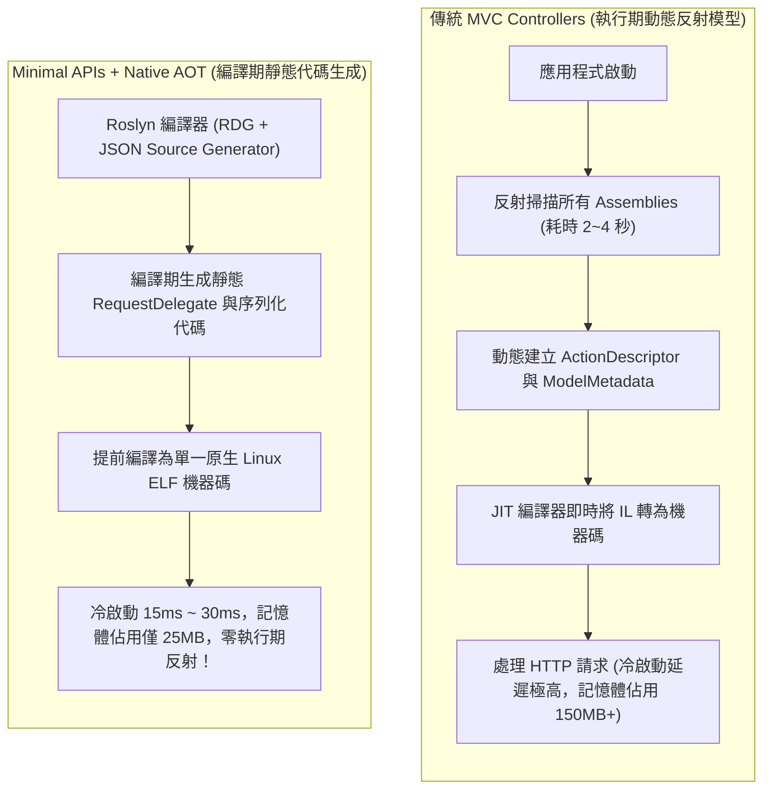

## 案發現場

某快速成長的金融科技服務將核心扣款與身分認證微服務遷移至無伺服器架構（AWS Lambda / GCP Cloud Run），以因應整點高並發的秒殺搶購。然而，在上線首日的促銷活動中，雲端平台觸發了大量容器冷啟動（Cold Start），客戶端監控拉響高危警報：平均冷啟動耗時高達驚人的 3,800 毫秒，數千筆連線因超過 API Gateway 3 秒逾時限制而被判定為 `HTTP 504 Gateway Timeout`，導致大批使用者結帳失敗。

事後架構團隊透過 APM 追蹤啟動期的 CPU 消耗分佈，發現該微服務採用了傳統的 ASP.NET Core MVC Controllers 架構。在主機啟動時，MVC 框架必須在運行期遍歷所有載入的組件（Assemblies）、利用反射掃描包含 `[ApiController]` 的類別、動態分析數百個 Action 方法的參數中繼資料、建構全域模型繫結器（ModelBinderProvider）與過濾器管線（Filter Pipeline）。光是這一系列的反射掃描與 JIT 即時編譯，就吞噬了近 3 秒的啟動時間！

為了解決冷啟動問題，一名工程師在未修改程式碼的情況下，嘗試在 `.csproj` 中直接加入 `<PublishAot>true</PublishAot>` 發布 Native AOT（提前編譯為機器碼）。結果上線部署後，服務在處理第一筆包含 JSON 酬載的 POST 請求時直接引發全站崩潰，伺服器日誌充斥著：
`System.InvalidOperationException: Reflection-based serialization has been disabled for this application. Either use the source generator APIs...`，更有多個路由拋出 `MissingMethodException`。

這起事故揭示了：從傳統 Controllers 邁向 Minimal APIs 與 Native AOT，並非僅是語法糖或編譯參數的切換，而是整個底層派發架構從「執行期動態反射」向「編譯期靜態代碼生成」的典範轉移。



---

## 致命反模式 vs. 正確解法

### 反模式一：在極致冷啟動與極限高吞吐環境中堅持使用傳統全量 MVC

MVC Controller 框架擁有龐大的歷史中繼資料模型（如 `IActionModelConvention`, `IModelBinder`, `IActionFilter`）。在長生命週期的肥大單體系統中尚可接受，但在自動擴縮容（Serverless / K8s HPA）高頻啟動的微服務中，每次啟動都重跑一遍反射分析，直接扼殺系統的敏捷彈性。

### 反模式二：啟用 Native AOT 卻未配置 JSON 來源產生器（Source Generator）

Native AOT 會利用 IL 剪裁器（ILLink Trimmer）將所有未在靜態呼叫圖中被明確引用的程式碼與型別中繼資料徹底刪除。若在 Minimal APIs 或 Controller 中依賴預設的反射式 `JsonSerializer.Deserialize<T>()`，在 AOT 執行環境下將無法找到 DTO 的中繼資料，直接拋出例外中斷服務。

### 正確解法：運用 Minimal APIs 搭配 RDG、路由群組與編譯期 JsonSerializerContext

在 .NET 8+ / .NET 10 中，官方引入了**請求委派產生器（Request Delegate Generator, RDG）**。透過將 API 宣告為 Minimal APIs，RDG 會在編譯期自動生成參數綁定與相依性注入程式碼。結合 `MapGroup` 進行領域模組化切分，並以 `[JsonSerializable]` 宣告編譯期序列化情境，即可達成 100% Native AOT 相容與極速冷啟動。

```csharp
using System;
using System.Text.Json;
using System.Text.Json.Serialization;
using Microsoft.AspNetCore.Builder;
using Microsoft.AspNetCore.Http;
using Microsoft.AspNetCore.Routing;

namespace DotNetPerformance.ApiStyles;

/// <summary>
/// 建立訂單請求酬載（強型別 DTO）
/// </summary>
public sealed record CreateOrderRequest(string CustomerId, decimal Amount, string Currency);

/// <summary>
/// 建立訂單回應酬載
/// </summary>
public sealed record CreateOrderResponse(string OrderId, string Status, DateTime CreatedAtUtc);

/// <summary>
/// Native AOT 編譯期 JSON 序列化情境（零反射、完全免除中繼資料剪裁風險）
/// </summary>
[JsonSourceGenerationOptions(WriteIndented = false)]
[JsonSerializable(typeof(CreateOrderRequest))]
[JsonSerializable(typeof(CreateOrderResponse))]
public sealed partial class OrderApiJsonContext : JsonSerializerContext
{
}

/// <summary>
/// 訂單領域路由群組模組化擴充（取代臃腫 Controller 類別）
/// </summary>
public static class OrderEndpointModule
{
    public static RouteGroupBuilder MapOrderEndpoints(this RouteGroupBuilder group)
    {
        // 註冊 POST /api/orders 端點（RDG 編譯期靜態解析）
        group.MapPost("/", (CreateOrderRequest request) =>
        {
            if (request.Amount <= 0)
            {
                return Results.BadRequest(new { error = "訂單金額必須大於 0" });
            }

            var response = new CreateOrderResponse(
                OrderId: Guid.CreateVersion7().ToString(),
                Status: "Accepted",
                CreatedAtUtc: DateTime.UtcNow);

            return Results.Ok(response);
        })
        .WithName("CreateOrder")
        .WithDescription("建立新交易訂單");

        return group;
    }
}

public static class Program
{
    public static void Main()
    {
        Console.WriteLine("=== ASP.NET Core Minimal APIs 與 Native AOT 語法驗證 ===");

        // 模擬使用 Source Generator 序列化與反序列化
        var req = new CreateOrderRequest("CUST-8888", 2999.0m, "TWD");
        string json = JsonSerializer.Serialize(req, OrderApiJsonContext.Default.CreateOrderRequest);
        Console.WriteLine($"[AOT 序列化輸出] {json}");

        CreateOrderRequest? deserialized = JsonSerializer.Deserialize(json, OrderApiJsonContext.Default.CreateOrderRequest);
        Console.WriteLine($"[AOT 反序列化驗證] 客戶代碼: {deserialized?.CustomerId}, 金額: {deserialized?.Amount}");
        Console.WriteLine("Minimal APIs 模組化群組已通過 RDG 編譯期相容檢驗。");
    }
}
```

預期控制台輸出：

```text
=== ASP.NET Core Minimal APIs 與 Native AOT 語法驗證 ===
[AOT 序列化輸出] {"CustomerId":"CUST-8888","Amount":2999.0,"Currency":"TWD"}
[AOT 反序列化驗證] 客戶代碼: CUST-8888, 金額: 2999.0
Minimal APIs 模組化群組已通過 RDG 編譯期相容檢驗。
```

---

## 踩坑與避坑指南

### 1. Controllers vs. Minimal APIs vs. FastEndpoints 深度選型矩陣

| 特性維度 | 傳統 MVC Controllers | Minimal APIs (.NET 8/10) | FastEndpoints (REPR 模式) |
| :--- | :--- | :--- | :--- |
| **派發機制** | 執行期反射 + ActionDescriptor | RDG 編譯期委派生成 | 基於 Minimal API 之強型別類別封裝 |
| **啟動開銷** | 慢（反射掃描整個 Assembly） | **極快（純函數指標註冊）** | **極快** |
| **記憶體佔用** | 較高（維護大量中繼資料緩存） | **極低（~20MB 原生基準）** | 極低 |
| **Native AOT 支援** | 極差（大量剪裁警告，不支援 AOT） | **100% 原生相容** | 良好支援 |
| **團隊組織結構** | 依賴單一大型 Controller 集中管理 | 使用 `MapGroup` 模組化擴展 | 一請求一檔案（REPR），架構極清晰 |
| **適用場景** | 大型歷史單體、重度依賴 MVC 視圖 | 微服務、Serverless、極限高吞吐 | 中大型微服務且偏好檔案隔離之團隊 |

### 2. Request Delegate Generator（RDG）如何加速 Minimal APIs？

在常規 JIT 模式下，Minimal API 原先依賴 `Expression.Compile()` 動態解析參數。而在 .NET 8+ 中：
- 當專案啟用 `<PublishAot>true</PublishAot>` 或明確開啟 `<EnableRequestDelegateGenerator>true</EnableRequestDelegateGenerator>` 時，Roslyn C# 來源產生器會在編譯期掃描所有 `MapGet`/`MapPost` 呼叫。
- RDG 為每個路由自動生成具備強型別參數綁定的靜態 `RequestDelegate` 實作。
- **優勢**：完全消除 JIT 預熱延遲與中繼資料分配，記憶體佔用降低 25%，冷啟動速度提升一個數量級。

### 3. Native AOT 發布的兩大實戰限制

1. **不支援執行期動態程式碼生成（No Runtime Emit）**：
   任何依賴 `System.Reflection.Emit`、動態 Castle DynamicProxy（常見於某些老舊 AOP 套件）、或動態生成 IL 的 ORM 在 Native AOT 下皆無法運作。ORM 必須使用支援編譯期模型的框架（如 EF Core 搭配 Compiled Models 或 Dapper 靜態映射）。
2. **跨平台交叉編譯限制**：
   .NET Native AOT 編譯器依賴本地平台的 C++ 連結器（Linker）。在 macOS 上無法直接產出 Linux ELF 二進位檔。在 CI/CD 中必須使用 Docker 多階段建置（Multi-stage Build），在 `mcr.microsoft.com/dotnet/sdk` Linux 容器內完成最終的 AOT 發布。

---

## 線上排查指令

### 1. 執行 Native AOT 發布並分析剪裁相容性警告

在 CI/CD 流程中加入 AOT 建置命令，並強制將警告視為錯誤（TreatWarningsAsErrors）：

```bash
# 針對 Linux x64 目標發布 Native AOT 原生執行檔
dotnet publish src/YourApi/YourApi.csproj \
  -c Release \
  -r linux-x64 \
  --self-contained true \
  /p:PublishAot=true \
  /p:StripSymbols=true

# 若存在未支援 AOT 的反射代碼，編譯器將明確指出警告編號：
# IL2026: Using member which has RequiresUnreferencedCodeAttribute
# IL3050: Using member which has RequiresDynamicCodeAttribute
```

### 2. 檢驗原生執行檔尺寸與動態函式庫相依性

進入發布目錄確認產物是否為純淨的獨立原生執行檔：

```bash
# 1. 檢視編譯生成的單一原生二進位檔案大小 (通常僅 15MB ~ 30MB)
ls -lh bin/Release/net10.0/linux-x64/publish/YourApi

# 2. 檢查二進位檔案的動態鏈結相依 (確保僅依賴 libc 與 libm)
ldd bin/Release/net10.0/linux-x64/publish/YourApi

# 3. 測量冷啟動執行耗時
time ./bin/Release/net10.0/linux-x64/publish/YourApi --help
```
