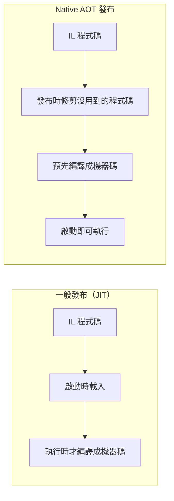

## 這是什麼

ASP.NET Core 有兩種寫 API 的方式：

- **Controller**：把端點寫成類別的方法，用屬性（`[HttpGet]`、`[Route]`）標註。功能完整，有 MVC Filter、模型驗證、慣例等機制。
- **Minimal API**：用 `app.MapGet(...)` 直接把網址對應到一個委派，程式碼少、啟動快，是新專案的預設範本。

**Native AOT** 是另一個獨立的選擇：在發布時把整個程式預先編譯成機器碼，不需要在執行時才由 JIT 編譯。好處是啟動快、記憶體少、執行檔小；代價是不能使用依賴執行期反射的功能。

## 運作原理



Native AOT 在發布時要「看得到」所有會被執行的程式碼，才能編譯並修剪掉用不到的部分。執行時才用反射決定要呼叫什麼的程式碼（例如 Controller 的探索、依型別動態序列化 JSON），編譯器看不到，就無法支援。

因此 ASP.NET Core 的 AOT 支援以 Minimal API 為主：

- **Request Delegate Generator（RDG）**：在編譯時為每個 `MapGet`／`MapPost` 產生參數綁定的程式碼，取代執行時反射。
- **JSON 來源產生器**：在編譯時為你的 DTO 產生序列化程式碼。

Controller 目前不支援 Native AOT。

## 常見錯誤與正確寫法

### 1. 開了 AOT，JSON 卻還依賴反射

發布時出現修剪警告（IL2026、IL3050），執行時某些型別序列化失敗。原因是沒有告訴來源產生器有哪些型別要序列化：

```csharp
// 列出所有會出現在請求或回應中的型別
[JsonSerializable(typeof(ProductDto))]
[JsonSerializable(typeof(List<ProductDto>))]
[JsonSerializable(typeof(PlaceOrderRequest))]
internal partial class ShopJsonContext : JsonSerializerContext;

var builder = WebApplication.CreateSlimBuilder(args); // 精簡版的建構器，預設只含 AOT 相容的元件
builder.Services.ConfigureHttpJsonOptions(options =>
{
    options.SerializerOptions.TypeInfoResolverChain.Insert(0, ShopJsonContext.Default);
});
```

在專案檔加上 `<PublishAot>true</PublishAot>` 後，建置時就會出現 AOT 相容性警告。把警告當成錯誤處理，不要忽略。

### 2. 為了「比較快」把所有服務都改成 AOT

AOT 改善的是**啟動時間**與**記憶體**，不一定改善長時間執行的吞吐量；JIT 可以依實際執行情況做最佳化（例如動態 PGO），長時間執行的服務用 JIT 可能更快，見 [JIT 與分層編譯](/platforms/dotnet/clr-jit/)。

適合 AOT 的情況：需要快速擴容、冷啟動頻繁的服務（例如縮到零的無伺服器環境）、或記憶體很受限的環境。核心的訂單 API 常駐執行、用了 EF Core 等大量依賴反射的套件，用 AOT 的收益小、限制多。

### 3. Minimal API 全部寫在 Program.cs

端點一多，`Program.cs` 就變得難以維護。用路由群組與擴充方法依功能分檔：

```csharp
// Features/Orders/OrderEndpoints.cs
public static class OrderEndpoints
{
    public static RouteGroupBuilder MapOrders(this IEndpointRouteBuilder app)
    {
        var group = app.MapGroup("/orders").RequireAuthorization().WithTags("Orders");
        group.MapGet("/{id:guid}", GetById);
        group.MapPost("/", PlaceOrder);
        return group;
    }
}

// Program.cs
app.MapOrders();
```

## 使用邊界

- **既有的 Controller 專案不需要改寫。** 兩者可以在同一個專案共存，新功能用 Minimal API 即可。
- 大量依賴 MVC 特有功能（例如自訂 Model Binder、OData、複雜的 Filter 管線）的系統，留在 Controller。
- EF Core 對 Native AOT 的支援仍有限制（例如需要預先編譯的查詢），使用前以官方文件確認目前的狀態。
- 反射對效能與 AOT 的影響，見 [反射與來源產生器](/platforms/dotnet/reflection/)。
