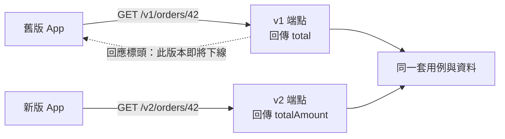

## 這是什麼

電商 App 已經上架，有些買家很久沒有更新。後端把訂單回應的 `total` 欄位改成 `totalAmount`，舊版 App 就讀不到金額了。後端可以隨時部署，但你無法控制用戶端什麼時候更新。

**API 版本管理**讓新舊用戶端可以同時使用各自的版本：新版 App 用 v2 的格式，舊版 App 繼續用 v1，直到 v1 下線。

## 運作原理



版本只是 API 的「對外格式」，背後的業務邏輯與資料通常是同一套。v1 和 v2 的端點各自把用例的結果轉成自己的 DTO。

**什麼時候需要新版本**：

| 變更 | 是否會讓舊用戶端出錯 | 需要新版本嗎 |
| --- | --- | --- |
| 新增回應欄位 | 否（用戶端忽略不認識的欄位） | 不需要 |
| 新增端點、新增選填的請求欄位 | 否 | 不需要 |
| 欄位改名、刪除欄位 | 是 | 需要 |
| 改變欄位的意義或型別（例如金額從元改成分） | 是 | 需要 |
| 新增必填的請求欄位 | 是 | 需要 |

能用「只新增」的方式演進，就不必建立新版本；版本越多，要維護與測試的東西就越多。

## 常見錯誤與正確寫法

### 1. 直接修改既有的回應格式

改名或刪除欄位前，先建立新版本，舊版本保留原本的格式。以 `Asp.Versioning.Http` 在網址中區分版本：

```csharp
// 套件：Asp.Versioning.Http
builder.Services.AddApiVersioning(options =>
{
    options.DefaultApiVersion = new ApiVersion(1);
    options.ReportApiVersions = true; // 回應標頭列出支援與已淘汰的版本
});

var orders = app.NewVersionedApi("Orders");

var v1 = orders.MapGroup("/v{version:apiVersion}/orders").HasApiVersion(1.0);
v1.MapGet("/{id:guid}", async (Guid id, OrderQueries q, CancellationToken ct) =>
    await q.GetAsync(id, ct) is { } o ? Results.Ok(new OrderV1(o.Id, o.Total)) : Results.NotFound());

var v2 = orders.MapGroup("/v{version:apiVersion}/orders").HasApiVersion(2.0);
v2.MapGet("/{id:guid}", async (Guid id, OrderQueries q, CancellationToken ct) =>
    await q.GetAsync(id, ct) is { } o ? Results.Ok(new OrderV2(o.Id, o.Total, o.Currency)) : Results.NotFound());
```

版本也可以放在查詢字串或標頭（例如 `api-version`）。網址中的版本最直觀、也最容易在日誌與負載平衡器上分辨，對外的公開 API 通常採用這種方式。

### 2. 舊版本永遠不下線

舊版本留著不管，裡面可能是較舊、較弱的驗證邏輯，也拖累每次修改的成本（每個版本都要測試）。新版本上線時就定好舊版本的下線日期，並讓用戶端知道：

- 將 v1 標記為已淘汰（`HasDeprecatedApiVersion` 或對應的設定），回應標頭會列出 `api-deprecated-versions`。
- 加上 `Sunset` 標頭（RFC 8594）告知下線日期。
- 記錄各版本的呼叫量，確認舊版本的流量降到可以接受的程度再移除。

### 3. 每個版本複製一份完整的程式碼

v1 與 v2 各有一套 Service、Repository，修一個錯要改兩次。版本只存在於最外層的端點與 DTO，用例與領域模型只有一份；必要時在端點中把同一個結果轉成不同的格式。

## 使用邊界

- **內部服務之間**（同一個團隊、同時部署）通常不需要正式的版本管理，以「只新增、不刪除」的方式演進即可。
- 行動 App 的舊版本會存在很久，版本下線的期限要依實際的更新率決定，必要時在 App 中提示更新。
- OpenAPI 文件要依版本分開產生，讓前端與合作夥伴看到各版本正確的格式。
- 舊版本是 API 清單管理的一部分，見 [API 安全風險](/security/api-risks/)。
