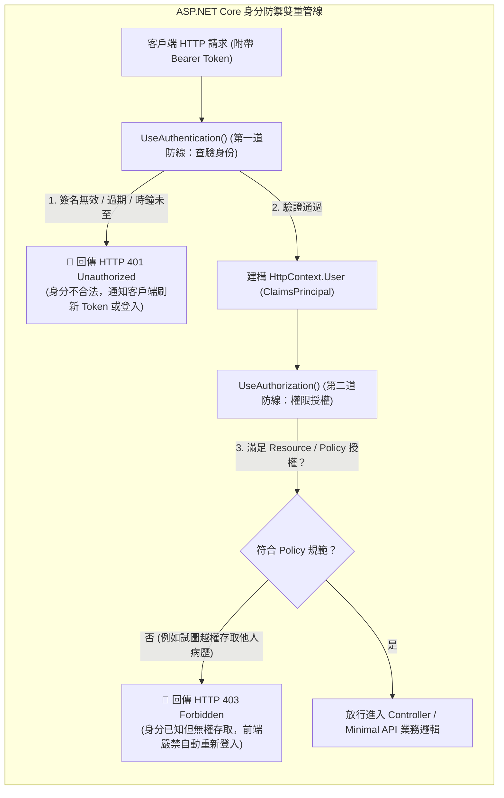

## 案發現場

某醫療健康管理平台在完成多節點分散式改造後，客服中心陸續接獲大批使用者投訴：用戶剛透過手機 App 成功登入並取得 Access Token，在發送下一筆病歷查詢請求時，卻隨機遭遇 `HTTP 401 Unauthorized` 慘遭強制登出。工程師調取閘道日誌後百思不得其解：Token 明明剛簽發不到 10 秒，簽名也完全正確，為何會被驗證中介軟體無情拒絕？

經過深入排查，發現生產環境兩台 Kubernetes 節點之間存在大約 2.5 秒的微小 NTP 時鐘漂移。而開發團隊在設定 JWT 驗證參數時，為了追求「絕對精確」，直接將 `TokenValidationParameters.ClockSkew = TimeSpan.Zero`。當負載平衡器將剛由 Node-A 簽發的 Token 路由至時鐘稍微走慢的 Node-B 時，Node-B 判定該 Token 的 `nbf`（Not Before）生效時間尚未到達，直接判定非法並回傳 401！

然而，更嚴重的資安災難發生在兩週後的滲透測試中：資安團隊回報了一個高危險漏洞（OWASP API1: BOLA 物件層級存取控制缺失）。在病歷匯出端點 `GET /api/records/{recordId}` 上，開發者僅僅標註了粗粒度的 `[Authorize]` 特性。這意味著：任何一名普通合法註冊的病患，只要在 HTTP 請求網址中竄改別人的 `recordId`，就能直接下載任意其他病患的敏感醫療隱私報告！

這兩起事件深刻揭示了現代分散式 Web API 在身分認證（Authentication）與存取控制（Authorization）架構設計上的核心痛點：對時鐘漂移機制的認知不足，以及將「身分查驗」誤當作「權限管控」的致命盲點。



---

## 致命反模式 vs. 正確解法

### 反模式一：忽視 `ClockSkew` 預設值（300 秒）或極端設為零

.NET 的 `TokenValidationParameters.ClockSkew` 預設值高達 **5 分鐘（300 秒）**。如果系統設計了有效期為 5 分鐘的短效 Access Token，實際上該 Token 在逾期後的 5 分鐘內依然能被正常驗證通過，等同於短效防護形同虛設；反之，若盲目設為 `TimeSpan.Zero`，在多伺服器節點存在微秒至毫秒級 NTP 誤差時，會導致合法 Token 頻繁誤判為「尚未生效」或「提前失效」。

### 反模式二：僅依賴 `[Authorize]` 裸跑，忽視物件層級授權（BOLA）

在 API 端點僅配置 `[Authorize]` 只能證明呼叫方「已登入」，但完全無法證明呼叫方「有權操作該筆特定資料」。這種粗粒度的身分驗證是引發水平越權與垂直越權的頭號根源。

### 正確解法：合理配置時鐘偏離、落實 Policy-based 宣告授權與資源所有權檢驗

以下完整程式碼展示了如何配置生產級的 JWT 驗證參數，並利用 ASP.NET Core 原生的 `IAuthorizationRequirement` 與 `AuthorizationHandler` 實現資源層級的精準授權防護。

```csharp
using System;
using System.Security.Claims;
using System.Threading.Tasks;
using Microsoft.AspNetCore.Authorization;
using Microsoft.IdentityModel.Tokens;

namespace DotNetPerformance.Security;

/// <summary>
/// 醫療病歷資源實體
/// </summary>
public sealed record MedicalRecord(string RecordId, string OwnerUserId, string DiagnosisData);

/// <summary>
/// 病歷資源擁有者授權需求
/// </summary>
public sealed class RecordOwnerRequirement : IAuthorizationRequirement
{
}

/// <summary>
/// 病歷資源擁有者授權處理器（杜絕 BOLA / 水平越權）
/// </summary>
public sealed class RecordOwnerAuthorizationHandler : AuthorizationHandler<RecordOwnerRequirement, MedicalRecord>
{
    protected override Task HandleRequirementAsync(
        AuthorizationHandlerContext context,
        RecordOwnerRequirement requirement,
        MedicalRecord resource)
    {
        // 從目前已驗證的 ClaimsPrincipal 中提取使用者識別碼
        string? currentUserId = context.User.FindFirst(ClaimTypes.NameIdentifier)?.Value;

        // 若使用者具備醫生主管角色 (Admin)，或為資源真正的擁有人，則放行授權
        bool isPlatformAdmin = context.User.IsInRole("ChiefMedicalOfficer");
        bool isOwner = string.Equals(currentUserId, resource.OwnerUserId, StringComparison.Ordinal);

        if (isPlatformAdmin || isOwner)
        {
            context.Succeed(requirement);
        }

        return Task.CompletedTask;
    }
}

public static class Program
{
    public static async Task Main()
    {
        Console.WriteLine("=== ASP.NET Core JWT 驗證與 Policy 授權防禦驗證 ===");

        // 1. 設定符合高安全性標準之 TokenValidationParameters
        var validationParameters = new TokenValidationParameters
        {
            ValidateIssuer = true,
            ValidIssuer = "https://auth.healthcorp.internal",
            ValidateAudience = true,
            ValidAudience = "healthcorp-api",
            ValidateLifetime = true,
            // 生產最佳實踐：將時鐘容許偏離壓縮至 5 秒，兼顧分散式 NTP 微誤差與防延遲漏洞
            ClockSkew = TimeSpan.FromSeconds(5)
        };

        Console.WriteLine($"[Token 參數檢驗] ClockSkew 設為: {validationParameters.ClockSkew.TotalSeconds} 秒");

        // 2. 模擬合法使用者 A (Patient_001) 嘗試存取 使用者 B (Patient_002) 的病歷資料
        var userAClaims = new[]
        {
            new Claim(ClaimTypes.NameIdentifier, "Patient_001"),
            new Claim(ClaimTypes.Role, "StandardUser")
        };
        var userAPrincipal = new ClaimsPrincipal(new ClaimsIdentity(userAClaims, "Bearer"));

        var victimRecord = new MedicalRecord(
            RecordId: "REC-9999",
            OwnerUserId: "Patient_002",
            DiagnosisData: "極度機密之醫療診斷報告");

        // 3. 執行資源層級授權審查
        var handler = new RecordOwnerAuthorizationHandler();
        var requirement = new RecordOwnerRequirement();

        var authContext = new AuthorizationHandlerContext(
            requirements: new[] { requirement },
            user: userAPrincipal,
            resource: victimRecord);

        await handler.HandleAsync(authContext);

        Console.WriteLine($"[BOLA 防護檢驗] 使用者 Patient_001 嘗試讀取 Patient_002 之病歷：");
        Console.WriteLine($"  授權審核結果: {(authContext.HasSucceeded ? "允許訪問 (高危漏洞)" : "拒絕訪問 (安全攔截)")}");
    }
}
```

預期控制台輸出：

```text
=== ASP.NET Core JWT 驗證與 Policy 授權防禦驗證 ===
[Token 參數檢驗] ClockSkew 設為: 5 秒
[BOLA 防護檢驗] 使用者 Patient_001 嘗試讀取 Patient_002 之病歷：
  授權審核結果: 拒絕訪問 (安全攔截)
```

---

## 踩坑與避坑指南

### 1. 中介軟體註冊順序天坑（The Ordering Trap）

在 ASP.NET Core 請求處理管線中，`UseAuthentication()` 與 `UseAuthorization()` 的順序**絕對不可顛倒**：

```csharp
app.UseRouting();

// 順序至關重要！
app.UseAuthentication(); // 1. 解析 Bearer Token 並填入 HttpContext.User
app.UseAuthorization();  // 2. 依據 HttpContext.User 進行 Policy / Role 裁決

app.MapControllers();
```

若誤將 `UseAuthorization()` 置於 `UseAuthentication()` 之前，當授權中介軟體執行時，`HttpContext.User` 尚為空匿名物件，所有端點將全數回傳 `401 Unauthorized`！

### 2. 401 Unauthorized vs. 403 Forbidden 語意邊界

- **401 Unauthorized（未通過驗證）**：
  呼叫方**尚未出示有效身分憑證**，或憑證已過期/簽名損毀。
  - 前端行為：嘗試呼叫 `/api/auth/refresh` 以 Refresh Token 換取新 Access Token；若換發失敗，引導使用者至登入畫面。
- **403 Forbidden（未獲授權 / 禁止存取）**：
  呼叫方的**身分已百分之百確認且合法**，但該身分**無權操作該資源**（例如普通員工試圖呼叫財務長結算 API）。
  - 前端行為：彈出「權限不足」提示，**嚴禁自動跳轉登入畫面**，否則使用者重新登入後再次存取仍為 403，引發無限跳轉死迴圈。

### 3. JWT 的無狀態撤銷（Revocation）與黑名單策略

由於 JWT 是無狀態的自我包含憑證（Self-contained），一旦簽發出去，伺服器在 Token 自然過期前無法直接「主動作廢」該 Token。
- **高安全架構標準解法**：
  1. **極短壽命 Access Token**：將過期時間（`exp`）設為 **10~15 分鐘**。
  2. **搭配有狀態的 Refresh Token**：將 Refresh Token 存於 Redis 或資料庫中，並綁定裝置指紋。當使用者登出或管理員凍結帳號時，立即刪除 Refresh Token。
  3. **高風險事件黑名單（Token Blacklist）**：對於立即性權限收回（如員工離職、修改密碼），將其 Token JTI（唯一識別碼）寫入 Redis 快取並設定等於剩餘有效期的 TTL，中介軟體針對少數敏感端點比對黑名單。

---

## 線上排查指令

### 1. 啟用驗證中介軟體除錯日誌定位驗證失敗根源

當線上大量爆發 401 錯誤時，將認證層日誌調至 `Debug` 等級以印出底層例外原因：

```bash
# 透過環境變數開啟驗證模組日誌詳細度
export Logging__LogLevel__Microsoft.AspNetCore.Authentication=Debug
export Logging__LogLevel__Microsoft.AspNetCore.Authorization=Debug
```

在應用程式日誌中搜尋以下關鍵字：
- `SecurityTokenExpiredException`：Token 生命週期已結束，檢查客戶端時鐘與 Refresh Token 機制。
- `SecurityTokenNotYetValidException`：Token `nbf` 晚於伺服器目前時間，直接證實遭遇時鐘漂移與 `ClockSkew` 過度縮減。
- `SecurityTokenSignatureKeyNotFoundException`：伺服器找不到匹配的公鑰/密鑰，檢查 JWKS 端點或金鑰輪替狀態。

### 2. 線上快速解碼與除錯 JWT Payload

在 Linux Bastion 或終端快速檢查 Token 內部聲明（Claims）：

```bash
# 提取 JWT 第二段 (Payload) 並以 Base64 解碼 (去除可能的 URL 安全字元)
echo "eyJhbGciOi..." | cut -d'.' -f2 | tr '_-' '/+' | base64 -d | jq .
```

確認輸出的 `exp`（過期時間）、`nbf`（生效時間）以及 `aud`（受眾標識）是否與當前微服務設定一致。
