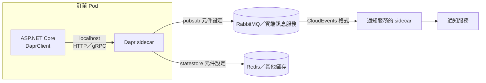

## 這是什麼

訂單服務要發布事件、讀寫一些狀態、呼叫其他服務。直接使用 RabbitMQ 和 Redis 的 SDK，程式就和這些元件綁在一起：連線管理、重試、序列化都要自己處理，哪天要把 RabbitMQ 換成雲端的訊息服務，就得改程式。

**Dapr** 的做法是在每個 Pod 旁邊放一個 **sidecar**（伴隨容器）。你的程式只透過本機的 HTTP 或 gRPC 呼叫 sidecar：「發布這個事件」「存這筆狀態」。sidecar 再依照設定檔，把請求轉給實際的元件。換元件時，改設定檔就好，程式不用動。

## 運作原理



Dapr 把常見能力包成 **building blocks**：服務呼叫、發布訂閱、狀態管理、密碼存取等。每個 building block 背後的實作由 **component** 設定決定，例如 `pubsub.rabbitmq`。

發布的事件會被包成 **CloudEvents** 標準格式，帶有 `id`、`source`、`type` 等欄位，消費端可以用 `id` 去重。

## 常見錯誤與正確寫法

### 1. sidecar 還沒準備好就開始呼叫

Pod 啟動時，應用程式容器可能比 sidecar 先準備好。這時呼叫 sidecar 會連線失敗，讓啟動流程出錯。在需要 sidecar 的初始化工作之前，先等它就緒：

```csharp
// 套件：Dapr.Client
var dapr = app.Services.GetRequiredService<DaprClient>();
using var cts = new CancellationTokenSource(TimeSpan.FromSeconds(30));
await dapr.WaitForSidecarAsync(cts.Token); // sidecar 健康後才繼續
```

### 2. 以為 Dapr 保證只處理一次

Dapr 的發布訂閱是**至少一次**交付：消費端回應失敗或逾時，訊息會再送一次。消費端照樣要去重：

```csharp
// 套件：Dapr.AspNetCore
app.UseCloudEvents();      // 解開 CloudEvents 外層，端點直接收到事件資料
app.MapSubscribeHandler(); // 讓 sidecar 查詢這個服務訂閱了哪些主題

app.MapPost("/events/order-placed", async (OrderPlaced evt, NotificationService service, CancellationToken ct) =>
{
    // 以訂單 ID 作為業務唯一條件：同一張訂單重複收到時不會寄兩次
    await service.NotifyOnceAsync(evt.OrderId, ct);
    return Results.Ok(); // 回 2xx 才代表處理成功
}).WithTopic("pubsub", "order-placed");
```

回應非 2xx 時，Dapr 會依設定重試或丟棄。要哪一種行為，取決於 component 的重試設定與死信設定。

### 3. 停機時 sidecar 先結束

Pod 停止時，應用程式還在處理最後幾個請求，sidecar 卻已經關閉，造成發布或狀態寫入失敗。Dapr 提供 sidecar 的優雅停機等待時間設定；同時讓應用程式在收到 SIGTERM 後盡快停止接受新工作，見 [探針與安全停止](/platforms/kubernetes/probes-resources/)。

## 使用邊界

- **只用一種訊息元件、短期內不會換的團隊，直接用 SDK 更簡單。** Dapr 的價值在「多語言、多元件、需要統一抽象」的環境。
- 每個請求多經過一次本機網路與 sidecar，延遲會增加一點；sidecar 本身也佔用 CPU 與記憶體，要算進資源預算。
- 抽象只涵蓋共通的能力。RabbitMQ 的 quorum queue、publisher confirm 細節這類元件特有的行為，透過 Dapr 不一定能完整控制，見 [RabbitMQ .NET 整合](/infrastructure/rabbitmq/dotnet-integration/)。
- Outbox 一樣需要：Dapr 有提供交易式 Outbox 功能，但要求狀態儲存與發布元件的特定組合，使用前確認支援範圍。
