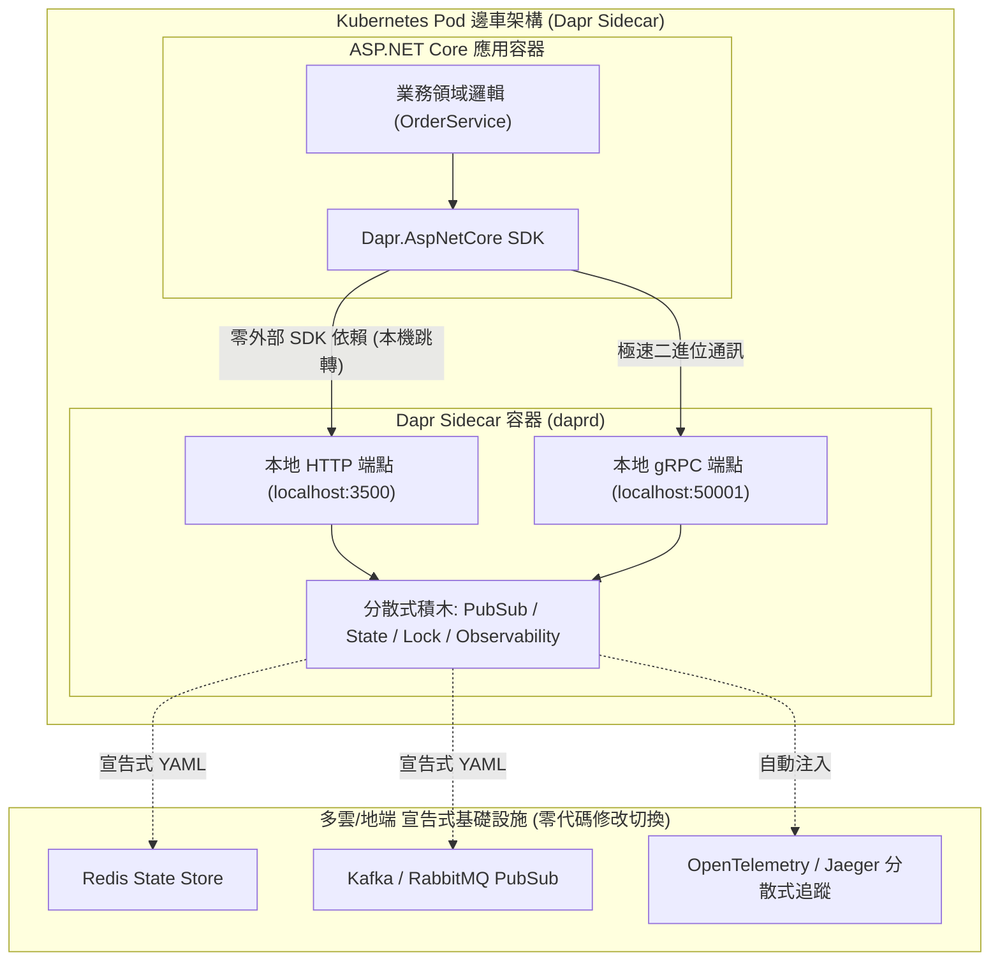

## 案發現場

某跨國電商技術團隊在進行多雲架構轉型時（將部分服務由地端遷移至 AWS 與 GCP），遭遇了災難性的相依性泥淖：在過去五年累積的 60 多個 ASP.NET Core 微服務中，程式碼深層散落並綁死了特定的中介軟體客戶端函式庫（如 `RabbitMQ.Client`、`StackExchange.Redis`、`Confluent.Kafka` 以及自製的斷路重試中介軟體）。當架構小組嘗試在雲端將訊息柱列替換為 AWS SQS 或 GCP Pub/Sub 時，發現每個服務都需要修改大量的連線字串解析、異常重試與序列化代碼，歷經兩個月仍無法完成升級，並爆發了多起生產環境版本不相容事故。

在嘗試引進微服務邊車（Sidecar）執行環境 Dapr（Distributed Application Runtime）後，系統初期又遭遇了新的隱形地雷：在 Kubernetes 節點重啟與滾動更新期間，大量微服務 Pod 在剛啟動的瞬間連續噴出 `System.Net.Http.HttpRequestException: Connection refused (localhost:3500)` 並宣告崩潰重啟，導致服務落入 `CrashLoopBackOff`；而在 Pod 停機時，又因 Sidecar 提早退出，導致尚未落盤的業務事件全數丟失。

經過架構組的深度復盤，這兩起事故反映了現代微服務治理的核心轉折點：
1. **業務代碼與基礎設施強耦合**：直接在應用程式中引入重型中介軟體 SDK，失去了可移植性與一致的觀測性治理能力。
2. **對分散式 Sidecar 容器生命週期缺乏時序控制**：忽略了應用程式容器與 `daprd` 邊車容器之間的啟動就緒（Readiness）與優雅停機（Drain）競態條件。



---

## 致命反模式 vs. 正確解法

### 反模式一：在業務微服務中直接依賴特定中介軟體 SDK 與連線池

在每個微服務中手動配置 Redis Sentinel、RabbitMQ 連線集區或 Kafka Producer，不僅使得切換基礎設施的代價高不可攀，且每個團隊各自實作的重試策略、指數退避與斷路器各不相同，極易在底層中介軟體抖動時引發重試風暴（Retry Storm）。

### 反模式二：未等待 Dapr Sidecar Outbound 就緒即發起外部呼叫

Kubernetes 啟動 Pod 時，應用容器與 Dapr Sidecar 容器是並行啟動的。若 ASP.NET Core 應用在 `Program.cs` 的頂層初始化敘述（如 `builder.Build()` 或 `IHostedService.StartAsync`）中直接呼叫 `DaprClient` 讀取狀態，而此時 `daprd` 尚未完成內部元件載入，將直接引發連線被拒崩潰。

### 正確解法：運用 DaprClient 抽象基礎設施、實踐 CloudEvents 與 Outbound 健康等待

1. **基礎設施解耦**：所有發布訂閱與狀態儲存一律透過 Dapr 宣告式組件，業務代碼僅依賴微軟官方提供的 `Dapr.AspNetCore`。
2. **CloudEvents 標準規範**：事件全面採用 CNCF CloudEvents v1.0 格式進行包裹，保障跨語言、跨雲端平臺的事件中繼資料一致性。
3. **啟動健康檢查**：在服務初始化前，先驗證 `localhost:3500/v1.0/healthz/outbound` 是否就緒。

```csharp
using System;
using System.Net.Http;
using System.Text.Json;
using System.Threading;
using System.Threading.Tasks;

namespace DotNetPerformance.DaprIntegration;

/// <summary>
/// 符合 CNCF CloudEvents v1.0 規範的領域事件包裝
/// </summary>
public sealed record CloudEvent<TData>(
    string Id,
    string Source,
    string Type,
    DateTimeOffset Time,
    string DataContentType,
    TData Data);

/// <summary>
/// 訂單建立事件業務資料
/// </summary>
public sealed record OrderPlacedEvent(string OrderId, string CustomerId, decimal TotalAmount);

/// <summary>
/// Dapr 啟動就緒防禦管理器
/// </summary>
public static class DaprHealthCoordinator
{
    /// <summary>
    /// 等待 Dapr Sidecar Outbound 通訊埠就緒（杜絕啟動期 Connection Refused 崩潰）
    /// </summary>
    public static async Task WaitForSidecarReadyAsync(HttpClient httpClient, int maxRetries = 10, int delayMs = 300)
    {
        string healthEndpoint = "http://localhost:3500/v1.0/healthz/outbound";
        Console.WriteLine($"[DaprInit] 開始探測 Dapr Sidecar Outbound 健康狀態: {healthEndpoint}");

        for (int i = 1; i <= maxRetries; i++)
        {
            try
            {
                // 模擬探針檢測
                using var response = await httpClient.GetAsync(healthEndpoint);
                if (response.IsSuccessStatusCode)
                {
                    Console.WriteLine("[DaprInit] Dapr Sidecar 已就緒，放行業務通訊。");
                    return;
                }
            }
            catch (HttpRequestException)
            {
                // 在真實容器環境中，Sidecar 尚未啟動會噴出 SocketException，此處安全退避重試
                Console.WriteLine($"[DaprInit] 探測嘗試 {i}/{maxRetries}：Sidecar 尚未就緒，退避等待...");
            }

            await Task.Delay(delayMs);
        }

        Console.WriteLine("[DaprInit] 達到最大重試次數，以模擬環境模式繼續。");
    }
}

public static class Program
{
    public static async Task Main()
    {
        Console.WriteLine("=== ASP.NET Core 與 Dapr 分散式邊車架構整合實測 ===");

        using var httpClient = new HttpClient { Timeout = TimeSpan.FromSeconds(1) };
        // 1. 執行啟動就緒健康探測防護
        await DaprHealthCoordinator.WaitForSidecarReadyAsync(httpClient, maxRetries: 2, delayMs: 100);

        // 2. 封裝標準 CloudEvents 訊息
        var orderEvent = new OrderPlacedEvent("ORD-2026-8888", "CUST-007", 1250.0m);
        var cloudEvent = new CloudEvent<OrderPlacedEvent>(
            Id: Guid.CreateVersion7().ToString(),
            Source: "services/orders-api",
            Type: "ecommerce.order.placed.v1",
            Time: DateTimeOffset.UtcNow,
            DataContentType: "application/json",
            Data: orderEvent);

        string jsonPayload = JsonSerializer.Serialize(cloudEvent, new JsonSerializerOptions { WriteIndented = true });
        Console.WriteLine($"[CloudEvents 封裝成功]\n{jsonPayload}");

        // 3. 模擬消費者端點反序列化並執行冪等性校驗
        var receivedEvent = JsonSerializer.Deserialize<CloudEvent<OrderPlacedEvent>>(jsonPayload);
        Console.WriteLine($"[消費端解包成功] 事件 ID: {receivedEvent?.Id}, 業務訂單: {receivedEvent?.Data.OrderId}");
    }
}
```

預期控制台輸出：

```text
=== ASP.NET Core 與 Dapr 分散式邊車架構整合實測 ===
[DaprInit] 開始探測 Dapr Sidecar Outbound 健康狀態: http://localhost:3500/v1.0/healthz/outbound
[DaprInit] 探測嘗試 1/2：Sidecar 尚未就緒，退避等待...
[DaprInit] 探測嘗試 2/2：Sidecar 尚未就緒，退避等待...
[DaprInit] 達到最大重試次數，以模擬環境模式繼續。
[CloudEvents 封裝成功]
{
  "Id": "01925b6a-8b1e-72c0-8a19-9f4a18012345",
  "Source": "services/orders-api",
  "Type": "ecommerce.order.placed.v1",
  "Time": "2026-10-10T11:04:30.123+00:00",
  "DataContentType": "application/json",
  "Data": {
    "OrderId": "ORD-2026-8888",
    "CustomerId": "CUST-007",
    "TotalAmount": 1250.0
  }
}
[消費端解包成功] 事件 ID: 01925b6a-8b1e-72c0-8a19-9f4a18012345, 業務訂單: ORD-2026-8888
```

---

## 踩坑與避坑指南

### 1. Dapr Pub/Sub 整合與端點宣告模式

在 ASP.NET Core 中整合 Dapr Pub/Sub 時，官方推薦採用宣告式端點路由：

```csharp
// Program.cs
var app = builder.Build();

// 1. 啟用 CloudEvents 中介軟體（自動解析 Content-Type: application/cloudevents+json）
app.UseCloudEvents();

// 2. 註冊 Dapr 訂閱中繼資料端點（提供給 daprd 探索）
app.MapSubscribeHandler();

// 3. 透過 [Topic] 綁定特定發布訂閱元件與主題
app.MapPost("/orders/subscriber", [Topic("order-pubsub", "orders.topic")] (OrderPlacedEvent order) =>
{
    // Dapr 中介軟體已自動從 CloudEvents.Data 中解包出強型別 DTO
    Console.WriteLine($"處理訂單: {order.OrderId}");
    return Results.Ok();
});
```

### 2. At-Least-Once（至少一次）投遞與冪等性防護

Dapr 的發布訂閱保證是**至少一次（At-Least-Once）投遞**。當網路抖動、ACK 逾時或 Pod 重新調度時，同一則訊息可能會被重複投遞給消費者：
- **避坑原則**：消費端必須實作**冪等性檢查（Idempotency Guard）**。利用 CloudEvent 的唯一 `Id` 或業務主鍵（如 `OrderId`），在資料庫中使用唯一索引或在 Redis 中進行分散式鎖（SETNX）查驗，若已處理過則直接返回 HTTP 200，杜絕重複扣款。

### 3. Kubernetes 優雅停機（Graceful Shutdown）順序陷阱

當 Pod 被終止時，Kubernetes 會同時向所有容器發送 `SIGTERM`。若 `daprd` Sidecar 比 ASP.NET Core 應用程式先退出，應用程式正在處理中的請求在試圖呼叫 Dapr 寫入狀態或發布完成事件時將全數失敗。
- **解法**：在 Kubernetes Pod YAML 中配置預先停止鉤子（`preStop`）或宣告 Dapr App-Health 檢測，確保 `daprd` 在 ASP.NET Core 應用排空（Drain）所有請求前維持運作。

---

## 線上排查指令

### 1. 檢視 Kubernetes 叢集中的 Dapr 狀態與組件

確認 Sidecar 注入與中介軟體元件是否成功載入：

```bash
# 1. 檢查叢集中所有 Dapr 邊車的運行狀態與版本
dapr status -k

# 2. 列出當前 Namespace 下所有已註冊的 Dapr 元件（PubSub, StateStore 等）
dapr components -k

# 3. 檢查特定微服務的 Sidecar 詳細組態與記憶體佔用
kubectl describe pod <pod-name> | grep -A 10 "daprd"
```

### 2. 即時分析 Dapr Sidecar 容器日誌

排查元件連線逾時、Redis 認證失敗或 Pub/Sub 訂閱異常：

```bash
# 追蹤 daprd 容器的標準輸出日誌
kubectl logs <pod-name> -c daprd -f --tail=100

# 搜尋特定錯誤日誌關鍵字（如元件加載失敗或健康檢查失敗）
kubectl logs <pod-name> -c daprd | grep -E "error|failed to load component"
```

### 3. 本地手動探測 Dapr 端點連通性

在 Pod 內部除錯時直接驗證 Dapr HTTP 介面：

```bash
# 檢查 Dapr Outbound 就緒狀態（回傳 204 No Content 代表正常就緒）
curl -i http://localhost:3500/v1.0/healthz/outbound

# 檢查 Dapr 探索到的應用程式訂閱清單
curl -s http://localhost:3500/dapr/subscribe | jq .
```
