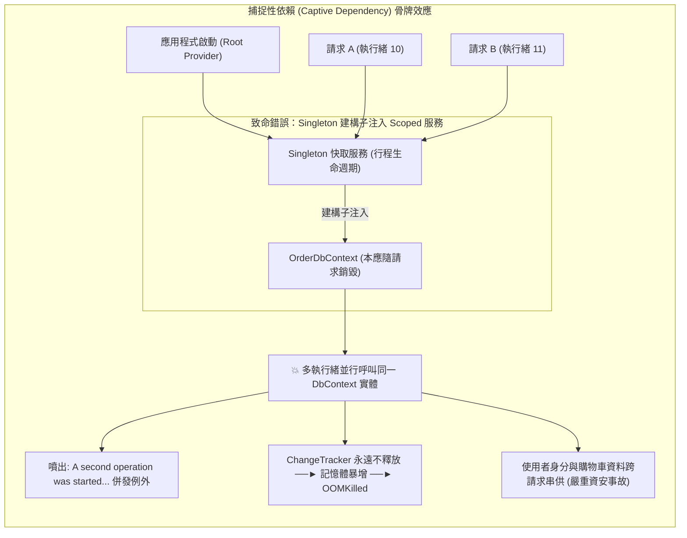

## 案發現場

某中型零售電商系統在一次週五版本發布後，客訴電話被憤怒的顧客打爆：多名買家在結帳頁面點擊送出訂單後，購物車與收件人姓名竟然隨機變成了陌生人的資料；更嚴重的是，後端資料庫日誌以每秒上百筆的頻率狂噴嚴重例外：
`System.InvalidOperationException: A second operation was started on this context instance before a previous operation completed. This is usually caused by different threads concurrently using the same instance of DbContext...`

緊接著在系統運行僅 4 小時後，該微服務容器的記憶體用量從 300MB 階梯式暴增至 2.5GB，觸碰 Kubernetes Pod 記憶體上限，直接被 Linux cgroup 判定為 OOMKilled 重啟。

資安團隊與 SRE 聯合緊急排查，最終在代碼庫中找到了這起「跨用戶串帳與記憶體洩漏」事故的始作俑者：
一名工程師為了在記憶體中快取全站商品目錄，撰寫了一個標註為 `AddSingleton` 的快取服務 `ProductCatalogCache`。為了方便在快取失效時重新查詢資料庫，他在該 Singleton 服務的建構函式中直接注入了 `OrderDbContext`。

這個舉動觸發了 .NET 相依性注入體系中極具破壞力的**捕捉性依賴（Captive Dependency）**：
`OrderDbContext` 預設為 `Scoped` 生命週期，本應隨著單一 HTTP 請求的結束而被即時銷毀與釋放。然而，當它被長壽命的 `Singleton` 服務捕捉後，其生命週期被強行拉長至與整個應用程式同壽！全站成千上萬名使用者的並行 HTTP 請求被指派到同一個 `DbContext` 實體上執行查詢，既破壞了執行緒安全，又使 Entity Framework Core 的 `ChangeTracker` 記憶體累積了數百萬個未釋放的實體狀態，最終引發全站雪崩。



---

## 致命反模式 vs. 正確解法

### 反模式一：長生命週期服務在其建構函式中直接注入短生命週期服務

- **Singleton 注入 Scoped / Transient**：這是最典型的 Captive Dependency。Scoped 實體無法被正確釋放，喪失請求隔離保護。
- **Scoped 注入 Transient（且 Transient 實作了 IDisposable）**：雖然生命週期合法，但若在一個長時間存活的 Scope 內重複解析大量實作了 `IDisposable` 的 Transient 物件，Scope 容器會保留對所有這些物件的引用以待結束時釋放，導致請求執行期間記憶體持續膨脹。

### 反模式二：在根容器（Root ServiceProvider）直接解析 Scoped 服務

若未呼叫 `CreateScope()`，直接在 `app.Services.GetRequiredService<TScoped>()`（或在 `Program.cs` 最頂層）解析 Scoped 物件，該物件將直接被 Root Provider 持有。這意味著該實體的 `Dispose()` 永遠不會被呼叫，直到應用程式完全終止前永遠無法被 GC 回收，形成隱蔽的記憶體洩漏。

### 正確解法：啟用啟動期與 CI 範圍驗證，並使用 `IServiceScopeFactory` 建立安全範疇

1. **強制啟用 `ValidateScopes` 與 `ValidateOnBuild`**：讓 Captive Dependency 在建置期或應用程式啟動的第 1 秒鐘直接拋出例外，Fail-Fast 阻斷發布。
2. **在 Singleton 中透過 `IServiceScopeFactory` 動態建立短暫 Scope**：確保業務操作在獨立的範疇內完成，且利用 `await using` 保證連線與資源完全釋放。

```csharp
using System;
using System.Threading.Tasks;
using Microsoft.Extensions.DependencyInjection;

namespace DotNetPerformance.DependencyInjection;

/// <summary>
/// 模擬資料庫連線上下文（Scoped 生命週期，非執行緒安全）
/// </summary>
public sealed class OrderDbContext : IDisposable
{
    private bool _isDisposed;
    public string SessionId { get; } = Guid.NewGuid().ToString("N")[..8];

    public void SaveOrder(string orderId)
    {
        ObjectDisposedException.ThrowIf(_isDisposed, this);
        Console.WriteLine($"[DbContext:{SessionId}] 訂單 {orderId} 成功寫入資料庫");
    }

    public void Dispose()
    {
        if (!_isDisposed)
        {
            _isDisposed = true;
            Console.WriteLine($"[DbContext:{SessionId}] 連線已安全關閉並釋放資源");
        }
    }
}

/// <summary>
/// 單例背景處理器（Singleton 生命週期）
/// </summary>
public sealed class OrderBackgroundProcessor
{
    private readonly IServiceScopeFactory _scopeFactory;

    // 正確解法：僅注入 IServiceScopeFactory，絕不直接注入 Scoped 服務
    public OrderBackgroundProcessor(IServiceScopeFactory scopeFactory)
    {
        _scopeFactory = scopeFactory;
    }

    /// <summary>
    /// 在獨立的短期範疇內安全執行訂單批次落盤
    /// </summary>
    public async Task ProcessOrderSafelyAsync(string orderId)
    {
        // 關鍵：使用 CreateAsyncScope 建立隔離的範疇，await using 確保退出時呼叫 DisposeAsync/Dispose
        await using AsyncServiceScope scope = _scopeFactory.CreateAsyncScope();

        // 從當前範疇容器中解析出專屬的 Scoped 實體
        var dbContext = scope.ServiceProvider.GetRequiredService<OrderDbContext>();
        dbContext.SaveOrder(orderId);

        // 範疇結束，dbContext 立即被 Dispose，杜絕記憶體洩漏與跨請求污染
    }
}

public static class Program
{
    public static async Task Main()
    {
        Console.WriteLine("=== ASP.NET Core DI Captive Dependency 防禦實測 ===");

        var services = new ServiceCollection();

        // 1. 註冊服務
        services.AddScoped<OrderDbContext>();
        services.AddSingleton<OrderBackgroundProcessor>();

        // 2. 構建 ServiceProvider 並強制開啟範圍與構建驗證
        // 提示：若此時嘗試將 OrderDbContext 宣告進 OrderBackgroundProcessor 的建構子，BuildServiceProvider 將立即拋出例外！
        ServiceProvider serviceProvider = services.BuildServiceProvider(new ServiceProviderOptions
        {
            ValidateScopes = true,
            ValidateOnBuild = true
        });

        Console.WriteLine("[DI 驗證] ValidateScopes 與 ValidateOnBuild 稽核通過，無 Captive Dependency 隱患。");

        // 3. 執行兩筆並行訂單處理，驗證 SessionId 彼此隔離
        var processor = serviceProvider.GetRequiredService<OrderBackgroundProcessor>();

        Task t1 = processor.ProcessOrderSafelyAsync("ORD-001");
        Task t2 = processor.ProcessOrderSafelyAsync("ORD-002");

        await Task.WhenAll(t1, t2);
        Console.WriteLine("批次處理順暢完工，所有 Scoped 物件均已安全釋放。");
    }
}
```

預期控制台輸出：

```text
=== ASP.NET Core DI Captive Dependency 防禦實測 ===
[DI 驗證] ValidateScopes 與 ValidateOnBuild 稽核通過，無 Captive Dependency 隱患。
[DbContext:a1b2c3d4] 訂單 ORD-001 成功寫入資料庫
[DbContext:e5f6g7h8] 訂單 ORD-002 成功寫入資料庫
[DbContext:a1b2c3d4] 連線已安全關閉並釋放資源
[DbContext:e5f6g7h8] 連線已安全關閉並釋放資源
批次處理順暢完工，所有 Scoped 物件均已安全釋放。
```

---

## 踩坑與避坑指南

### 1. 三大生命週期的本質差異與底層資源管理

| 生命週期 (Lifetime) | 解析行為 | 實體由誰持有？ | 誰負責呼叫 `Dispose()`？ | 適用場景 |
| :--- | :--- | :--- | :--- | :--- |
| **Transient** (暫時) | 每次 `GetService` 均全新建立 | 由當前解析的容器（Root 或 Scope）持有引用 | 當所屬的 Scope 或 Root 銷毀時釋放 | 無狀態的輕量輔助計算類、純演算法邏輯。 |
| **Scoped** (範圍) | 在同一個 Scope 內共用單一實體 | 由當前 Scope 容器持有 | 當該 Scope 結束（`Dispose()`）時釋放 | `DbContext`、單位工作模式（Unit of Work）、特定 HTTP 請求的身分資訊。 |
| **Singleton** (單例) | 全應用程式生命週期僅建立一次 | 由 Root Provider 根容器持有 | 應用程式關閉退出時統一釋放 | 記憶體快取（MemoryCache）、配置選項監控器、全域 Metrics 指標發布器。 |

> [!CAUTION]
> **Transient 物件實作 `IDisposable` 的致命陷阱**：
> 如果一個類別宣告為 `Transient` 且實作了 `IDisposable`，若你在 Controller 中呼叫 `provider.GetRequiredService<T>()` 解析了 10,000 次，當前請求的 Scope 容器將把這 10,000 個實體的引用全部保存在內部列表中！在請求結束前，GC 完全無法回收它們，極易造成短暫的記憶體尖峰。

### 2. 為什麼微軟預設只在 Development 環境開啟 `ValidateScopes`？

在 ASP.NET Core 預設樣板中，`CreateDefaultBuilder` 僅在 `builder.Environment.IsDevelopment()` 為 True 時才將 `ValidateScopes` 設為 True。
- **微軟原廠考量**：在冷啟動階段為每個註冊的服務遞迴檢查依賴關係樹，會增加數毫秒至數十毫秒的啟動開銷。
- **生產環境踩坑**：許多團隊在本地開發時未觸發特定業務分支，到了 Staging 或 Production 才因環境不同而暴露 Captive Dependency。
- **避坑黃金法則**：
  在單元測試或整合測試流水線（CI/CD）中，**務必以 `ValidateScopes = true` 與 `ValidateOnBuild = true` 跑完全部測試套件**，以零執行期開銷的代價提前攔截所有生命週期錯誤。

### 3. 避免 Service Locator 反模式

嚴禁在方法中隨處傳遞 `IServiceProvider` 並手動調用 `_serviceProvider.GetService<T>()`（即 Service Locator 反模式）：
- 它隱藏了類別的真正依賴關係，使單元測試極難 Mock。
- 它模糊了程式碼與 Scope 容器的邊界，極易誘發在非預期的生命週期範疇中解析服務。

---

## 線上排查指令

### 1. 透過 DumpHeap 統計堆積上異常殘留的 Scoped 實體數量

當線上懷疑發生 DI 洩漏或 Captive Dependency 時，採集 CoreDump 並利用 SOS 指令檢查實體計數：

```bash
# 1. 採集記憶體快照
dotnet-dump collect -p $(pgrep -n -f "dotnet.*YourService") -o /tmp/di_leak.dmp

# 2. 進入互動式分析終端
dotnet-dump analyze /tmp/di_leak.dmp
```

在互動式視窗內執行：

```text
# 統計記憶體中 DbContext 或自訂 Scoped 服務的實體總數
> dumpheap -stat -type OrderDbContext

# 若發現實體數高達數萬個，隨機挑選一個實體位址分析其 GC 根引用鏈 (GC Root)
> gcroot <十六進位物件位址>
```

判讀要點：
- 若引用鏈頂部直接指向某個 `Singleton` 服務或 `Microsoft.Extensions.DependencyInjection.ServiceLookup.ServiceProviderEngine` 根節點，**直接實錘存在 Captive Dependency 或 Root Provider 洩漏！**

### 2. 在本機或 CI 中啟用嚴格檢測組態

在 `Program.cs` 中強制啟用全域防禦：

```csharp
builder.Host.UseDefaultServiceProvider((context, options) =>
{
    options.ValidateScopes = true;
    options.ValidateOnBuild = true;
});
```
