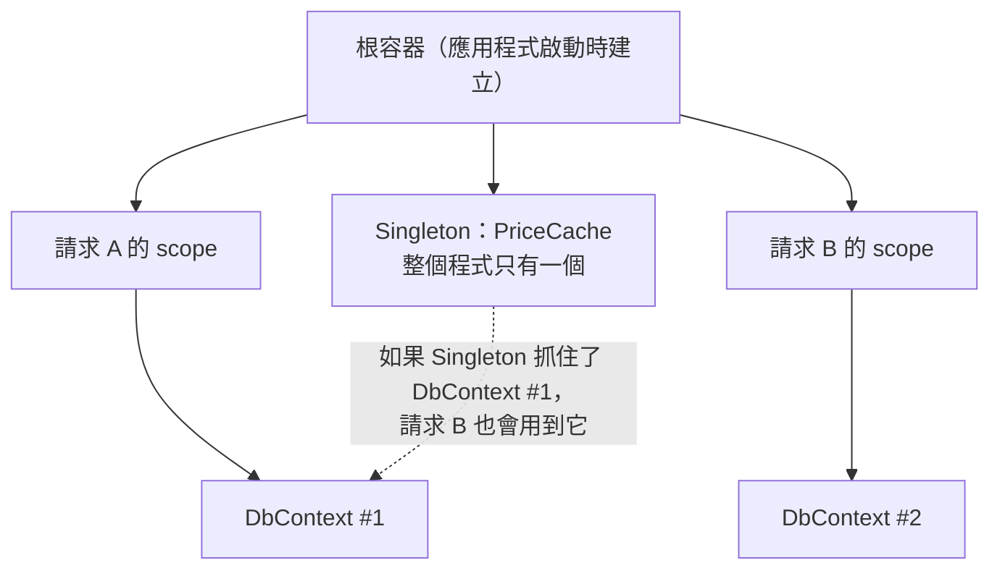

## 這是什麼

訂單 Service 需要 `DbContext`、需要 `ILogger`、需要付款用戶端。如果在每個類別裡自己 `new` 這些東西，類別就得知道它們怎麼建立、何時釋放，測試時也換不掉。

**相依性注入**（Dependency Injection，DI）的做法是：類別只在建構子上宣告「我需要什麼」，由 DI 容器負責建立並傳進來。你在 `Program.cs` 告訴容器「介面 A 用類別 B 實作、要活多久」，之後所有地方都由容器組裝。

```csharp
builder.Services.AddScoped<IOrderRepository, OrderRepository>();

public sealed class PlaceOrderHandler(IOrderRepository orders, ILogger<PlaceOrderHandler> logger)
{
    // 容器建立 Handler 時，自動傳入 orders 與 logger
}
```

## 運作原理

每個服務註冊時都有一個**生命週期**，決定容器多久建立一次新的實例：

| 生命週期 | 建立時機 | 適合 |
| --- | --- | --- |
| Singleton | 整個應用程式只建一個 | 無狀態或執行緒安全的服務，例如快取、設定、`HttpClient` 工廠 |
| Scoped | 每個 HTTP 請求一個 | 和一次請求綁在一起的服務，例如 `DbContext`、目前使用者 |
| Transient | 每次被要求都建新的 | 輕量、無狀態的小工具 |



**Captive Dependency（被俘虜的相依）**：Singleton 在建構子裡注入了 Scoped 服務，這個 Scoped 實例就被 Singleton 永遠留住，活得和整個應用程式一樣久。以 `DbContext` 為例，它不是執行緒安全的，又會一直追蹤載入過的實體；所有請求共用同一個 `DbContext`，輕則記憶體持續增加，重則同時存取時丟出例外、讀到別人的資料。

## 常見錯誤與正確寫法

### 1. Singleton 直接注入 Scoped 服務

```csharp
// 錯：PriceCache 是 Singleton，卻抓住了 Scoped 的 DbContext
builder.Services.AddSingleton<PriceCache>();
public sealed class PriceCache(ShopDbContext db) { /* ... */ }
```

Singleton 需要用到 Scoped 服務時，注入 `IServiceScopeFactory`，每次使用時建立一個 scope，用完就釋放：

```csharp
public sealed class PriceCache(IServiceScopeFactory scopes)
{
    public async Task RefreshAsync(CancellationToken ct)
    {
        await using var scope = scopes.CreateAsyncScope();
        var db = scope.ServiceProvider.GetRequiredService<ShopDbContext>();
        var prices = await db.Products.AsNoTracking().Select(p => new { p.Id, p.Price }).ToListAsync(ct);
        // ... 更新快取
    } // scope 結束，DbContext 被釋放
}
```

`BackgroundService` 是 Singleton，所以在背景服務裡使用 `DbContext` 也要這樣做。

### 2. 讓問題等到上線才出現

ASP.NET Core 在 Development 環境預設會檢查生命週期錯誤：`ValidateScopes` 會在 Singleton 解析 Scoped 服務時丟出例外，`ValidateOnBuild` 會在啟動時就檢查所有註冊能否被建立。但在 Production 環境預設關閉，因為檢查有成本。

讓 CI 的整合測試以 Development 環境啟動應用程式，或在測試專案中明確開啟：

```csharp
builder.Host.UseDefaultServiceProvider(options =>
{
    options.ValidateScopes = true;   // Singleton 解析 Scoped 時丟出例外
    options.ValidateOnBuild = true;  // 啟動時檢查所有註冊都能建立
});
```

這樣 Captive Dependency 會在 CI 就失敗，而不是在尖峰時才出現奇怪的資料錯亂。

### 3. 到處注入 IServiceProvider 自己拿服務

```csharp
// 錯：從建構子看不出這個類別依賴什麼，測試時也不知道要準備哪些服務
public sealed class CheckoutService(IServiceProvider services)
{
    public Task RunAsync() => services.GetRequiredService<IPaymentClient>().ChargeAsync(...);
}
```

這叫 Service Locator。除了上面「Singleton 需要建立 scope」這種情況，相依都應該寫在建構子上，讓相依關係一目了然。

## 使用邊界

- 拿不準生命週期時，先問「這個物件有沒有和某個請求相關的狀態」：有就用 Scoped，沒有而且執行緒安全就用 Singleton。
- Transient 服務如果實作了 `IDisposable`，由容器在 scope 結束時釋放；從根容器解析的 Transient 會活到應用程式結束，不要在根容器上大量解析。
- 設定值的注入方式見 [Options](/frameworks/aspnet-core/options/)；`HttpClient` 不要自己 new，見 [IHttpClientFactory](/frameworks/aspnet-core/http-client-factory/)。
- 同一個介面有多種實作、依情況挑選，見 [Strategy 與 Decorator](/architecture/behavior-patterns/)。
