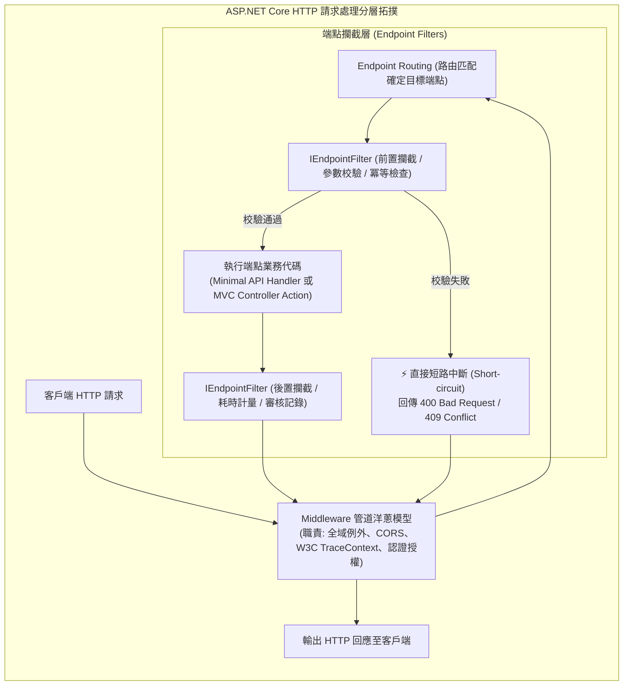

## 案發現場

某快速成長的金融微服務在進行架構升級時，團隊將核心交易轉帳端點由傳統的 MVC Controllers 改寫為效能更佳的 Minimal APIs。為了防止使用者手滑或前端網路重送引發「重複轉帳」，工程師沿用了團隊過去在 MVC 時代高度成熟的自訂過濾器 `IdempotencyActionFilter`（實作了 `IActionFilter`）。

然而上線首日的轉帳高峰期，客服中心接獲嚴重災情報警：一名使用者在網路延遲時連續點擊了兩次送出，系統竟然在同一秒鐘內成功扣款了兩筆完全相同的 50,000 元交易！
後續排查結果令資深開發者大為震驚：新改寫的 Minimal APIs 端點完全沒有執行該 ActionFilter，該冪等性過濾器在運行期直接被靜默忽略！

同一週內，另一起例外監控事故接踵而至：架構團隊為了統一全站錯誤格式，撰寫了一個 `ApiExceptionFilter`（實作了 `IExceptionFilter`）。然而，當第三方呼叫端傳入畸形格式的 JSON 觸發了底層反序列化崩潰時，或者在自訂中介軟體層發生了連線中斷例外時，該 ExceptionFilter 完全毫無感知，例外直接穿透管線，向客戶端噴出未經處理的 HTML 伺服器黃頁錯誤，嚴重洩漏內部呼叫堆疊。

這兩起重大事故暴露了開發團隊對 ASP.NET Core **AOP 攔截體系（Middleware vs. MVC Filters vs. Endpoint Filters）** 的職責層級與派發範圍缺乏本質上的清晰界線。



---

## 致命反模式 vs. 正確解法

### 反模式一：在 Minimal APIs 中誤用 MVC 專屬的 `IActionFilter`

`IActionFilter` 深度綁定於 ASP.NET Core MVC 動作調度器（Action Invoker）。Minimal APIs 繞過了整個龐大的 MVC 框架以獲取極致吞吐量，因此任何掛載在 Minimal API 端點上的 ActionFilter 都**絕對不會被觸發**！現代架構必須統一遷移至 .NET 7+ 引進的跨端點標準介面 `IEndpointFilter`。

### 反模式二：試圖用 `IExceptionFilter` 充當系統全域例外處理器

`IExceptionFilter` 的作用範疇極端狹隘：它只能捕捉 Controller Action 內部被拋出且未被 catch 的例外。如果錯誤發生在：
1. 路由解析或中介軟體管線中。
2. 模型繫結（Model Binding）解析 JSON 階段。
3. Action 執行完畢後的結果序列化階段（`IActionResult.ExecuteResultAsync`）。

`IExceptionFilter` 均完全無法捕獲！全域錯誤兜底**必須且只能交由最外層的 ExceptionHandler Middleware**。

### 正確解法：運用通用的 `IEndpointFilter` 落實端點前置校驗與優雅短路

以下完整程式碼展示了如何實作一個可重用、跨端點的生產級冪等性校驗端點篩選器（`IEndpointFilter`），示範如何讀取強型別參數、在條件不符時安全短路（Short-circuiting），並精確量測端點執行耗時。

```csharp
using System;
using System.Collections.Concurrent;
using System.Diagnostics;
using System.Threading.Tasks;
using Microsoft.AspNetCore.Http;

namespace DotNetPerformance.Filters;

/// <summary>
/// 轉帳請求酬載（強型別 DTO）
/// </summary>
public sealed record TransferRequest(string TransactionId, decimal Amount, string TargetAccount);

/// <summary>
/// 生產級冪等性與前置驗證端點篩選器（IEndpointFilter 通用實作）
/// </summary>
public sealed class IdempotencyAndValidationEndpointFilter : IEndpointFilter
{
    // 模擬已處理之交易 ID 快取（生產環境通常對接 Redis）
    private static readonly ConcurrentDictionary<string, byte> _processedTransactions = new();

    public async ValueTask<object?> InvokeAsync(EndpointFilterInvocationContext context, EndpointFilterDelegate next)
    {
        var sw = Stopwatch.StartNew();

        // 1. 從端點參數列表中搜尋目標 DTO
        TransferRequest? request = null;
        for (int i = 0; i < context.Arguments.Count; i++)
        {
            if (context.Arguments[i] is TransferRequest req)
            {
                request = req;
                break;
            }
        }

        if (request is null)
        {
            // 若未找到預期 DTO，直接放行交由後續管線處理
            return await next(context);
        }

        // 2. 業務前置驗證：金額檢核
        if (request.Amount <= 0)
        {
            // 關鍵：直接回傳 TypedResults 達成安全短路，杜絕執行後續業務 Handler
            Console.WriteLine("[Filter短路] 交易金額非法，阻斷請求。");
            return TypedResults.BadRequest(new { error = "轉帳金額必須大於 0" });
        }

        // 3. 冪等性檢核：防重複送出
        if (!_processedTransactions.TryAdd(request.TransactionId, 0))
        {
            Console.WriteLine($"[Filter短路] 偵測到重複交易提交: {request.TransactionId}，阻斷重複扣款！");
            return TypedResults.Conflict(new { error = "該筆交易已在處理中或已完成，請勿重複提交" });
        }

        try
        {
            // 4. 通過所有檢驗，放行進入端點業務邏輯
            object? result = await next(context);
            return result;
        }
        finally
        {
            sw.Stop();
            Console.WriteLine($"[Filter後置] 端點執行完畢，交易單號: {request.TransactionId}，耗時: {sw.ElapsedMilliseconds} ms");
        }
    }
}

public static class Program
{
    public static async Task Main()
    {
        Console.WriteLine("=== ASP.NET Core 通用 Endpoint Filter 實測驗證 ===");

        var filter = new IdempotencyAndValidationEndpointFilter();

        // 模擬 Minimal API 業務 Handler
        static ValueTask<object?> DummyTransferHandler(EndpointFilterInvocationContext ctx)
        {
            var req = (TransferRequest)ctx.Arguments[0]!;
            Console.WriteLine($"[業務處理中] 扣款成功: {req.Amount} -> 帳戶: {req.TargetAccount}");
            return ValueTask.FromResult<object?>(TypedResults.Ok(new { status = "Success" }));
        }

        // 案例一：合法請求首次提交
        var req1 = new TransferRequest("TXN-2026-0001", 1000.0m, "ACC-8888");
        var context1 = new MockEndpointFilterInvocationContext([req1]);
        var result1 = await filter.InvokeAsync(context1, DummyTransferHandler);
        Console.WriteLine($"案例一結果型別: {result1?.GetType().Name}\n");

        // 案例二：完全相同之交易單號重複提交（觸發冪等性短路）
        var context2 = new MockEndpointFilterInvocationContext([req1]);
        var result2 = await filter.InvokeAsync(context2, DummyTransferHandler);
        Console.WriteLine($"案例二結果型別: {result2?.GetType().Name}\n");

        // 案例三：金額為負數（觸發前置業務短路）
        var req3 = new TransferRequest("TXN-2026-0002", -50.0m, "ACC-8888");
        var context3 = new MockEndpointFilterInvocationContext([req3]);
        var result3 = await filter.InvokeAsync(context3, DummyTransferHandler);
        Console.WriteLine($"案例三結果型別: {result3?.GetType().Name}");
    }
}

/// <summary>
/// 輕量模擬 EndpointFilterInvocationContext 以進行單元驗證
/// </summary>
public sealed class MockEndpointFilterInvocationContext(IList<object?> arguments) : EndpointFilterInvocationContext
{
    private readonly IList<object?> _arguments = arguments;
    public override HttpContext HttpContext => new DefaultHttpContext();
    public override IList<object?> Arguments => _arguments;
    public override T GetArgument<T>(int index) => (T)_arguments[index]!;
}
```

預期控制台輸出：

```text
=== ASP.NET Core 通用 Endpoint Filter 實測驗證 ===
[業務處理中] 扣款成功: 1000.0 -> 帳戶: ACC-8888
[Filter後置] 端點執行完畢，交易單號: TXN-2026-0001，耗時: 0 ms
案例一結果型別: Ok`1

[Filter短路] 偵測到重複交易提交: TXN-2026-0001，阻斷重複扣款！
案例二結果型別: Conflict`1

[Filter短路] 交易金額非法，阻斷請求。
案例三結果型別: BadRequest`1
```

---

## 踩坑與避坑指南

### 1. Middleware vs. MVC Filters vs. Endpoint Filters 職責分工全景圖

| 攔截技術 | 所在層級 | 能否存取強型別參數？ | 適用範圍 | 最佳應用職責 |
| :--- | :--- | :--- | :--- | :--- |
| **Middleware** (中介軟體) | 最外層 HTTP 管線 (洋蔥模型) | 否（僅有未解包之 Stream） | 全站所有端點（包含靜態檔、探針） | 全域例外處理、CORS、W3C 分散式追蹤、gzip 壓縮、IP 黑名單。 |
| **MVC Filters** (5 大過濾器) | MVC 內部專屬管線 | 是（透過 ActionExecutingContext） | **僅限 Controller Action** | 傳統單體專案中與 MVC 視圖（View）高度耦合之邏輯。 |
| **Endpoint Filters** | 端點派發層 (Routing 之後) | **是（透過 Arguments 集合）** | **Minimal APIs 與 Controller 通用** | 端點參數校驗、業務冪等性、API 審核日誌、細粒度權限。 |

### 2. 多重 Filter 的串聯順序（Filter Ordering）天坑

當同一個端點或 `RouteGroup` 掛載了多個 Filter 時：
- **前置邏輯（Pre-logic）**：依照註冊順序**由先至後（FIFO）**依序執行。
- **後置邏輯（Post-logic）**：依照註冊順序**由後至先（LIFO）**依序退回。
- 若在某個 Filter 呼叫中直接回傳結果而**沒有執行 `await next(context)`**，後續所有尚未執行的 Filter 以及真正的業務 Handler 將全部被短路（跳過）。務必確認短路邏輯是否符合安全預期。

### 3. 短路傳回型別推薦：全面擁抱 `TypedResults`

在 Endpoint Filter 中短路中斷時，強烈建議傳回 `TypedResults`（例如 `TypedResults.BadRequest()` 或 `TypedResults.Problem()`）而非早期的 `Results.BadRequest()`：
- `TypedResults` 具備強型別編譯期推導，能自動被 OpenAPI / Swagger 工具精確識別回傳狀態碼與 Schema，徹底杜絕 API 文件與真實回應脫節。

---

## 線上排查指令

### 1. 啟用 HTTP 端點過濾器呼叫之 Debug 日誌

當懷疑某個 Filter 未正常執行或短路順序異常時：

```bash
# 開啟 ASP.NET Core 端點過濾器詳細日誌
export Logging__LogLevel__Microsoft.AspNetCore.Http=Debug
export Logging__LogLevel__Microsoft.AspNetCore.Routing=Debug
```

在標準輸出中將印出：
```text
dbug: Microsoft.AspNetCore.Http.Internal[1]
      Executing endpoint filter 'IdempotencyAndValidationEndpointFilter' on endpoint 'POST /api/transfer'.
```

### 2. 線上排查未捕獲之全域例外洩漏

檢驗是否有例外穿透 Filter 直達最外層：

```bash
# 檢查生產日誌中是否有未處理例外所導致的 500 錯誤
grep -E "HTTP 500|UnhandledException" /var/log/app/*.log | tail -n 20
```
