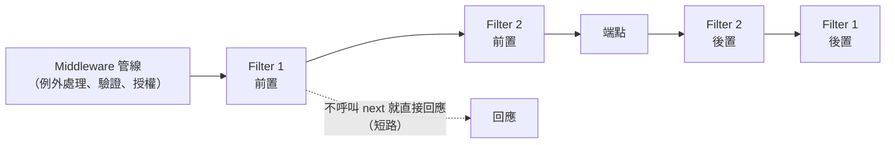

## 這是什麼

有些事不是每個請求都要做，而是只有特定端點需要：修改價格的 API 要寫稽核紀錄、後台 API 要檢查商店狀態、某些端點的輸入要做額外檢查。這些放在 Middleware 太廣，寫在每個端點裡又重複。

**Filter** 就是為這種情況設計的：它掛在端點上，在端點執行前後被呼叫，而且知道是哪個端點、參數是什麼。ASP.NET Core 有兩套：

- **MVC Filter**（`IActionFilter`、`IResourceFilter` 等）：只用於 Controller。
- **Endpoint Filter**（`IEndpointFilter`）：用於 Minimal API，也可以用在 Controller 的端點上。

## 運作原理



Endpoint Filter 是一條鏈：每個 Filter 拿到 `context` 和 `next`，呼叫 `await next(context)` 就交給下一個，最後才是端點本身。先加的 Filter 在外層，前置先執行、後置後執行。

Filter 在路由選定端點、授權完成之後才執行。所以被 Middleware 擋下的請求（例如未登入、找不到路由）不會經過 Filter。

## 常見錯誤與正確寫法

### 1. 在 Minimal API 上掛 MVC 的 ActionFilter

`IActionFilter` 屬於 MVC，對 `app.MapPost(...)` 這類 Minimal API 端點不會執行，也不會有任何錯誤提示。Minimal API 用 `IEndpointFilter`：

```csharp
// 只有商店營業中才允許下單；否則短路回應 503
public sealed class StoreOpenFilter(IStoreStatus store) : IEndpointFilter
{
    public async ValueTask<object?> InvokeAsync(EndpointFilterInvocationContext context, EndpointFilterDelegate next)
    {
        if (!await store.IsOpenAsync(context.HttpContext.RequestAborted))
        {
            return TypedResults.Problem(statusCode: 503, title: "商店暫停營業", detail: "請稍後再試");
        }
        return await next(context); // 繼續交給下一個 Filter 或端點
    }
}

app.MapPost("/orders", PlaceOrder).AddEndpointFilter<StoreOpenFilter>();
```

需要讀取端點參數時，用 `context.GetArgument<T>(index)` 或從 `context.Arguments` 取得。

### 2. 用 Exception Filter 當全域例外處理

MVC 的 `IExceptionFilter` 只接得到 Controller action 裡的例外；Middleware、Minimal API、模型綁定之前發生的例外它都接不到。全系統的例外統一由 `UseExceptionHandler` 與 `IExceptionHandler` 處理，回應格式一致，見 [HTTP 契約](/frameworks/aspnet-core/http-contracts/)。

### 3. 多個 Filter 的順序與預期不同

```csharp
// 由外往內：先檢查商店狀態，再寫稽核紀錄
app.MapPost("/orders", PlaceOrder)
    .AddEndpointFilter<StoreOpenFilter>()   // 外層：先執行
    .AddEndpointFilter<AuditFilter>();      // 內層：商店營業中才會執行到
```

稽核要記錄「被拒絕的嘗試」時，就要把它放到外層。順序就是業務語意，加 Filter 時順手寫下為什麼這樣排。

## 使用邊界

- **Middleware 還是 Filter？** 和端點無關、每個請求都要做的放 Middleware；需要知道端點或參數的放 Filter。整體比較見 [橫切行為](/architecture/cross-cutting/)。
- Filter 裡做的 I/O 會加在每次呼叫上；需要查資料的檢查，考慮快取結果。
- 授權不要自己寫在 Filter 裡，使用 ASP.NET Core 的授權 Policy，見 [驗證與授權](/security/authentication/)。
- Native AOT 與 Minimal API 的搭配，見 [API 風格與 Native AOT](/frameworks/aspnet-core/api-styles-aot/)。
