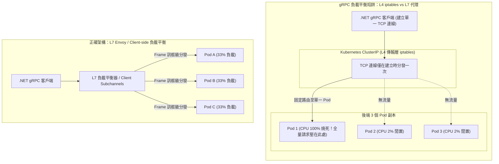

## 案發現場

某金融期貨即時報價微服務在流量衝破每秒 40,000 次查詢時，內部跨微服務通訊引發了嚴重的中樞神經癱瘓。由於各微服務之間沿用傳統的 HTTP/1.1 JSON REST API，伺服器叢集每秒充斥著數萬次 TCP 短連線建立與握手、龐大的 HTTP 標頭字串解析，以及數十 MB 的 JSON 文字序列化 CPU 開銷。微服務 Pod 的網路頻寬被大量填滿，P99 延遲由平時的 8ms 惡化至 180ms，多次觸發下游服務超時熔斷。

技術團隊隨即決定將內部跨服務調用全面替換為基於 Google Protocol Buffers 的 **gRPC**。然而在內部未配置 TLS 的 Kubernetes 內網上線測試的第一天，所有客戶端微服務在向新版 gRPC 服務發送請求時，頻繁且全面地崩潰並拋出：
`System.Net.Http.HttpRequestException: An HTTP/2 connection could not be established because the server did not negotiate HTTP/2.`

更為怪異的是：在嘗試開啟明文連線後，雖然連線成功建立，但在業務突波期間，維運監控顯示該 gRPC 服務明明部署了 10 個 Pod 副本，卻只有「Pod-0」的 CPU 被打滿至 100%，而其餘 9 個 Pod 的 CPU 使用率竟然全部在 2% 左右「看熱鬧」，所有外部請求因為單一 Pod 飽和而被大量拒絕！

這起事故直接揭示了現代工程師在實施 gRPC 架構時最容易踩中的兩大深坑：
1. **對 HTTP/2 明文協商（H2C）機制認知不清**：誤以為 HTTP/2 能像 HTTP/1.1 一樣自適應降級。
2. **對 L4 傳輸層負載平衡與 HTTP/2 長連線多工（Multiplexing）衝突毫無防備**：導致單點過載與負載嚴重傾斜。



---

## 致命反模式 vs. 正確解法

### 反模式一：內部無 TLS 網路直接裸呼叫未配置 H2C 的 Kestrel

HTTP/2 規範預設透過 TLS 的 ALPN（Application-Layer Protocol Negotiation）擴充套件進行協商。如果微服務執行在 Kubernetes 內網且關閉了 TLS，Kestrel 預設的監聽設定會拒絕無 ALPN 的 HTTP/2 請求。伺服器必須明確配置支援 `HttpProtocols.Http2`（Cleartext HTTP/2，即 H2C），且客戶端必須開啟明文支援開關。

### 反模式二：依賴 Kubernetes 預設 ClusterIP Service 進行 gRPC 負載平衡

Kubernetes 預設的 ClusterIP 是基於 Linux iptables / IPVS 的 **L4（傳輸層）** 負載平衡。它只在 TCP 連線建立的三向交握階段決定目標 Pod。由於 gRPC 採用 HTTP/2 單連線多工（Multiplexing），客戶端在建立連線後會長期複用該單一 TCP 連線發送成千上萬筆請求。結果就是：**所有請求永遠只打到同一個 Pod 上**，徹底喪失橫向擴展的能力！

### 正確解法：規範 H2C 端點配置、實踐 Client-side 負載平衡與標準 RpcException 狀態碼

1. **伺服器端明確配置 H2C**：在 Kestrel 中設定監聽埠專門服務 `HttpProtocols.Http2`。
2. **負載平衡方案**：
   - 方案 A（推薦）：搭配 Kubernetes Headless Service（`ClusterIP: None`），使用 `grpc://dns:///service-name:5000` 讓客戶端解析所有 Pod IP，建立連線集區輪詢發送（Client-side Load Balancing）。
   - 方案 B：透過 Envoy 或 Linkerd/Istio Service Mesh 進行 L7 訊框級轉發。
3. **錯誤與取消控制**：嚴禁拋出普通未處理例外，一律映射為標準 `RpcException`，並串聯 `ServerCallContext.CancellationToken`。

```csharp
using System;
using System.Threading;
using System.Threading.Tasks;
using Grpc.Core;

namespace DotNetPerformance.Grpc;

/// <summary>
/// 生產級 gRPC 訂單服務實作
/// </summary>
public sealed class OrderGrpcService
{
    /// <summary>
    /// 查詢訂單詳情（支援 Deadline 超時傳播與取消中斷）
    /// </summary>
    public async Task<string> QueryOrderAsync(string orderId, ServerCallContext context)
    {
        // 1. 檢驗客戶端取消權杖（若上游逾時或斷線，即刻中斷後續昂貴計算）
        if (context.CancellationToken.IsCancellationRequested)
        {
            throw new RpcException(new Status(StatusCode.Cancelled, "客戶端已取消該請求或已逾時"));
        }

        // 2. 參數驗證：拋出合規的 InvalidArgument 狀態碼（杜絕裸 500）
        if (string.IsNullOrWhiteSpace(orderId))
        {
            var status = new Status(StatusCode.InvalidArgument, "訂單識別碼不得為空字串");
            throw new RpcException(status);
        }

        // 3. 模擬業務資料查詢
        try
        {
            // 模擬非同步 I/O 呼叫並傳遞取消權杖
            await Task.Delay(10, context.CancellationToken);

            if (orderId == "ORD-NOT-FOUND")
            {
                throw new RpcException(new Status(StatusCode.NotFound, $"找不到訂單: {orderId}"));
            }

            return $"[gRPC 回應] 訂單 {orderId} 狀態正常，金額: 1,999 TWD";
        }
        catch (OperationCanceledException) when (context.CancellationToken.IsCancellationRequested)
        {
            Console.WriteLine("[gRPC中斷] 偵測到客戶端斷線或逾時，已安全釋放資料庫連線。");
            throw new RpcException(new Status(StatusCode.DeadlineExceeded, "處理超時，伺服器主動中斷"));
        }
    }
}

public static class Program
{
    public static async Task Main()
    {
        Console.WriteLine("=== ASP.NET Core gRPC 例外規範與取消傳播實測 ===");

        var service = new OrderGrpcService();
        var mockContext = new MockServerCallContext();

        // 測試一：正常查詢
        string result = await service.QueryOrderAsync("ORD-2026-8888", mockContext);
        Console.WriteLine(result);

        // 測試二：參數非法驗證
        try
        {
            await service.QueryOrderAsync("", mockContext);
        }
        catch (RpcException ex)
        {
            Console.WriteLine($"[例外捕捉] 狀態碼: {ex.StatusCode}, 訊息: {ex.Status.Detail}");
        }

        // 測試三：資料不存在驗證
        try
        {
            await service.QueryOrderAsync("ORD-NOT-FOUND", mockContext);
        }
        catch (RpcException ex)
        {
            Console.WriteLine($"[例外捕捉] 狀態碼: {ex.StatusCode}, 訊息: {ex.Status.Detail}");
        }
    }
}

/// <summary>
/// 輕量模擬 ServerCallContext 進行離線單元驗證
/// </summary>
public sealed class MockServerCallContext : ServerCallContext
{
    protected override string MethodCore => "QueryOrder";
    protected override string HostCore => "localhost";
    protected override string PeerCore => "127.0.0.1:50051";
    protected override DateTime DeadlineCore => DateTime.UtcNow.AddSeconds(5);
    protected override Metadata RequestHeadersCore => [];
    protected override CancellationToken CancellationTokenCore => CancellationToken.None;
    protected override Metadata ResponseTrailersCore => [];
    protected override Status StatusCore { get; set; }
    protected override WriteOptions? WriteOptionsCore { get; set; }
    protected override AuthContext AuthContextCore => null!;
    protected override ContextPropagationToken CreatePropagationTokenCore(ContextPropagationOptions? options) => null!;
    protected override Task WriteHeadersAsyncCore(Metadata responseHeaders) => Task.CompletedTask;
}
```

預期控制台輸出：

```text
=== ASP.NET Core gRPC 例外規範與取消傳播實測 ===
[gRPC 回應] 訂單 ORD-2026-8888 狀態正常，金額: 1,999 TWD
[例外捕捉] 狀態碼: InvalidArgument, 訊息: 訂單識別碼不得為空字串
[例外捕捉] 狀態碼: NotFound, 訊息: 找不到訂單: ORD-NOT-FOUND
```

---

## 踩坑與避坑指南

### 1. Kestrel 明文 HTTP/2（H2C）生產伺服器組態

在 `appsettings.json` 或 `Program.cs` 中配置 Kestrel，必須明確將專屬 gRPC 的監聽埠綁定至 `Http2`：

```csharp
// Program.cs
builder.WebHost.ConfigureKestrel(options =>
{
    // 端點 1：專門用於外部 HTTP/1.1 REST API 或健康檢查
    options.ListenAnyIP(8080, listenOptions =>
    {
        listenOptions.Protocols = HttpProtocols.Http1;
    });

    // 端點 2：專門用於內部微服務 gRPC 高速通訊 (明文 H2C)
    options.ListenAnyIP(50051, listenOptions =>
    {
        listenOptions.Protocols = HttpProtocols.Http2;
    });
});
```

### 2. 客戶端負載平衡（Client-side Load Balancing）實踐

在 .NET 8+ / .NET 10 中，官方原生支援了基於 DNS 的客戶端負載平衡。只需在 Kubernetes 宣告 Headless Service（`clusterIP: None`），並在客戶端註冊時使用 `dns:///` 前綴：

```csharp
// 註冊 gRPC 客戶端並開啟 DNS 輪詢負載平衡
services.AddGrpcClient<OrderClient.OrderClientClient>(o =>
{
    // 連線至 Kubernetes Headless Service
    o.Address = new Uri("dns:///order-service-headless.default:50051");
})
.ConfigureChannel(channelOptions =>
{
    // 啟用 Round-Robin 負載平衡策略
    channelOptions.Credentials = ChannelCredentials.Insecure;
    channelOptions.ServiceConfig = new ServiceConfig
    {
        LoadBalancingConfigs = { new RoundRobinConfig() }
    };
});
```
這樣客戶端便會自動定期向 CoreDNS 解析出後端所有 Pod 的實體 IP，為每個 Pod 建立專屬的 HTTP/2 鏈路，將請求平均分散至所有副本，徹底解決單 Pod 熱點過載問題！

### 3. 何時不適合使用 gRPC？

1. **瀏覽器前端直連（Browser-to-Backend）**：瀏覽器 JavaScript 缺乏對底層 HTTP/2 訊框的細微控制權限，必須透過 `grpc-web` 轉譯代理，架構複雜度高；且二進位 Proto 使得瀏覽器網路面板（Network Tab）難以直接閱讀請求內容。
2. **需要對外部第三方合作夥伴公開的開放平台 API**：第三方開發者可能採用各類小眾語言，強制要求編譯 `.proto` 檔案會顯著提高對接門檻。對公網公開介面依然首選 OpenAPI / JSON REST 或 GraphQL。

---

## 線上排查指令

### 1. 使用 `grpc_cli` 探測生產 gRPC 服務端點與健康狀態

在 Kubernetes 叢集內部使用官方 `grpc_cli` 測試反射與方法調用：

```bash
# 1. 檢視目標 Pod 公開的所有 gRPC 服務清單 (服務端需註冊 MapGrpcReflectionService)
grpc_cli ls 10.244.1.25:50051

# 2. 檢視特定方法定義
grpc_cli type 10.244.1.25:50051 ecommerce.orders.v1.OrderService

# 3. 發送帶 JSON 參數的真實 RPC 調用
grpc_cli call 10.244.1.25:50051 QueryOrder "order_id: 'ORD-2026-8888'"
```

### 2. 即時監控 Kestrel HTTP/2 連線與資料訊框指標

使用 `dotnet-counters` 驗證連線是否被過度集中於單一節點：

```bash
# 監控 Kestrel 的 HTTP/2 連線數、當前 Streams 串流數與連線生命週期
dotnet-counters monitor Microsoft.AspNetCore.Server.Kestrel \
  --counters http2-connections,http2-streams,current-connections \
  --process-id $(pgrep -n -f "dotnet.*YourGrpcApp")
```

指標判斷：
- 若 `http2-connections` 僅有 1 或 2，但 `http2-streams` 高達數千：證實上游缺乏連線池分散或未配置 Client-side 負載平衡。
