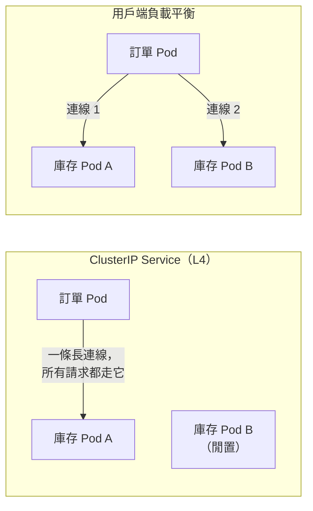

## 這是什麼

訂單服務每秒要問庫存服務上千次「這個商品還有幾件」。用 JSON over HTTP/1.1 也可以，但每次都要序列化成文字、每個連線一次只能處理一個請求。

**gRPC** 是一種跨服務呼叫的方式：

- 用 **Protobuf** 定義契約（`.proto` 檔），編譯器產生兩邊的 C# 程式碼，欄位型別和名稱在編譯時就對齊。
- 資料以二進位編碼，比 JSON 小、解析快。
- 跑在 **HTTP/2** 上，一條連線可以同時傳送很多個請求（多工），也支援串流。

## 運作原理



Kubernetes 的 ClusterIP Service 在**連線層**做負載平衡：新連線建立時，選一個 Pod。HTTP/1.1 的用戶端常常開很多條連線，流量自然分散。gRPC 只開一條長連線、在上面多工，所以這條連線落在哪個 Pod，所有請求就都去那裡。擴容新增的 Pod 也分不到流量。

解法是讓負載平衡發生在**請求層**：

- **用戶端負載平衡**：Service 設為 headless（`clusterIP: None`），DNS 會回傳所有 Pod 的 IP，gRPC 用戶端對每個 Pod 各開連線，並輪流分配請求。
- **L7 代理**：服務網格或支援 gRPC 的閘道，看得懂每一個請求，可以逐一分配。

## 常見錯誤與正確寫法

### 1. 叢集內沒有 TLS，Kestrel 卻沒設定 HTTP/2

叢集內部常常不加 TLS。沒有 TLS 時，HTTP/2 不能靠 TLS 協商自動啟用，Kestrel 的端點要明確設定成只用 HTTP/2（h2c）：

```json
{
  "Kestrel": {
    "Endpoints": {
      "Grpc": { "Url": "http://0.0.0.0:5001", "Protocols": "Http2" },
      "Http": { "Url": "http://0.0.0.0:8080", "Protocols": "Http1" }
    }
  }
}
```

gRPC 和一般的 HTTP/1.1（例如健康檢查）分開兩個 port，各自設定協定。

### 2. 用 ClusterIP Service 呼叫 gRPC

改成 headless Service，搭配用戶端負載平衡：

```csharp
// Service 名稱 inventory-grpc 必須是 headless（clusterIP: None），DNS 才會回傳所有 Pod
var channel = GrpcChannel.ForAddress("dns:///inventory-grpc.shop.svc.cluster.local:5001", new GrpcChannelOptions
{
    Credentials = ChannelCredentials.Insecure,  // 叢集內明文；跨網路要用 TLS
    ServiceConfig = new ServiceConfig { LoadBalancingConfigs = { new RoundRobinConfig() } },
});
builder.Services.AddSingleton(new Inventory.InventoryClient(channel));
```

`GrpcChannel` 本身管理連線，要建立一次、重複使用。

### 3. 用例外訊息回傳錯誤

gRPC 有自己的狀態碼（`NotFound`、`InvalidArgument`、`Unavailable` 等）。伺服器端丟出 `RpcException` 並指定狀態碼，用戶端就能依狀態碼決定是否重試：

```csharp
public override async Task<StockReply> GetStock(StockRequest request, ServerCallContext context)
{
    var stock = await _stocks.FindAsync(request.ProductId, context.CancellationToken)
        ?? throw new RpcException(new Status(StatusCode.NotFound, $"商品 {request.ProductId} 不存在"));
    return new StockReply { Available = stock.Available };
}
```

## 使用邊界

- **對外的公開 API 不適合 gRPC。** 瀏覽器無法直接呼叫原生 gRPC（需要 gRPC-Web 轉換），第三方整合也普遍預期 JSON。
- 契約一旦發布，欄位編號就不能改、不能重複使用；新增欄位是相容的，刪除欄位要保留編號。
- 呼叫量不大、團隊熟悉 REST 時，JSON over HTTP 的除錯成本較低。
- 什麼時候該同步呼叫、什麼時候改用訊息，見 [通訊方式的選擇](/architecture/communication-boundaries/)；Service 的運作見 [Service 與 Gateway](/platforms/kubernetes/services-gateway/)。
