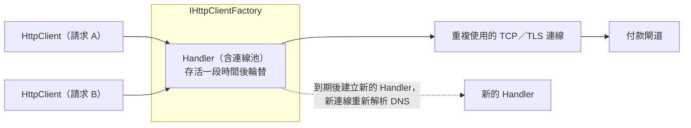

## 這是什麼

訂單 API 要呼叫付款閘道、物流報價、發票服務。.NET 用 `HttpClient` 發 HTTP 請求。`HttpClient` 背後有一個**連線池**：建立 TCP 與 TLS 連線很花時間，所以連線用完不會馬上關閉，而是留著給下一個請求重複使用。

問題出在 `HttpClient` 的建立方式：

- 每次都 `new` 一個：每個都有自己的連線池，用完 Dispose 後連線關閉，舊的 socket 還要在作業系統裡停留一段時間（TIME_WAIT）。尖峰時可用的 port 被耗盡，新的請求連不出去。
- 整個程式只用一個靜態的：連線一直重複使用，永遠不會重新查 DNS。下游服務換了 IP（例如藍綠部署、負載平衡器更換），你還在連舊的 IP。

**IHttpClientFactory** 同時解決這兩個問題。

## 運作原理



`HttpClient` 本身很輕，真正昂貴的是它背後的 Handler 與連線池。IHttpClientFactory 讓多個 `HttpClient` 共用同一個 Handler，並定期（預設 2 分鐘）換一個新的 Handler，新連線就會重新查 DNS。

另一個做法是直接設定 `SocketsHttpHandler.PooledConnectionLifetime`：連線存活超過這段時間就不再重複使用，自然會建立新連線並重新查 DNS。這適合不使用 DI 的情況。

## 常見錯誤與正確寫法

### 1. 每次請求都 new HttpClient

```csharp
// 錯：每次都建立新的連線池，尖峰時 socket 耗盡
public async Task<Quote> GetQuoteAsync(Address to, CancellationToken ct)
{
    using var client = new HttpClient();
    return (await client.GetFromJsonAsync<Quote>($"https://shipping.example.com/quote?zip={to.Zip}", ct))!;
}
```

改成**具型別用戶端**（typed client）：一個類別包住某個下游服務，由 factory 提供設定好的 `HttpClient`。

```csharp
public sealed class ShippingClient(HttpClient http)
{
    public async Task<Quote> GetQuoteAsync(Address to, CancellationToken ct) =>
        (await http.GetFromJsonAsync<Quote>($"quote?zip={Uri.EscapeDataString(to.Zip)}", ct))!;
}

builder.Services.AddHttpClient<ShippingClient>(client =>
{
    client.BaseAddress = new Uri("https://shipping.example.com/v1/"); // 結尾要有斜線
    client.Timeout = TimeSpan.FromSeconds(5);
});
```

`BaseAddress` 結尾的斜線很重要：`https://shipping.example.com/v1` 加上相對路徑 `quote`，依 URL 規則會變成 `https://shipping.example.com/quote`，把 `v1` 弄丟了。

### 2. 把具型別用戶端注入 Singleton

具型別用戶端預設是 Transient。如果把 `ShippingClient` 注入一個 Singleton，它拿到的 `HttpClient` 就永遠不會換 Handler，等於回到「單一靜態實例看不到 DNS 變更」的問題。

Singleton 需要呼叫 HTTP 時，注入 `IHttpClientFactory` 並在每次使用時 `CreateClient`，或使用設定了 `PooledConnectionLifetime` 的共用 `HttpClient`：

```csharp
// 不使用 factory 時：共用一個 HttpClient，但讓連線定期汰換
private static readonly HttpClient SharedClient = new(new SocketsHttpHandler
{
    PooledConnectionLifetime = TimeSpan.FromMinutes(2),
});
```

### 3. 每個下游都用同樣的設定

付款閘道和商品圖片服務的逾時、重試需求不同。每個下游一個具型別用戶端，各自設定逾時與彈性策略，見 [HTTP 彈性策略](/frameworks/aspnet-core/http-resilience/)。

## 使用邊界

- `HttpClient.Timeout` 預設是 100 秒，幾乎一定太長。依呼叫端能等待的時間設定，並把 `CancellationToken` 傳進去。
- 對同一個下游的併發請求很多時，注意每個伺服器的連線數上限（`SocketsHttpHandler.MaxConnectionsPerServer`），以及下游自己的限流。
- .NET 8 起內建 HTTP 用戶端指標，例如 `http.client.request.duration` 與 `http.client.open_connections`，可用 OpenTelemetry 收集，見 [指標與追蹤](/engineering/metrics-tracing/)。
- 在 Kubernetes 裡呼叫其他 Service 時，DNS 通常指向穩定的 ClusterIP；但呼叫外部服務或 headless Service 時，DNS 更新仍然重要。
