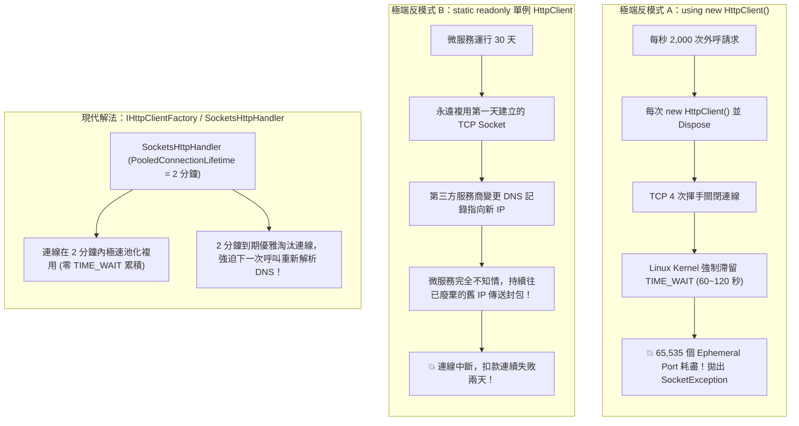

## 案發現場

某電商核心微服務在年中大促尖峰流量期間，突然爆發了外呼通訊全面癱瘓事故：所有呼叫第三方金流閘道與電子發票開立的 HTTP 請求無一例外全部崩潰，應用程式日誌以每秒數百筆的驚人頻率噴出：
`System.Net.Sockets.SocketException: Only one usage of each socket address (protocol/network address/port) is normally permitted`，甚至直接拋出 `System.Net.Http.HttpRequestException: Resource temporarily unavailable`。

維運工程師登入 Linux 容器節點執行網路診斷，眼前景象令人觸目驚心：系統中竟有高達 38,000 多個 TCP 連線死死滯留在 `TIME_WAIT` 狀態，作業系統所能分配的暫時連接埠（Ephemeral Ports）在短短數分鐘內被徹底抽乾！

事後排查代碼，發現是一名新手工程師在服務外呼方法中，依照 C# 的習慣撰寫了：
```csharp
using (var client = new HttpClient())
{
    var response = await client.PostAsync("https://payment.gateway/charge", content);
    // ...
}
```
為了緊急止血，架構小組決定將其改寫為全域共享的 `private static readonly HttpClient _httpClient = new HttpClient();`。改動上線後，`TIME_WAIT` 危機瞬間解除，系統平穩運行了一個月。

然而，更大的隱形災難在一個月後悄然爆發：第三方金流公司進行了伺服器機房搬遷，更新了其公開網域的 DNS A 記錄並指向新的伺服器 IP。由於靜態單例 `HttpClient` 長期複用既有的 TCP 連線池，在運行期間**永遠不會重新查詢 DNS**，該電商微服務在接下來的整整兩天內，持續向金流公司已經廢棄關閉的舊 IP 發送扣款請求，造成數萬筆真實訂單無法付款，引發慘烈的商譽受損！

這起連環事故生動展現了 .NET 開發者在處理對外 HTTP 呼叫時最容易陷入的兩極地雷：**Socket 耗盡（Socket Exhaustion）** vs. **DNS 漂移失效（DNS Drift）**。



---

## 致命反模式 vs. 正確解法

### 反模式一：在方法內部反覆 `using (new HttpClient())`

`HttpClient` 雖然實作了 `IDisposable`，但呼叫 `Dispose()` 僅能釋放託管記憶體，作業系統底層的 TCP Socket 必須嚴格遵循 TCP RFC 規範進入 `TIME_WAIT` 狀態（通常維持 1 到 2 分鐘），以確保網路中延遲抵達的舊封包不會污染後續的新連線。在高併發微服務環境中，每秒大量建立並丟棄連線會瞬間耗盡作業系統的暫時連接埠。

### 反模式二：使用裸 `static readonly HttpClient` 且未設定連線存活時間

單例 `HttpClient` 解決了 Socket 耗盡，但它天生對 DNS 紀錄的變更「完全免疫」。除非作業系統重啟或微服務重新部署，否則底層 TCP 連線池永遠不會釋放，導致遭遇 DNS 漂移時直接失聯。

### 正確解法：運用 `IHttpClientFactory` 具型別客戶端，或為 `SocketsHttpHandler` 配置 `PooledConnectionLifetime`

自 .NET Core 3.0 開始，CLR 引入了全新的高效能套接字處理常式 `SocketsHttpHandler`。透過將 `PooledConnectionLifetime` 設定為 **2 分鐘**，既能享有連線池複用的零配置效能，又能在 2 分鐘後自動淘汰連線以重新解析 DNS。

```csharp
using System;
using System.Net.Http;
using System.Threading;
using System.Threading.Tasks;
using Microsoft.Extensions.DependencyInjection;

namespace DotNetPerformance.HttpClients;

/// <summary>
/// 具型別物流客戶端（Typed Client）
/// </summary>
public sealed class LogisticsApiClient
{
    private readonly HttpClient _httpClient;

    public LogisticsApiClient(HttpClient httpClient)
    {
        _httpClient = httpClient;
    }

    /// <summary>
    /// 查詢物流即時軌跡
    /// </summary>
    public async Task<string> TrackPackageAsync(string trackingNumber, CancellationToken cancellationToken = default)
    {
        // 模擬使用配置好的 HttpClient 發送請求
        Console.WriteLine($"[LogisticsClient] 正在查詢單號: {trackingNumber}，目標端點: {_httpClient.BaseAddress}");
        
        // 實際外呼通常為: using var response = await _httpClient.GetAsync($"track/{trackingNumber}", cancellationToken);
        await Task.Delay(10, cancellationToken);

        return $"包裹 {trackingNumber} 已抵達轉運中心 (狀態碼: 200 OK)";
    }
}

public static class Program
{
    public static async Task Main()
    {
        Console.WriteLine("=== ASP.NET Core IHttpClientFactory 與連線池治理實測 ===");

        var services = new ServiceCollection();

        // 註冊 Typed Client 並深度配置 SocketsHttpHandler
        services.AddHttpClient<LogisticsApiClient>(client =>
        {
            // 注意：BaseAddress 結尾務必包含斜線，以利 RFC 3986 相對路徑拼接
            client.BaseAddress = new Uri("https://api.logistics.internal/v1/");
            client.Timeout = TimeSpan.FromSeconds(5);
        })
        .ConfigurePrimaryHttpMessageHandler(() => new SocketsHttpHandler
        {
            // 核心黃金設定：連線存活 2 分鐘後強制標記過期，促使重新解析 DNS，防範 DNS 漂移
            PooledConnectionLifetime = TimeSpan.FromMinutes(2),
            // 空閒連線在集區保留 1 分鐘後關閉，節省連線佔用
            PooledConnectionIdleTimeout = TimeSpan.FromMinutes(1),
            // 限制對單一目標伺服器的最大連線數，防止過載
            MaxConnectionsPerServer = 100,
            // 嚴格連線超時設定（防止 TCP 握手假死）
            ConnectTimeout = TimeSpan.FromSeconds(2)
        });

        using ServiceProvider serviceProvider = services.BuildServiceProvider();

        // 從 DI 解析 Typed Client（注意：Typed Client 本質為 Transient 服務）
        var client = serviceProvider.GetRequiredService<LogisticsApiClient>();

        string result = await client.TrackPackageAsync("PKG-2026-9999");
        Console.WriteLine($"[外呼結果] {result}");
        Console.WriteLine("SocketsHttpHandler 連線池與 DNS 自動更新防護已生效。");
    }
}
```

預期控制台輸出：

```text
=== ASP.NET Core IHttpClientFactory 與連線池治理實測 ===
[LogisticsClient] 正在查詢單號: PKG-2026-9999，目標端點: https://api.logistics.internal/v1/
[外呼結果] 包裹 PKG-2026-9999 已抵達轉運中心 (狀態碼: 200 OK)
SocketsHttpHandler 連線池與 DNS 自動更新防護已生效。
```

---

## 踩坑與避坑指南

### 1. Typed Client 的生命週期本質與 Captive Dependency 陷阱

透過 `services.AddHttpClient<TClient>()` 註冊的具型別客戶端，其在 DI 容器中的預設生命週期是 **Transient**！
- **常見陷阱**：若工程師將 `LogisticsApiClient` 注入進一個 `AddSingleton` 的快取服務或排程器中，該 Typed Client 會被該 Singleton 永久持有（Captive Dependency），導致其內部持有的 `HttpClient` 實例永遠無法更新，使工廠的 Handler 輪替機制失去效用。
- **最佳實踐**：在 Singleton 服務中，應直接注入 `IHttpClientFactory`，並在每次需要發送請求時透過 `factory.CreateClient("ClientName")` 獲取臨時客戶端。

### 2. BaseAddress 與相對路徑的「結尾斜線」天坑（RFC 3986）

在設定 `HttpClient.BaseAddress` 時，斜線的有無會完全改變 URL 的解析結果：

```csharp
// 正確配置：BaseAddress 必須以斜線結尾，相對路徑開頭不得有斜線
client.BaseAddress = new Uri("https://api.example.com/v1/");
await client.GetAsync("orders"); 
// 實際請求網址: https://api.example.com/v1/orders (正確)

// 錯誤配置 A：BaseAddress 缺少結尾斜線
client.BaseAddress = new Uri("https://api.example.com/v1");
await client.GetAsync("orders"); 
// 實際請求網址: https://api.example.com/orders (v1 被無情削除了！)

// 錯誤配置 B：相對路徑開頭包含斜線
client.BaseAddress = new Uri("https://api.example.com/v1/");
await client.GetAsync("/orders"); 
// 實際請求網址: https://api.example.com/orders (根路徑覆蓋了 v1！)
```

### 3. 何時不應在 HttpClient 啟用自動重試（Polly）？

- **非冪等（Non-Idempotent）端點（如 POST 扣款 / 成立訂單）**：
  若因外呼網路逾時（Socket 超過 3 秒未回應）而盲目自動重試，極有可能伺服器端已經扣款成功，只是 ACK 封包在網路回程中遺失。自動重試會直接導致使用者被**重複扣款**！非冪等請求一律應交由商務邏輯的補償機制或對帳排程處理。

---

## 線上排查指令

### 1. 檢視 Linux 伺服器 TCP 連線狀態與 TIME_WAIT 總量

在節點出現網路異常時，快速評估連線埠消耗狀況：

```bash
# 1. 統計當前作業系統所有 TCP 連線狀態分佈
ss -s

# 2. 統計特定狀態（如 TIME_WAIT、ESTABLISHED）的 Socket 數量
ss -tan state time-wait | wc -l
ss -tan state established | wc -l

# 3. 檢查系統目前配置的暫時連接埠範圍 (預設通常為 32768 ~ 60999，約 28,000 個)
cat /proc/sys/net/ipv4/ip_local_port_range
```

### 2. 即時監控 .NET 應用的 HTTP 外呼連線池指標

利用 `dotnet-counters` 掌握微服務開啟的外呼連線數與請求率：

```bash
# 即時監控 System.Net.Http 計數器
dotnet-counters monitor System.Net.Http \
  --counters requests-started-rate,current-requests,current-connections,http11-connections,http20-connections \
  --process-id $(pgrep -n -f "dotnet.*YourService")
```

指標判斷法則：
- 若 `current-connections` 暴增至數千且無法回落：代表外呼未正確釋放或連線池上限被設定過大。
- 若 `requests-started-rate` 正常但 `current-requests` 持續堆積：代表下游第三方服務正在經歷嚴重延遲，微服務外呼正面臨廣泛超時。
