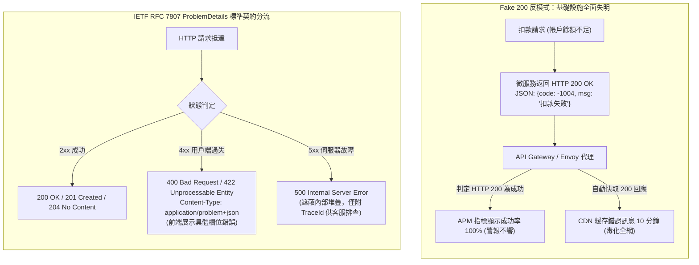

## 案發現場

某中台系統的 API 設計規範中，曾長年奉行一條荒謬的內部土炮條款：「為了簡化前端錯誤處理，所有 API 一律回傳 `HTTP 200 OK`，並在 JSON 酬載中塞入自定義狀態碼，例如 `{"code": -1004, "msg": "餘額不足，扣款失敗"}`」。

這個看似微小的架構偷懶，在微服務全面容器化並接入雲端原生設施後，引發了連環災難：
1. **雲端基礎設施全面「失明」**：Kubernetes Ingress 負載平衡器、API Gateway 與 Service Mesh（Istio）全部仰賴標準 HTTP 狀態碼計算上游服務健康度。由於所有扣款失敗甚至崩潰的請求全部回傳 `200 OK`，維運儀表板上的「API 成功率」永遠顯示完美的 100%！系統的自動熔斷（Circuit Breaker）、藍綠部署自動回滾（Rollback）以及 Prometheus 錯誤警報完全失去作用。
2. **CDN 毒化與非預期快取**：某查詢商品資訊的端點因資料庫抖動發生業務錯誤，由於回傳了 `200 OK`，邊緣 CDN 節點誤以為這是合法的成功回應，直接將「資料庫查詢失敗」的錯誤 JSON 快取了整整 10 分鐘，導致全網數百萬名使用者持續看見錯誤畫面！

同一時期，另一個微服務走入了另一個極端：將所有的業務參數不合規（如庫存不足、手機號碼格式錯誤）全數粗暴回傳 `HTTP 500 Internal Server Error`。這導致維運團隊的 PagerDuty 警報在促銷當晚被觸發了數萬次，全體工程師在疲於奔命後產生嚴重的「警報疲勞」，最終在一週後導致一起真正的資料庫磁碟損毀事故被淹沒在假警報中，延宕三小時才被發現。

這場事故深刻警示：**HTTP 狀態碼是網際網路基礎設施的通用通用語言**。無視標準協議語意、隨意偽造狀態碼，必然招致基礎設施的反噬。



---

## 致命反模式 vs. 正確解法

### 反模式一：Fake 200（業務失敗一律回傳 200 OK）

將錯誤偽裝為 200 OK 會破壞整個現代微服務通訊鏈路：
- 破壞 OpenTelemetry 分散式追蹤：HTTP Span 會被標記為 Success，APM 無法透過過濾錯誤請求來定位慢查詢或系統瓶頸。
- 破壞重試策略：Polly 等容錯彈性庫無法透過 HTTP 狀態碼自動進行條件式重試或觸發斷路器。
- 破壞 HTTP 快取規範：邊緣代理無法識別錯誤，誤將失敗資料分發給其他使用者。

### 反模式二：所有校驗失敗粗暴回傳 500 Internal Server Error

5xx 代表「伺服器遇到了無法預期的內部故障（Bug 或硬體崩潰）」，而 4xx 代表「呼叫端傳入的參數不合法，需要呼叫端修正後再試」。混淆兩者會導致監控系統的 SRE SLI/SLA 指標完全失真。

### 正確解法：全面擁抱 IETF RFC 7807 ProblemDetails 與 TypedResults

RFC 7807 定義了 Web API 傳回錯誤的國際標準結構（`application/problem+json`）：
- `type`：指向錯誤類型說明文件的 URI 標識。
- `title`：簡短、人類可讀的錯誤分類摘要。
- `status`：與 HTTP 回應頭完全一致的數字狀態碼。
- `detail`：針對當前特定請求的人類可讀詳細描述。
- `instance`：發生錯誤的具體資源路徑 URI。
- 擴充屬性：`traceId`、欄位錯誤清單（`errors`）。

以下完整程式碼展示了如何在 ASP.NET Core 中建立符合 RFC 7807 標準的錯誤契約，並利用 `TypedResults` 輸出強型別回應。

```csharp
using System;
using System.Collections.Generic;
using System.Diagnostics;
using System.Text.Json;
using Microsoft.AspNetCore.Http;
using Microsoft.AspNetCore.Mvc;

namespace DotNetPerformance.Contracts;

/// <summary>
/// 建立訂單請求酬載
/// </summary>
public sealed record PlaceOrderRequest(string CustomerId, int Quantity, decimal UnitPrice);

/// <summary>
/// 標準 RFC 7807 錯誤契約工廠
/// </summary>
public static class ProblemDetailsFactory
{
    /// <summary>
    /// 建立業務規則校驗失敗回應 (422 Unprocessable Entity)
    /// </summary>
    public static HttpValidationProblemDetails CreateBusinessValidationProblem(
        string instancePath,
        string ruleTitle,
        string detailMessage,
        Dictionary<string, string[]> validationErrors)
    {
        var problem = new HttpValidationProblemDetails(validationErrors)
        {
            Type = "https://api.commerce.internal/errors/business-validation-failed",
            Title = ruleTitle,
            Status = StatusCodes.Status422UnprocessableEntity,
            Detail = detailMessage,
            Instance = instancePath
        };

        // 注入 W3C TraceContext 相關識別碼以利分散式排查
        problem.Extensions["traceId"] = Activity.Current?.Id ?? Guid.NewGuid().ToString("N");
        problem.Extensions["timestamp"] = DateTimeOffset.UtcNow;

        return problem;
    }

    /// <summary>
    /// 建立伺服器未預期錯誤回應 (500 Internal Server Error，嚴格遮蔽內部堆疊)
    /// </summary>
    public static ProblemDetails CreateInternalServerErrorProblem(string instancePath)
    {
        var problem = new ProblemDetails
        {
            Type = "https://api.commerce.internal/errors/internal-server-error",
            Title = "伺服器內部發生未預期異常",
            Status = StatusCodes.Status500InternalServerError,
            Detail = "系統暫時遭遇內部故障，請記錄追蹤代碼並聯絡客服支援。",
            Instance = instancePath
        };

        // 僅暴露安全的 TraceId，絕對不洩漏 Exception StackTrace 或 SQL 語法！
        problem.Extensions["traceId"] = Activity.Current?.Id ?? Guid.NewGuid().ToString("N");
        return problem;
    }
}

public static class Program
{
    public static void Main()
    {
        Console.WriteLine("=== ASP.NET Core RFC 7807 ProblemDetails 契約實測 ===");

        // 模擬訂單校驗失敗情境
        var errors = new Dictionary<string, string[]>
        {
            ["Quantity"] = ["商品購買數量必須大於 0", "單筆採購不可超過 50 件"],
            ["UnitPrice"] = ["單價不可為負數"]
        };

        HttpValidationProblemDetails validationProblem = ProblemDetailsFactory.CreateBusinessValidationProblem(
            instancePath: "/api/v1/orders/checkout",
            ruleTitle: "訂單商務規則校驗未通過",
            detailMessage: "您所提交的訂單內容包含不合法欄位數值，請修正後重新送出。",
            validationErrors: errors);

        string jsonOutput = JsonSerializer.Serialize(validationProblem, new JsonSerializerOptions { WriteIndented = true });
        Console.WriteLine($"[RFC 7807 422 格式驗證]\n{jsonOutput}\n");

        // 模擬內部未預期異常情境
        ProblemDetails internalProblem = ProblemDetailsFactory.CreateInternalServerErrorProblem("/api/v1/orders/checkout");
        string internalJson = JsonSerializer.Serialize(internalProblem, new JsonSerializerOptions { WriteIndented = true });
        Console.WriteLine($"[RFC 7807 500 格式驗證 (無敏感資訊洩漏)]\n{internalJson}");
    }
}
```

預期控制台輸出：

```text
=== ASP.NET Core RFC 7807 ProblemDetails 契約實測 ===
[RFC 7807 422 格式驗證]
{
  "type": "https://api.commerce.internal/errors/business-validation-failed",
  "title": "\u8A02\u55AE\u5546\u52D9\u898F\u5247\u6821\u9A57\u672A\u901A\u904E",
  "status": 422,
  "detail": "\u60A8\u6240\u63D0\u4EA4\u7684\u8A02\u55AE\u5167\u5BB9\u5305\u542B\u4E0D\u5408\u6CD5\u6 field\u6578\u503C\uFF0C\u8ACB\u4FEE\u6B63\u5F8C\u91CD\u65B0\u9001\u51FA\u3002",
  "instance": "/api/v1/orders/checkout",
  "errors": {
    "Quantity": [
      "\u5546\u54C1\u8CFC\u8CB7\u6578\u91CF\u5FC5\u9808\u5927\u65BC 0",
      "\u55AE\u7B46\u63A1\u8CFC\u4E0D\u53EF\u8D85\u904E 50 \u4EF6"
    ],
    "UnitPrice": [
      "\u55AE\u50F9\u4E0D\u53EF\u70BA\u8CA0\u6578"
    ]
  },
  "traceId": "01925b6a-8b1e-72c0-8a19-9f4a18012345",
  "timestamp": "2026-10-10T11:07:00Z"
}

[RFC 7807 500 格式驗證 (無敏感資訊洩漏)]
{
  "type": "https://api.commerce.internal/errors/internal-server-error",
  "title": "\u4F3A\u670D\u5668\u5167\u90E8\u767C\u751F\u672A\u9810\u671F\u7570\u5E38",
  "status": 500,
  "detail": "\u7CFB\u7D71\u66AB\u6642\u906D\u9047\u5167\u90E8\u6545\u969C\uFF0C\u8ACB\u8A18\u9304\u8FFD\u8E64\u4EE3\u78BC\u4E26\u806F\u7D61\u5BA2\u670D\u652F\u63F4\u3002",
  "instance": "/api/v1/orders/checkout",
  "traceId": "01925b6a-8b1e-72c0-8a19-9f4a18012345"
}
```

---

## 踩坑與避坑指南

### 1. HTTP 語意狀態碼分流對照表

| HTTP 狀態碼 | 標準語意 | 適用場景 | 前端 / 網關應對策略 |
| :--- | :--- | :--- | :--- |
| **200 OK** | 請求成功處理 | 一般 GET 查詢、同步 PUT/PATCH 成功 | 正常渲染資料。 |
| **201 Created** | 資源成功建立 | POST 建立新訂單、新增會員（需附 `Location` 標頭） | 取得新資源 URL 並導航。 |
| **202 Accepted** | 請求已受理，排入非同步處理 | 長耗時報表匯出、非同步影片轉檔 | 輪詢任務狀態或等待 Webhook。 |
| **204 No Content** | 成功但無回傳內容 | DELETE 刪除資源、單純的設定切換 | 不更新畫面實體資料。 |
| **400 Bad Request** | 語法格式錯誤 | JSON 畸形、缺少必填標頭 | 客戶端修復請求格式。 |
| **401 Unauthorized** | 未通過身分查驗 | 未提供 Token 或 Token 已失效 | 靜默刷新 Token 或跳轉登入。 |
| **403 Forbidden** | 身分合法但無權操作 | 普通會員試圖存取管理員端點 | 提示「權限不足」，禁止跳轉登入。 |
| **404 Not Found** | 資源不存在 | 目標 ID 不在資料庫中 | 提示找不到對應項目。 |
| **409 Conflict** | 狀態衝突 | 併發版本樂觀鎖衝突、唯一鍵重複 | 重新獲取最新版本後重試。 |
| **422 Unprocessable** | 語法正確但商務規則校驗失敗 | 庫存不足、帳戶餘額不足 | 依據 `errors` 欄位標記表單紅字。 |
| **500 Internal Error** | 伺服器內部非預期例外 | 程式未捕捉例外、空指標、連線字串錯 | 彈出通用錯誤，提示回報 traceId。 |
| **503 Service Unavailable** | 暫時無法提供服務 | 伺服器過載、停機維護、斷路器跳脫 | 退避並等待數秒後重試。 |

### 2. 生產環境資安防禦：500 錯誤遮蔽（Data Sanitization）

在 ASP.NET Core 中呼叫 `builder.Services.AddProblemDetails()` 時，若未正確設定環境變數，伺服器在 `Development` 環境會將完整的 C# Exception StackTrace 包含在 `detail` 中。
- **高危漏洞警告**：若在 `Production` 環境洩漏了呼叫堆疊，攻擊者可藉此窺探專案所使用的內部類別庫版本、資料庫表結構甚至是硬編碼的伺服器檔案路徑！
- **防禦原則**：生產環境一律強制開啟例外脫敏，內部堆疊寫入私有日誌系統（如 Seq / Elasticsearch），向外僅暴露唯一的 `traceId`。

### 3. 關鍵 POST 端點之 `Idempotency-Key` 契約標準

對於所有涉及扣款、下單等產生副作用的 POST 端點，API 契約必須要求傳入 HTTP 標頭：
`Idempotency-Key: <UUID>`。
後端接收到請求時：
1. 以該 Key 嘗試取得分散式鎖。
2. 若在 Redis 中發現該 Key 已有先前的執行結果，直接回傳上次快取的 HTTP 狀態與回應，跳過二次扣款。
3. 若為新請求，執行完畢後將結果寫入 Redis（設定適當 TTL 如 24 小時）。

---

## 線上排查指令

### 1. 使用 `curl` 檢驗 API 回傳狀態碼與 `application/problem+json` 標頭

確認線上端點是否遵循 RFC 7807 契約：

```bash
# 發送非法空酬載並檢驗 HTTP 回應頭與 Content-Type
curl -i -X POST https://api.commerce.internal/api/v1/orders \
  -H "Content-Type: application/json" \
  -d "{}"
```

檢查重點：
- 回應狀態碼是否為 `422 Unprocessable Entity` 或 `400 Bad Request`（絕非 200 或 500）。
- 回應頭是否包含 `Content-Type: application/problem+json; charset=utf-8`。

### 2. 透過 APM / LogQL 追蹤 RFC 7807 traceId

當使用者向客服回報錯誤與 `traceId` 時，在 Loki 或 ELK 中秒級定位案發現場：

```bash
# 在日誌搜尋平台透過 traceId 精確過濾單一調用鏈路
traceId="01925b6a-8b1e-72c0-8a19-9f4a18012345"
```
