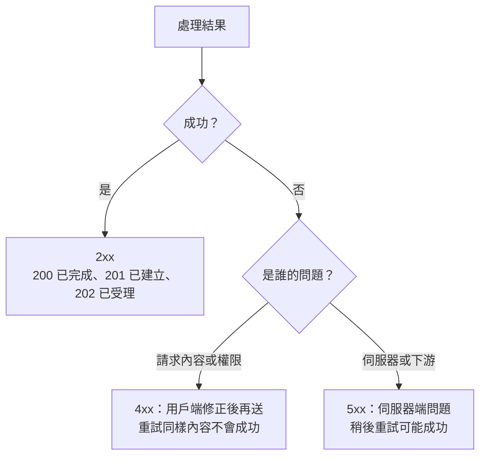

## 這是什麼

API 回應給用戶端兩樣東西：狀態碼和內容。**HTTP 契約**指的是這兩者代表什麼的約定：成功回什麼、各種失敗回什麼、錯誤內容長什麼樣子。

狀態碼不只是給人看的。前端依它決定要顯示錯誤還是重試，HTTP 用戶端的重試策略依它決定要不要再送一次，監控系統依它計算錯誤率。狀態碼不說實話，這些機制就會一起出錯。

## 運作原理



電商常用的狀態碼：

| 狀態碼 | 意思 | 電商例子 |
| --- | --- | --- |
| 200 OK | 完成，並回傳結果 | 查詢商品 |
| 201 Created | 建立了新資源，`Location` 指向它 | 訂單已建立 |
| 202 Accepted | 已受理，稍後處理 | 匯出報表已排入佇列 |
| 400 Bad Request | 格式錯誤 | JSON 格式不對、數量不是數字 |
| 401 Unauthorized | 沒有有效的身分 | 沒帶 token 或 token 過期 |
| 403 Forbidden | 知道你是誰，但你沒有權限 | 買家想改商品價格 |
| 404 Not Found | 資源不存在（或不讓你知道它存在） | 商品不存在、查別人的訂單 |
| 409 Conflict | 和目前狀態衝突 | 庫存不足、版本衝突、重複下單 |
| 422 Unprocessable Content | 格式正確但不符合業務規則 | 已出貨的訂單不能取消 |
| 429 Too Many Requests | 太頻繁，請稍後再試 | 觸發限流 |
| 500 Internal Server Error | 伺服器未預期的錯誤 | 程式例外 |
| 503 Service Unavailable | 暫時無法服務 | 依賴的資料庫停機 |

**Problem Details（RFC 9457）**是錯誤內容的標準格式，Content-Type 為 `application/problem+json`，固定有 `type`、`title`、`status`、`detail` 等欄位，用戶端可以用同一套程式處理所有錯誤。它取代了舊的 RFC 7807。

## 常見錯誤與正確寫法

### 1. 業務失敗也回 200

```json
// 錯：HTTP 200，內容卻是失敗；重試策略與監控都以為成功了
{ "success": false, "message": "庫存不足" }
```

依失敗原因回對應的狀態碼，內容用 Problem Details：

```csharp
app.MapPost("/orders", async Task<Results<Created<OrderDto>, ProblemHttpResult>> (
    PlaceOrderRequest request, PlaceOrderHandler handler, CancellationToken ct) =>
{
    var result = await handler.HandleAsync(request, ct);
    return result.Status switch
    {
        PlaceOrderStatus.Created => TypedResults.Created($"/orders/{result.Order!.Id}", result.Order),
        PlaceOrderStatus.OutOfStock => TypedResults.Problem(statusCode: 409, title: "庫存不足",
            detail: $"商品 {request.ProductId} 目前只剩 {result.Available} 件"),
        _ => TypedResults.Problem(statusCode: 422, title: "訂單不符合規則", detail: result.Reason),
    };
});
```

`TypedResults` 讓回傳型別出現在方法簽章上，OpenAPI 文件也能正確描述所有可能的回應。

### 2. 未預期的例外把內部訊息回給用戶端

`NpgsqlException` 的訊息可能包含資料表名稱、SQL 片段甚至連線資訊。Production 環境只回應通用訊息與一個追蹤用的 ID，詳細內容只寫進日誌：

```csharp
builder.Services.AddProblemDetails(options =>
{
    options.CustomizeProblemDetails = context =>
    {
        // 加上 traceId，用戶回報問題時可以對應到日誌與追蹤
        context.ProblemDetails.Extensions["traceId"] = Activity.Current?.Id ?? context.HttpContext.TraceIdentifier;
    };
});
app.UseExceptionHandler(); // 未處理的例外轉成 500 Problem Details，不含例外訊息
```

### 3. 下單 API 沒有冪等鍵

網路不穩時，App 沒收到回應就重送下單請求，伺服器建立了兩張訂單。讓用戶端在每次「同一個下單意圖」帶上同一個 `Idempotency-Key` 標頭，伺服器以它作為唯一條件：第一次建立訂單，之後相同的鍵直接回傳第一次的結果；同一個鍵卻帶著不同內容，回 422。實作方式見 [高併發 CRUD](/data-access/concurrent-crud/)。

## 使用邊界

- 查詢別人的訂單時，回 404 比 403 更安全：403 等於告訴對方「這張訂單存在」。
- 400 與 422 的界線各團隊不同，重點是全系統一致，並寫進 API 文件。
- 202 只代表「收到了」，要提供查詢處理結果的方式，例如 `Location` 指向一個狀態端點。
- 用戶端該如何依狀態碼重試，見 [HTTP 彈性策略](/frameworks/aspnet-core/http-resilience/)。
