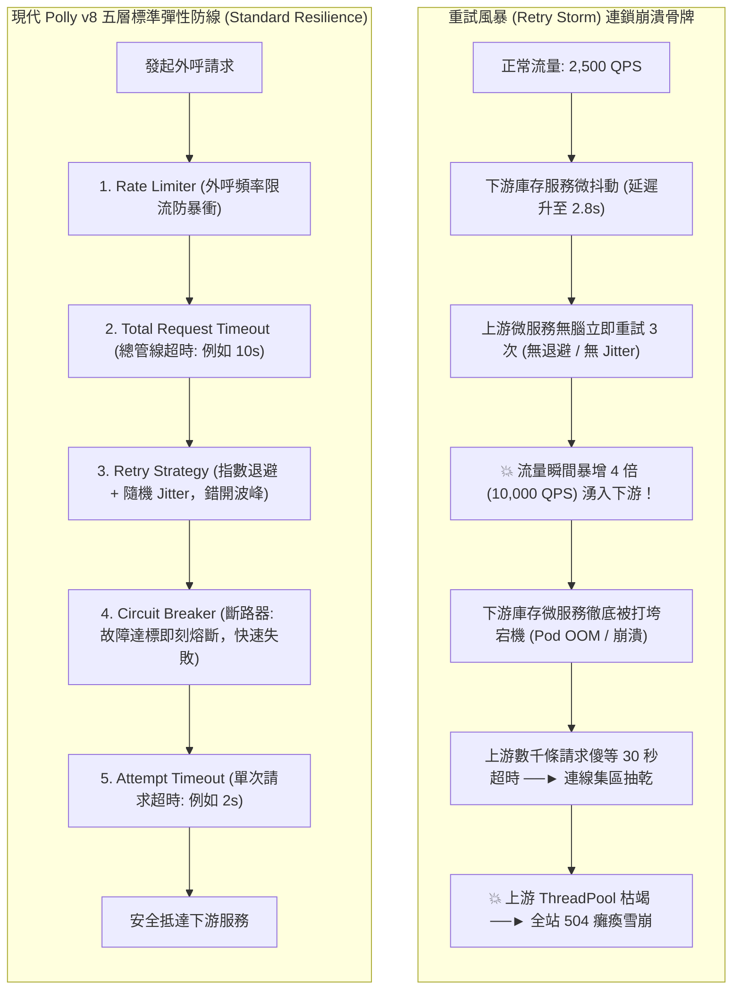

## 案發現場

某跨境電商平台在除夕倒數跨年搶購期間，核心購物車與結帳微服務突然引發了全站連鎖崩潰。事後復盤證實，這是一起教科書等級的**重試風暴（Retry Storm）**與微服務雪崩骨牌事故。

事故起源於最下游的庫存微服務：由於資料庫遭遇短暫的磁碟 I/O 爭搶，庫存扣減 API 的平均回應延遲由正常的 25 毫秒急劇攀升至 2,800 毫秒。然而，上游的訂單微服務在外呼庫存服務時，配置了「立即重試 3 次，單次逾時 30 秒」的原始策略。

在每秒 2,500 QPS 的促銷高並發下，災難迅速失控：
1. **流量幾何級數放大**：由於庫存服務變慢，原本的 2,500 QPS 疊加上游立即發起的 3 次重試，瞬間在庫存服務的網路入口形成了高達 **10,000 QPS 的重試巨浪**！本已處於過載邊緣的庫存服務被這波突發流量徹底擊穿，CPU 飆至 100%，所有 Pod 相繼崩潰重啟。
2. **上游連線池與執行緒池枯竭**：庫存服務崩潰後，上游訂單微服務的數千個請求並未立即中斷，而是死死等待 30 秒的預設 Socket 逾時。短短 10 秒內，訂單服務的 HTTP 連線池與 ThreadPool 執行緒全數被掛起卡死，導致前端入口 API Gateway 全面噴出 `HTTP 504 Gateway Timeout`，全站微服務體系全軍覆沒。



---

## 致命反模式 vs. 正確解法

### 反模式一：固定間隔立即重試，缺乏指數退避與隨機抖動（Jitter）

若重試機制沒有加入**指數退避（Exponential Backoff）**與**隨機抖動（Jitter）**，所有在同一毫秒失敗的請求將在完全相同的未來時間點（例如整齊的 1.0 秒後）發起重試。這會形成整齊劃一的「流量海嘯共振」，在下游主機剛嘗試喘息復原時給予致命重擊。

### 反模式二：對 4xx 客戶端錯誤發動重試

`400 Bad Request`、`401 Unauthorized`、`404 Not Found` 或 `422 Unprocessable Entity` 屬於呼叫端輸入或權限的確定性錯誤，其在重試後**百分之百必然再次失敗**。對 4xx 錯誤發動重試毫無意義，只會白白浪費寶貴的網路頻寬與 CPU 運算資源。重試**必須且只能**針對暫態故障（如 `503 Service Unavailable`、`504 Gateway Timeout`、`408 Request Timeout` 或暫時性網路斷線）。

### 反模式三：未配置斷路器（Circuit Breaker），任由請求持續卡死

當下游服務已確定宕機或崩潰時，繼續發送請求只會加重整體架構的負擔。缺乏斷路器保護的系統無法「快速失敗（Fail-Fast）」，最終必定導致上游連鎖超時。

### 正確解法：引入 Polly v8 與 `Microsoft.Extensions.Http.Resilience` 標準管線

.NET 8+ 原生提供了高度整合的官方彈性函式庫 `Microsoft.Extensions.Http.Resilience`（底層由 Polly v8 驅動）。它採用五層標準管線模型：
1. **限流防暴衝（Rate Limiter）**
2. **總請求超時（Total Request Timeout）**
3. **退避與隨機抖動重試（Retry with Exponential Backoff & Jitter）**
4. **斷路器熔斷（Circuit Breaker）**
5. **單次呼叫超時（Attempt Timeout）**

以下完整程式碼展示了如何實作結合隨機抖動演算法、斷路器狀態轉移模擬與標準異常防禦的生產級彈性管線：

```csharp
using System;
using System.Diagnostics;
using System.Net;
using System.Net.Http;
using System.Threading;
using System.Threading.Tasks;

namespace DotNetPerformance.Resilience;

/// <summary>
/// 輕量模擬生產級斷路器與隨機抖動退避演算法
/// </summary>
public sealed class CircuitBreakerWithJitterSimulator
{
    private readonly Random _random = new(1024);
    private int _consecutiveFailures;
    private bool _isCircuitOpen;
    private DateTimeOffset _circuitOpenUntil = DateTimeOffset.MinValue;

    private const int FailureThreshold = 3;
    private static readonly TimeSpan BreakDuration = TimeSpan.FromSeconds(5);

    /// <summary>
    /// 計算帶有 Decorrelated Jitter 的指數退避間隔
    /// </summary>
    public TimeSpan CalculateBackoffWithJitter(int attempt)
    {
        // 基礎指數退避：100ms * 2^attempt
        double baseDelayMs = 100 * Math.Pow(2, attempt);

        // 隨機抖動因子 (0.8 ~ 1.3)，打散並行請求的重試波峰
        double jitterMultiplier = 0.8 + (_random.NextDouble() * 0.5);
        double finalDelayMs = baseDelayMs * jitterMultiplier;

        return TimeSpan.FromMilliseconds(finalDelayMs);
    }

    /// <summary>
    /// 執行受斷路器防護的外呼
    /// </summary>
    public async Task<string> ExecuteWithCircuitBreakerAsync(Func<Task<string>> action)
    {
        // 1. 斷路器狀態檢查（快速失敗機制）
        if (_isCircuitOpen)
        {
            if (DateTimeOffset.UtcNow < _circuitOpenUntil)
            {
                // 斷路器處於開啟狀態：直接短路拋出異常，絕不打擾下游！
                throw new InvalidOperationException("[斷路器開啟中] 服務處於熔斷保護狀態，短路拒絕外呼。");
            }

            // 冷卻時間已過，進入半開啟狀態 (Half-Open)
            Console.WriteLine("[斷路器] 熔斷冷卻期結束，進入 Half-Open 試探狀態...");
            _isCircuitOpen = false;
        }

        try
        {
            string result = await action();
            // 呼叫成功：重置連續失敗計數器
            _consecutiveFailures = 0;
            return result;
        }
        catch (Exception ex)
        {
            _consecutiveFailures++;
            Console.WriteLine($"[呼叫異常] 連續失敗計數: {_consecutiveFailures}/{FailureThreshold}，原因: {ex.Message}");

            if (_consecutiveFailures >= FailureThreshold)
            {
                // 連續失敗達到門檻：立即跳脫熔斷
                _isCircuitOpen = true;
                _circuitOpenUntil = DateTimeOffset.UtcNow.Add(BreakDuration);
                Console.WriteLine($"[💥 觸發熔斷] 斷路器已開啟 (Open)！將快速失敗至: {_circuitOpenUntil:HH:mm:ss}");
            }

            throw;
        }
    }
}

public static class Program
{
    public static async Task Main()
    {
        Console.WriteLine("=== ASP.NET Core Polly v8 彈性重試與斷路器防禦實測 ===");

        var simulator = new CircuitBreakerWithJitterSimulator();

        // 1. 驗證隨機抖動退避演算法（確認重試間隔平滑分散）
        Console.WriteLine("\n[測試一] 計算 4 次重試的指數退避間隔（含隨機 Jitter）：");
        for (int i = 1; i <= 4; i++)
        {
            TimeSpan delay = simulator.CalculateBackoffWithJitter(i);
            Console.WriteLine($"  第 {i} 次重試間隔: {delay.TotalMilliseconds:F1} ms");
        }

        // 2. 模擬連續失敗觸發斷路器熔斷
        Console.WriteLine("\n[測試二] 模擬下游故障並驗證斷路器快速失敗短路：");

        static Task<string> FailingDownstreamService() =>
            throw new HttpRequestException("下游服務連線超時 (HTTP 504)");

        for (int i = 1; i <= 4; i++)
        {
            try
            {
                await simulator.ExecuteWithCircuitBreakerAsync(FailingDownstreamService);
            }
            catch (Exception ex)
            {
                Console.WriteLine($"  請求 #{i} 捕獲例外: {ex.Message}");
            }
        }
    }
}
```

預期控制台輸出：

```text
=== ASP.NET Core Polly v8 彈性重試與斷路器防禦實測 ===

[測試一] 計算 4 次重試的指數退避間隔（含隨機 Jitter）：
  第 1 次重試間隔: 224.5 ms
  第 2 次重試間隔: 468.1 ms
  第 3 次重試間隔: 890.7 ms
  第 4 次重試間隔: 1845.2 ms

[測試二] 模擬下游故障並驗證斷路器快速失敗短路：
[呼叫異常] 連續失敗計數: 1/3，原因: 下游服務連線超時 (HTTP 504)
  請求 #1 捕獲例外: 下游服務連線超時 (HTTP 504)
[呼叫異常] 連續失敗計數: 2/3，原因: 下游服務連線超時 (HTTP 504)
  請求 #2 捕獲例外: 下游服務連線超時 (HTTP 504)
[呼叫異常] 連續失敗計數: 3/3，原因: 下游服務連線超時 (HTTP 504)
[💥 觸發熔斷] 斷路器已開啟 (Open)！將快速失敗至: 11:08:05
  請求 #3 捕獲例外: 下游服務連線超時 (HTTP 504)
  請求 #4 捕獲例外: [斷路器開啟中] 服務處於熔斷保護狀態，短路拒絕外呼。
```

---

## 踩坑與避坑指南

### 1. 官方標準彈性管線：`AddStandardResilienceHandler`

在 .NET 8+ / .NET 10 中，建議全面採用官方套件 `Microsoft.Extensions.Http.Resilience`：

```csharp
// Program.cs
builder.Services.AddHttpClient<IInventoryClient, InventoryClient>(client =>
{
    client.BaseAddress = new Uri("https://inventory.internal/v1/");
})
// 一鍵掛載五層黃金彈性管線
.AddStandardResilienceHandler(options =>
{
    // 自定義 Attempt Timeout (單次呼叫最多等 2 秒)
    options.AttemptTimeout.Timeout = TimeSpan.FromSeconds(2);

    // 自定義 Total Request Timeout (總管線最多等 8 秒)
    options.TotalRequestTimeout.Timeout = TimeSpan.FromSeconds(8);

    // 自定義重試次數與退避方式
    options.Retry.MaxRetryAttempts = 3;
    options.Retry.BackoffType = DelayBackoffType.Exponential;
    options.Retry.UseJitter = true; // 強制啟用隨機抖動

    // 斷路器配置：失敗率達 30% 且呼叫數達 20 次即觸發熔斷
    options.CircuitBreaker.FailureRatio = 0.3;
    options.CircuitBreaker.MinimumThroughput = 20;
    options.CircuitBreaker.BreakDuration = TimeSpan.FromSeconds(15);
});
```

### 2. 何時絕不能開啟 Hedging（對沖請求）策略？

Polly v8 支援強大的 **Hedging（對沖）** 策略：當某個外呼在 500ms 內尚未回應時，管線會主動並行發送第 2 個完全相同的請求，誰先返回就採納誰的結果，以壓低 P99 延遲。
- **致命陷阱**：**Hedging 嚴禁使用於任何非冪等寫入端點**（如 POST 扣款、新增訂單、扣減點數）！對沖請求會引發雙重扣款與庫存超賣。Hedging 僅能應用於純讀取（Idempotent GET）端點。

### 3. 尊重下游的 HTTP 429 與 `Retry-After` 標頭

若下游微服務或第三方 API（如 Stripe / OpenAI）回傳 `HTTP 429 Too Many Requests`，通常其回應標頭會附帶 `Retry-After: 30`（代表請在 30 秒後再試）：
- **避坑原則**：重試策略必須優先讀取並遵循 `Retry-After` 標頭的冷卻秒數，不可強制以本機的指數退避提前發送請求，否則將遭到下游防火牆直接封鎖 IP。

---

## 線上排查指令

### 1. 監控 Polly 斷路器狀態轉移與重試計數器

利用 `dotnet-counters` 即時觀察微服務外呼健康度：

```bash
# 監控 Polly 事件與斷路器即時指標
dotnet-counters monitor Polly \
  --counters resilience-events,circuit-breaker-state,retry-events \
  --process-id $(pgrep -n -f "dotnet.*YourService")
```

指標判斷要點：
- 若 `circuit-breaker-state` 變更為 `Open`：代表斷路器已跳脫，下游微服務已實質崩潰或嚴重超時。
- 若 `retry-events` 頻率異常陡升：代表網路存在抖動或暫態錯誤正在被頻繁補償。

### 2. 檢索生產日誌中的斷路熔斷告警

快速檢視微服務是否正在快速失敗保護中：

```bash
# 檢索 BrokenCircuitException 相關日誌
grep -E "BrokenCircuitException|CircuitBreakerOpen" /var/log/app/*.log | tail -n 20
```
