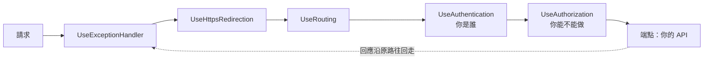

## 這是什麼

一個 HTTP 請求進到 ASP.NET Core，會依序經過好幾關：處理例外、轉 HTTPS、比對路由、驗證身分、檢查權限，最後才到你的 API 程式。每一關叫一個 **Middleware（中介軟體）**，整串叫做**請求管線**。

每個 Middleware 可以在把請求交給下一關之前做事，也可以在下一關處理完、回應往回走時做事，或者乾脆不往下傳，直接回應（短路）。

## 運作原理



Middleware 依照 `app.Use...` 的呼叫順序串起來。請求由上往下，回應由下往上。所以：

- **例外處理要在最前面**，才包得住後面所有元件丟出的例外。
- **驗證（Authentication）要在授權（Authorization）之前**，授權需要先知道使用者是誰。
- **路由要在授權之前**，授權才知道這個端點要求什麼權限。

**回應一旦開始送出就不能改標頭。** HTTP 回應的狀態碼和標頭在最前面。當端點開始寫 Body 時，ASP.NET Core 會先把狀態碼和標頭送出去，之後 `Response.HasStarted` 為 true，再修改標頭會丟出例外。

## 常見錯誤與正確寫法

### 1. 順序放錯

```csharp
// 錯：授權在驗證之前，授權時還不知道使用者是誰，所有需要登入的端點都回 401
app.UseAuthorization();
app.UseAuthentication();
```

依官方建議的順序排列（省略不需要的元件即可）：

```csharp
var app = builder.Build();

app.UseExceptionHandler();      // 最外層：接住後面所有例外
app.UseHttpsRedirection();
app.UseRouting();
app.UseCors();
app.UseAuthentication();        // 先知道你是誰
app.UseAuthorization();         // 再決定你能不能做
app.UseRateLimiter();           // 需要用到使用者身分做限流時，放在驗證之後

app.MapControllers();
app.Run();
```

### 2. 在下一關之後才加標頭

```csharp
// 錯：端點已經開始寫 Body，這時加標頭會丟出 InvalidOperationException
app.Use(async (context, next) =>
{
    await next(context);
    context.Response.Headers["X-Server-Region"] = "asia-east1";
});
```

用 `OnStarting` 登記一個回呼，ASP.NET Core 會在送出標頭之前呼叫它：

```csharp
app.Use(async (context, next) =>
{
    context.Response.OnStarting(() =>
    {
        context.Response.Headers["X-Server-Region"] = "asia-east1";
        return Task.CompletedTask;
    });
    await next(context);
});
```

### 3. 讀了 Request Body，後面就讀不到了

Request Body 是一個只能往前讀的串流。Middleware 為了記錄日誌把它讀完，後面的模型綁定就讀到空的內容。需要重複讀取時，先開啟緩衝並在讀完後倒回開頭：

```csharp
app.Use(async (context, next) =>
{
    context.Request.EnableBuffering(); // 允許重複讀取（大內容會暫存到磁碟）
    using var reader = new StreamReader(context.Request.Body, leaveOpen: true);
    var body = await reader.ReadToEndAsync(context.RequestAborted);
    context.Request.Body.Position = 0;  // 倒回開頭，讓後面的元件能讀
    // ... 記錄 body（注意不要記錄密碼、信用卡等敏感資料）
    await next(context);
});
```

記錄整個 Body 有成本也有個資風險，一般只在除錯時針對特定端點開啟。

## 使用邊界

- 和「哪個端點」有關的邏輯（例如只有某些 API 要稽核），用 [Filter](/frameworks/aspnet-core/filters/) 比 Middleware 合適，因為 Filter 知道端點與參數。
- 以類別寫的 Middleware 是 Singleton，建構子不能注入 Scoped 服務；需要 Scoped 服務時，把它放在 `InvokeAsync` 方法的參數上。
- 例外處理的回應格式見 [HTTP 契約](/frameworks/aspnet-core/http-contracts/)；放置位置的整體比較見 [橫切行為](/architecture/cross-cutting/)。
