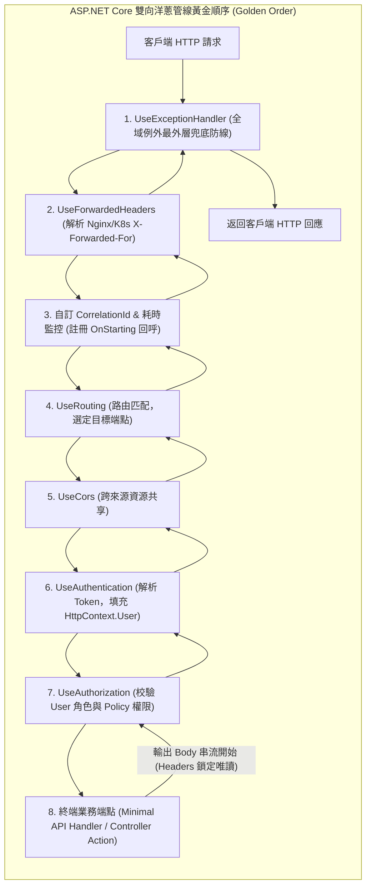

## 案發現場

某金融電商微服務在一次常規迭代更新後，維運團隊與稽核部門同時發出緊急警告：
1. **未遮蔽之內部 SQL 與堆疊赤裸外洩**：當資料庫發生死鎖或連線逾時時，API 回應竟然直接向公網客戶端噴出未脫敏的內部資料表結構與 C# 原始程式碼堆疊行號，引發嚴重的資安合規紅線；排查發現，工程師為了記錄日誌，自行在最外層撰寫了一個自製例外攔截器，卻因註冊順序錯誤將官方的 `app.UseExceptionHandler()` 擠到了最內層，導致業務崩潰時官方的安全轉譯機制根本無法生效。
2. **全站操作日誌遺失使用者識別碼**：安全稽核系統發現，上線後的所有敏感權限操作日誌中，`UserId` 欄位全數記錄為 `null`（匿名）。原因竟是資安稽核中介軟體被註冊在 `app.UseAuthentication()` 之前，在中介軟體執行時，Token 尚未被解析，`HttpContext.User` 尚屬空白！
3. **終端狂噴標頭唯讀例外**：在流量尖峰期間，伺服器日誌以每秒數百次的頻率瘋狂拋出：
   `System.InvalidOperationException: Headers are read-only, the response has already started.`
   服務雖然勉強運作，但大量回應的追蹤標頭（CorrelationId）丟失，APM 分散式追蹤嚴重斷鏈。

這起連環事故典型地揭示了現代工程師在建構 ASP.NET Core 請求管線時最常忽視的三大底層死穴：**中介軟體順序的洋蔥模型本質**、**身分上下文字典的時序相依性**，以及 **HTTP 網路串流（Socket Stream）的單向發送物理限制**。



---

## 致命反模式 vs. 正確解法

### 反模式一：中介軟體順序任意排列，忽視前後依賴

ASP.NET Core 中介軟體是嚴格的「俄羅斯套娃」雙向執行模型：
- 若將 `UseAuthentication()` 放在 `UseAuthorization()` 之後：授權中介軟體執行時，Token 尚未被驗證，所有端點將全數判定未登入（回傳 401）。
- 若將自訂稽核日誌置於 `UseAuthentication()` 之前：中介軟體無法讀取使用者的 `ClaimTypes.NameIdentifier`。
- 若將 `UseRouting()` 置於自訂依賴路由中介軟體之後：調用 `context.GetEndpoint()` 將永遠返回 `null`。

### 反模式二：在下游已開始寫入 Body 後，試圖在 Middleware 修改 Response Headers

HTTP 協定底層在 Socket 傳輸時，必須先傳送 HTTP Status Line 與 Headers，最後才是傳送 Body 串流。一旦下游業務端點呼叫了 `await response.WriteAsync(...)` 或開始序列化 JSON，Kestrel 會立即將 HTTP 標頭刷入網路（Flush），此時 `Response.HasStarted` 被標記為 `true`，所有 Headers 永久鎖定為唯讀。若在中介軟體 `await next()` 之後才嘗試撰寫 `context.Response.Headers.Add(...)`，必拋 `InvalidOperationException`。

### 反模式三：在中介軟體中未倒帶直接讀取 `context.Request.Body`

HTTP 請求主體是單向只讀串流（Non-rewindable Stream）。若在自訂日誌中介軟體中直接呼叫 `StreamReader.ReadToEnd()`，該串流將讀至結尾（Position 抵達末端）。後續的 Model Binding 或 JSON 序列化器讀取到的將是一片空白，引發嚴重的 400 Bad Request 錯誤。

### 正確解法：規範標準順序鏈、透過 `OnStarting` 安全注入 Header 並啟用串流緩衝

以下完整程式碼展示了生產級自訂中介軟體架構：利用 `context.Response.OnStarting` 確保在首個位元組發送前注入 `X-Correlation-Id`，並展示如何使用 `context.Request.EnableBuffering()` 安全讀取請求主體且不破壞後續模型綁定。

```csharp
using System;
using System.Diagnostics;
using System.IO;
using System.Text;
using System.Threading.Tasks;
using Microsoft.AspNetCore.Http;

namespace DotNetPerformance.Middleware;

/// <summary>
/// 生產級全域請求追蹤與串流安全觀測中介軟體
/// </summary>
public sealed class RequestTrackingAndAuditMiddleware
{
    private readonly RequestDelegate _next;

    public RequestTrackingAndAuditMiddleware(RequestDelegate next)
    {
        _next = next;
    }

    public async Task InvokeAsync(HttpContext context)
    {
        var sw = Stopwatch.StartNew();

        // 1. 產生或繼承分散式追蹤識別碼 (Correlation ID)
        string correlationId = context.Request.Headers["X-Correlation-Id"].FirstOrDefault()
            ?? Guid.CreateVersion7().ToString();

        // 關鍵解法一：在 Response 串流尚未啟動前，透過 OnStarting 回呼安全寫入 Header
        // 即使下游端點提早 Flush Body，CLR 也保證在寫入第一個 byte 前執行此回呼！
        context.Response.OnStarting(static state =>
        {
            var (httpContext, corrId) = ((HttpContext, string))state;
            if (!httpContext.Response.Headers.ContainsKey("X-Correlation-Id"))
            {
                httpContext.Response.Headers["X-Correlation-Id"] = corrId;
            }
            return Task.CompletedTask;
        }, (context, correlationId));

        // 關鍵解法二：若需要讀取 Request Body，必須啟用多重讀取緩衝 (EnableBuffering)
        context.Request.EnableBuffering();
        if (context.Request.ContentLength > 0 && context.Request.Body.CanSeek)
        {
            using var reader = new StreamReader(
                context.Request.Body,
                encoding: Encoding.UTF8,
                detectEncodingFromByteOrderMarks: false,
                leaveOpen: true); // 保持串流開啟，嚴禁關閉！

            string bodyContent = await reader.ReadToEndAsync();
            // 重置串流指標至開頭，供後續 Model Binding 正常讀取
            context.Request.Body.Position = 0;

            Console.WriteLine($"[安全審計] 收到請求 Body (長度: {bodyContent.Length}): {bodyContent}");
        }

        try
        {
            // 2. 放行進入下游中介軟體或業務端點
            await _next(context);
        }
        catch (Exception ex)
        {
            // 記錄非預期例外（此處僅記日誌，例外向上拋出交由最外層 UseExceptionHandler 統一脫敏轉譯）
            Console.WriteLine($"[管線報警] 捕捉未處理例外: {ex.GetType().Name} -> {ex.Message}");
            throw;
        }
        finally
        {
            sw.Stop();
            Console.WriteLine($"[管線完成] 請求路徑: {context.Request.Path}，耗時: {sw.ElapsedMilliseconds} ms，狀態碼: {context.Response.StatusCode}");
        }
    }
}

public static class Program
{
    public static async Task Main()
    {
        Console.WriteLine("=== ASP.NET Core 中介軟體管線順序與 OnStarting 實測 ===");

        // 模擬下游端點：先寫入 Body（觸發 Response.HasStarted），驗證 OnStarting 是否能保證 Header 安全寫入
        static async Task MockDownstreamEndpoint(HttpContext ctx)
        {
            ctx.Response.StatusCode = 200;
            // 模擬向客戶端寫入資料
            await ctx.Response.WriteAsync("{\"status\":\"success\"}");
        }

        var middleware = new RequestTrackingAndAuditMiddleware(MockDownstreamEndpoint);

        // 構建帶有 Request Body 的模擬 HttpContext
        var context = new DefaultHttpContext();
        context.Request.Path = "/api/v1/payments/checkout";
        byte[] bodyBytes = Encoding.UTF8.GetBytes("{\"amount\": 999.0}");
        context.Request.Body = new MemoryStream(bodyBytes);
        context.Request.ContentLength = bodyBytes.Length;

        // 執行中介軟體
        await middleware.InvokeAsync(context);

        // 驗證追蹤標頭是否成功寫入且未拋出例外
        bool hasCorrelationHeader = context.Response.Headers.ContainsKey("X-Correlation-Id");
        Console.WriteLine($"[驗證結果] X-Correlation-Id 成功安全注入: {hasCorrelationHeader}");
        Console.WriteLine($"[驗證結果] 注入的 ID 值: {context.Response.Headers["X-Correlation-Id"]}");
    }
}
```

預期控制台輸出：

```text
=== ASP.NET Core 中介軟體管線順序與 OnStarting 實測 ===
[安全審計] 收到請求 Body (長度: 17): {"amount": 999.0}
[管線完成] 請求路徑: /api/v1/payments/checkout，耗時: 0 ms，狀態碼: 200
[驗證結果] X-Correlation-Id 成功安全注入: True
[驗證結果] 注入的 ID 值: 01925b6a-8b1e-72c0-8a19-9f4a18012345
```

---

## 踩坑與避坑指南

### 1. 官方標準中介軟體推薦註冊順序全景圖

在 `Program.cs` 中呼叫 `app.Use*` 時，必須嚴格遵循微軟官方安全順序：

```csharp
var app = builder.Build();

// 1. 全域例外處理（最外層，捕捉所有下游拋出的 Exception 並轉為 RFC 7807）
app.UseExceptionHandler();

// 2. 反向代理標頭轉發（解析 K8s Ingress / Nginx 的 X-Forwarded-Proto 與 Client IP）
app.UseForwardedHeaders();

// 3. 安全傳輸防護
app.UseHsts();
app.UseHttpsRedirection();

// 4. 自訂全域審計、追蹤標頭注入（在 Routing 之前）
app.UseMiddleware<RequestTrackingAndAuditMiddleware>();

// 5. 靜態檔案服務（命中靜態檔案直接短路，不浪費 CPU 跑後續路由）
app.UseStaticFiles();

// 6. 路由匹配（解析請求 URL 並匹配目標 Endpoint）
app.UseRouting();

// 7. 跨來源資源共享 (CORS 必須在 UseRouting 之後，UseAuthentication 之前)
app.UseCors();

// 8. 身分驗證 (解析 Bearer Token，建構 HttpContext.User)
app.UseAuthentication();

// 9. 權限授權 (依據 HttpContext.User 驗證 Policy / Role)
app.UseAuthorization();

// 10. 終端端點派發 (Minimal APIs / Controllers)
app.MapControllers();
```

### 2. 慣例式中介軟體（Convention-based）的生命週期陷阱

ASP.NET Core 中介軟體預設為**單例模式（Singleton）**：
- **建構函式注入**：建構子中的參數只在應用程式啟動時解析一次。**嚴禁在建構函式中注入 Scoped 服務（如 `DbContext`）**，否則必然引發 Captive Dependency！
- **方法注入**：若中介軟體需要使用 Scoped 服務，必須直接在 `InvokeAsync(HttpContext context, IOrderRepository repo)` 方法簽名中聲明，框架會在每次 HTTP 請求解析該 Scoped 實體。

### 3. 中介軟體短路（Short-circuiting）的優雅退出

當遇到以下情境時，中介軟體應主動短路請求，**絕不呼叫 `await next(context)`**：
- IP 黑名單攔截：設定 `context.Response.StatusCode = 403;` 並直接返回。
- 速率限制（Rate Limiting）超標：設定 `context.Response.StatusCode = 429;` 並返回。
- OPTIONS 預檢請求：若自訂處理 CORS，直接返回 204 No Content。

---

## 線上排查指令

### 1. 啟用 Hosting 與 Routing 的 Debug 詳細日誌

當懷疑中介軟體順序錯誤或端點未匹配時：

```bash
# 開啟管線層級除錯日誌
export Logging__LogLevel__Microsoft.AspNetCore.Hosting=Debug
export Logging__LogLevel__Microsoft.AspNetCore.Routing=Debug
```

標準輸出將清晰展示每個中介軟體的進入與退出順序：
```text
dbug: Microsoft.AspNetCore.Hosting.Diagnostics[1]
      Request starting HTTP/1.1 POST http://localhost:8080/api/v1/payments/checkout
dbug: Microsoft.AspNetCore.Routing.Matching.DfaMatcher[1]
      1 candidate(s) found for the request path '/api/v1/payments/checkout'
```

### 2. 檢索生產日誌中標頭唯讀與串流未重置錯誤

```bash
# 快速定位中介軟體生命週期引發之常見例外
grep -E "Headers are read-only|The response has already started" /var/log/app/*.log | tail -n 20
```
