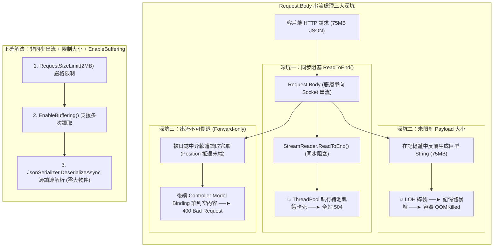

## 案發現場

某電商平台的批次匯入商品與訂單結帳端點，在黑色星期五遭遇了一次隱蔽的惡意拒絕服務（DoS）攻擊：黑客利用自動化腳本，向訂單端點以極慢的速度連續發送了數千個大小高達 75MB 的深層巢狀畸形 JSON 酬載。

由於該端點未針對單一請求限制承載大小（`MaxRequestBodySize`），Kestrel 預設將整個龐大的請求本文讀入記憶體緩衝區。微服務的 CLR Managed Heap 在數秒內配置了超過 10GB 的臨時字串物件，直接被塞爆 LOH（大型物件堆積），引發連續的 Gen 2 Full GC 全域凍結；隨後各 Pod 相繼被 Linux cgroup 判定超出 2Gi 記憶體配額，以 `Exit Code 137 (OOMKilled)` 慘烈崩潰。

屋漏偏逢連夜雨，在同系統的另一個即時防詐稽核端點中，工程師為了在自訂模型繫結器（ModelBinder）內記錄完整的客戶端未經處理原始資料，撰寫了以下程式碼：
```csharp
using var reader = new StreamReader(bindingContext.HttpContext.Request.Body);
string rawJson = reader.ReadToEnd(); // 致命同步阻塞！
```
在高並發流量湧入時，該同步 `ReadToEnd()` 呼叫直接將 ThreadPool 工作執行緒釘死在底層 Socket 的 I/O 等待中。隨著請求不斷累積，執行緒池瞬間枯竭（ThreadPool Starvation），所有非同步回呼被迫排隊，服務延遲從 20ms 斷崖式惡化至 8,000ms，全站噴發 `HTTP 504 Gateway Timeout`！

這兩起重大事故暴露了後端開發者對 ASP.NET Core **HTTP 請求本文（Request Body）底層串流機制**、**非同步 I/O 規範**以及**邊界安全防禦**的認知死角。



---

## 致命反模式 vs. 正確解法

### 反模式一：使用同步 API 讀取未受保護的 `Request.Body`

`Request.Body` 本質是單向前進（Forward-only）、不可直接 Seek 的網路 Socket 串流。
- 呼叫同步方法（如 `reader.ReadToEnd()` 或 `stream.Read()`）會直接阻塞作業系統執行緒，引發大規模 ThreadPool 飢餓。
- 讀取完成後，若未啟用多重讀取緩衝機制，串流的讀取指標會停留在結尾，後續的 MVC 模型繫結器將讀取到完全空白的資料，造成難以追蹤的業務異常。

### 反模式二：未配置 `MaxRequestBodySize`，任由巨型封包打爆記憶體

Kestrel 預設的全域請求大小上限約為 28.6MB（30,000,000 bytes），這對於普通 JSON API 而言依然過於龐大。若遇到惡意慢速上傳或超大酬載，伺服器必須配置大量實體記憶體來承載未經解析的位元組陣列，極易觸發 Linux OOM Killer。

### 反模式三：在 ModelBinder 中直接連線資料庫執行業務規則檢查

ModelBinder 的唯一職責是**協議資料解析與型別轉換**（例如將 Route、Query、Header、Body 提取並組裝成強型別 C# 物件）。在 ModelBinder 中直接注入 `DbContext` 檢查庫存或會員狀態，會打破單一職責原則（SRP），導致資料庫連線過早佔用，且在驗證失敗時無法產出標準的 RFC 7807 錯誤結構。

### 正確解法：端點限制承載大小、全面非同步串流反序列化與資料註解驗證

1. **嚴格限制端點大小**：針對 JSON 端點明確標註 `[RequestSizeLimit(1024 * 1024)]`（1MB），若超標直接在 Socket 層級回應 `413 Payload Too Large`，絕不將資料載入 Managed Heap。
2. **全程非同步串流**：使用 `JsonSerializer.DeserializeAsync(stream)`，邊由網路緩衝區讀取邊組裝物件，達成零 LOH 暫存字串配置。
3. **分層驗證**：語法約束交由 DataAnnotations，複雜領域商務驗證留給 Service / Handler。

```csharp
using System;
using System.Collections.Generic;
using System.ComponentModel.DataAnnotations;
using System.IO;
using System.Text;
using System.Text.Json;
using System.Threading.Tasks;

namespace DotNetPerformance.ModelBinding;

/// <summary>
/// 建立訂單明細資料傳輸物件（DTO）
/// </summary>
public sealed class CreateOrderItemDto
{
    [Required(ErrorMessage = "商品編號（Sku）為必填欄位")]
    [StringLength(32, MinimumLength = 3, ErrorMessage = "商品編號長度必須介於 3 到 32 個字元之間")]
    public string Sku { get; set; } = string.Empty;

    [Range(1, 100, ErrorMessage = "單次購買數量必須介於 1 到 100 件之間")]
    public int Quantity { get; set; }

    [Range(0.01, 100000.0, ErrorMessage = "商品單價超出合理業務範圍")]
    public decimal UnitPrice { get; set; }
}

/// <summary>
/// 安全非同步串流解碼與驗證輔助器
/// </summary>
public static class SafeStreamBindingHelper
{
    private static readonly JsonSerializerOptions _jsonOptions = new()
    {
        PropertyNameCaseInsensitive = true
    };

    /// <summary>
    /// 從不可倒帶的串流中非同步串流解析 DTO 並執行宣告型資料註解驗證
    /// </summary>
    public static async Task<(CreateOrderItemDto? Model, List<ValidationResult> Errors)> BindAndValidateAsync(Stream requestBodyStream)
    {
        // 1. 全程非同步串流反序列化（零大型暫存 String 配置）
        CreateOrderItemDto? model = await JsonSerializer.DeserializeAsync<CreateOrderItemDto>(
            requestBodyStream,
            _jsonOptions);

        var validationErrors = new List<ValidationResult>();

        if (model is null)
        {
            validationErrors.Add(new ValidationResult("無法由請求串流中反序列化有效的 JSON 資料"));
            return (null, validationErrors);
        }

        // 2. 執行 DataAnnotations 宣告式驗證
        var validationContext = new ValidationContext(model);
        Validator.TryValidateObject(model, validationContext, validationErrors, validateAllProperties: true);

        return (model, validationErrors);
    }
}

public static class Program
{
    public static async Task Main()
    {
        Console.WriteLine("=== ASP.NET Core 模型繫結與非同步串流驗證實測 ===");

        // 測試一：合規的非同步串流輸入
        string validJson = "{\"sku\": \"PROD-IPHONE-16\", \"quantity\": 2, \"unitPrice\": 29900.0}";
        using (var stream1 = new MemoryStream(Encoding.UTF8.GetBytes(validJson)))
        {
            var (model, errors) = await SafeStreamBindingHelper.BindAndValidateAsync(stream1);
            Console.WriteLine($"[案例一: 合法輸入] Sku: {model?.Sku}, 驗證通過: {errors.Count == 0}");
        }

        // 測試二：欄位不合規的串流輸入（觸發 DataAnnotations 驗證失敗）
        string invalidJson = "{\"sku\": \"\", \"quantity\": 999, \"unitPrice\": -10.0}";
        using (var stream2 = new MemoryStream(Encoding.UTF8.GetBytes(invalidJson)))
        {
            var (model, errors) = await SafeStreamBindingHelper.BindAndValidateAsync(stream2);
            Console.WriteLine($"\n[案例二: 非法輸入] 驗證通過: {errors.Count == 0}，捕捉錯誤筆數: {errors.Count}");
            foreach (var err in errors)
            {
                Console.WriteLine($"  - 錯誤欄位 [{string.Join(",", err.MemberNames)}]: {err.ErrorMessage}");
            }
        }
    }
}
```

預期控制台輸出：

```text
=== ASP.NET Core 模型繫結與非同步串流驗證實測 ===
[案例一: 合法輸入] Sku: PROD-IPHONE-16, 驗證通過: True

[案例二: 非法輸入] 驗證通過: False，捕捉錯誤筆數: 3
  - 錯誤欄位 [Sku]: 商品編號（Sku）為必填欄位
  - 錯誤欄位 [Quantity]: 單次購買數量必須介於 1 到 100 件之間
  - 錯誤欄位 [UnitPrice]: 商品單價超出合理業務範圍
```

---

## 踩坑與避坑指南

### 1. 嚴格配置 Request Body 大小上限

在微服務架構中，必須在全域與特定端點雙重收緊請求大小限制：

```csharp
// 1. 全域限制 Kestrel 預設最大請求大小為 2MB (預設約 28.6MB 過於寬鬆)
builder.WebHost.ConfigureKestrel(serverOptions =>
{
    serverOptions.Limits.MaxRequestBodySize = 2 * 1024 * 1024; // 2MB
});

// 2. 在需要大檔案上傳的特定端點 (如圖片或影片) 單獨放寬限制
app.MapPost("/api/v1/files/upload", async (IFormFile file) =>
{
    // 處理上傳
    return Results.Ok();
})
.DisableAntiforgery()
.WithMetadata(new RequestSizeLimitAttribute(50 * 1024 * 1024)); // 單獨放寬至 50MB
```

### 2. 多次讀取 `Request.Body` 的黃金 SOP：`EnableBuffering`

若因資安稽核中介軟體非得在模型繫結前讀取原始 JSON，必須遵守以下標準流程：

```csharp
// 中介軟體內部
context.Request.EnableBuffering(); // 1. 啟用磁碟/記憶體交換緩衝區

// 2. 保持串流開啟 (leaveOpen: true)，嚴禁 Dispose Request.Body！
using (var reader = new StreamReader(context.Request.Body, Encoding.UTF8, leaveOpen: true))
{
    string rawPayload = await reader.ReadToEndAsync();
    // 進行安全檢驗...
}

// 3. 關鍵：重置串流讀取位置為 0，供下游 Model Binding 正常讀取
context.Request.Body.Position = 0;
await next(context);
```

### 3. C# 12+ 可為 Null 參考型別（NRT）與 `[Required]` 的語意差異

在啟用了 `<Nullable>enable</Nullable>` 的專案中：
- `public string Sku { get; set; } = string.Empty;`：若客戶端在 JSON 中未傳遞 `sku` 欄位，它會維持預設的空字串 `""`，此時純 `[Required]` 特性若未搭配 `AllowEmptyStrings = false` 可能會被略過！
- 最佳防禦實踐：使用 C# 11+ `required` 關鍵字（`public required string Sku { get; set; }`），或者在 DTO 欄位明確聲明為 `public string? Sku { get; set; }` 並標註 `[Required]`，強制反序列化器在缺少該鍵時拋出明確校驗錯誤。

---

## 線上排查指令

### 1. 檢索生產日誌中 413 Payload Too Large 與 BadHttpRequestException

快速檢視系統是否正面臨超大封包灌流：

```bash
# 檢索 Kestrel 因超過 MaxRequestBodySize 而阻斷之例外
grep -E "413 Payload Too Large|Request body too large|BadHttpRequestException" /var/log/app/*.log | tail -n 20
```

### 2. 即時監控 Kestrel 請求位元組接收速率與連線數

使用 `dotnet-counters` 觀察微服務當前流量負載：

```bash
# 監控 Kestrel 接收位元組速率與佇列
dotnet-counters monitor Microsoft.AspNetCore.Server.Kestrel \
  --counters current-connections,bytes-received-rate,request-queue-length \
  --process-id $(pgrep -n -f "dotnet.*YourService")
```

指標判斷要點：
- 若 `bytes-received-rate` 急速飆升但 `request-queue-length` 堆積：代表客戶端正在灌入超大 Request Body，需檢查 `RequestSizeLimit` 配置。
