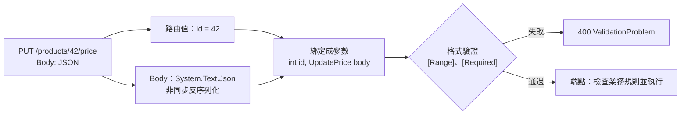

## 這是什麼

`PUT /products/42/price` 帶著 JSON `{ "price": 120, "currency": "TWD" }`。端點需要的是 `int id` 和一個 `UpdatePrice` 物件。**模型綁定**就是 ASP.NET Core 自動做的這件事：從網址、查詢字串、標頭、Body 找到資料，轉成方法參數的型別。

轉好之後還要檢查內容合不合法，例如價格不能是負數，這是**驗證**。

## 運作原理



參數來源的預設規則：

- 路由範本裡出現的名稱 → 從路由取（`{id}` → `id`）。
- 簡單型別（`int`、`string`）→ 從查詢字串取。
- 複雜型別 → 從 Body 的 JSON 取。

不確定時可以明確標註 `[FromRoute]`、`[FromQuery]`、`[FromBody]`、`[FromHeader]`。

Controller 加上 `[ApiController]` 時，驗證失敗會自動回 400。Minimal API 從 .NET 10 起可以用 `builder.Services.AddValidation()` 開啟內建驗證；更早的版本要自己在端點或 Endpoint Filter 裡驗證。

## 常見錯誤與正確寫法

### 1. 沒有限制請求大小

Kestrel 預設允許約 28.6 MB（30,000,000 位元組）的 Body。一個只需要幾 KB 的下單 API，如果被送進幾十 MB 的 JSON，反序列化時會配置大量記憶體。依端點設定合理的上限：

```csharp
// Controller：單一 action 的上限
[HttpPost]
[RequestSizeLimit(64 * 1024)] // 64 KB
public Task<IActionResult> PlaceOrder(PlaceOrderRequest request, CancellationToken ct) => ...;

// Minimal API：用相同的屬性當作中繼資料
app.MapPost("/orders", PlaceOrder).WithMetadata(new RequestSizeLimitAttribute(64 * 1024));
```

超過上限時回應 413。上傳商品圖片這種真的需要大內容的端點，個別放寬上限，並改用串流寫到物件儲存，不要整個讀進記憶體。

### 2. 同步讀取 Request Body

```csharp
// 錯：同步讀取會佔住執行緒；ASP.NET Core 預設也禁止同步 I/O，會直接丟出例外
var json = new StreamReader(Request.Body).ReadToEnd();
```

讓框架綁定就好；真的要自己讀，用非同步 API：

```csharp
var order = await JsonSerializer.DeserializeAsync<PlaceOrderRequest>(Request.Body, cancellationToken: ct);
```

### 3. 在模型綁定或驗證裡查資料庫

「商品是否存在」「庫存是否足夠」需要查資料庫，這是業務規則，不是格式驗證。放在自訂 ModelBinder 或驗證屬性裡，會讓每次綁定都做 I/O，而且錯誤只能回成 400。

分兩層處理：

```csharp
public sealed record PlaceOrderRequest(
    [property: Required] Guid? ProductId,   // 用 Guid?：缺少欄位時是 null，[Required] 才擋得下
    [property: Range(1, 99)] int Quantity); // 格式：交給驗證

// 業務規則：在用例裡檢查，回應有意義的錯誤
var product = await db.Products.FindAsync([request.ProductId!.Value], ct);
if (product is null) return TypedResults.Problem(statusCode: 404, title: "商品不存在");
if (product.Stock < request.Quantity) return TypedResults.Problem(statusCode: 409, title: "庫存不足");
```

## 使用邊界

- 可為 null 的參考型別只在編譯期提醒；請求少了欄位時屬性仍會是 null。用 `required` 或 `[Required]` 讓綁定階段就擋下，見 [語法陷阱速查](/languages/csharp/syntax-traps/)。
- 不要讓用戶端決定伺服器端的欄位，例如價格、訂單狀態、使用者 ID。請求模型只放用戶端能提供的欄位，避免大量指派（mass assignment）的風險；資料擁有權的檢查見 [驗證與授權](/security/authentication/)。
- 錯誤回應的格式統一用 Problem Details，見 [HTTP 契約](/frameworks/aspnet-core/http-contracts/)。
