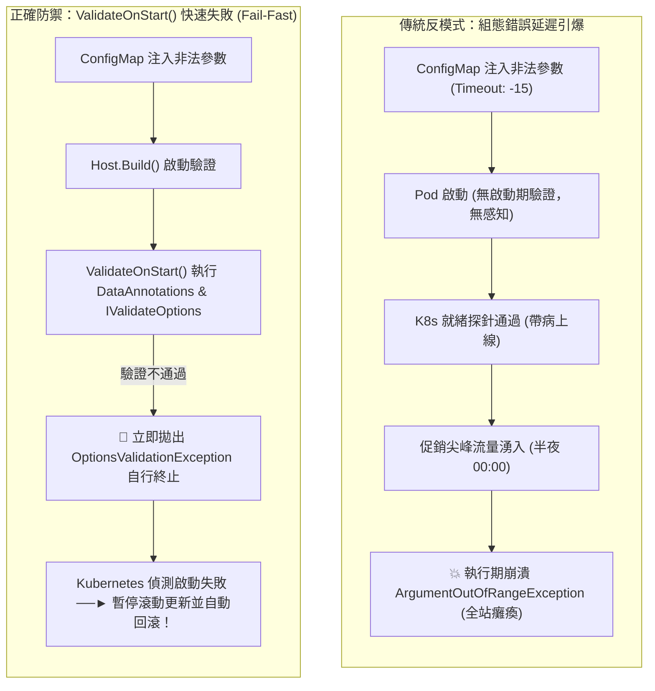

## 案發現場

某跨境電商核心支付微服務在大促前夕進行了一次緊湊的發布。維運團隊在 Kubernetes ConfigMap 中配置金流閘道參數時，誤將連線逾時秒數打成了負數（`-15`），且金流 API 端點網址的通訊協定漏打了前綴（寫成 `prod.payment.internal` 而非 `https://...`）。

令人驚訝的是，新版本的 Pod 順利啟動並通過了 Kubernetes 的 Liveness 與 Readiness 健康探針，所有 Pod 均顯示為綠色 Running 狀態，發布流程被判定為「完美成功」。直到半夜 00:00 促銷開跑、首批上萬筆顧客扣款請求湧入時，系統在深層的 HTTP 客戶端建立邏輯處，突然連續爆發大量的 `System.ArgumentOutOfRangeException: Timeout must be greater than zero` 以及 `System.UriFormatException: Invalid URI: The format of the URI could not be determined`！全站扣款通道瞬間癱瘓，造成了數千萬元的直接營收損失。

雪上加霜的是，在該團隊試圖緊急修改組態時，一名工程師在一個長壽命的 Singleton 背景清算服務中注入了 `IOptionsSnapshot<PaymentOptions>`。服務在重啟的第一秒鐘直接崩潰，伺服器日誌狂噴：
`System.InvalidOperationException: Cannot consume scoped service 'Microsoft.Extensions.Options.IOptionsSnapshot<PaymentOptions>' from singleton 'SettlementBackgroundService'.`

這起典型慘劇揭露了 .NET 系統在處理應用程式組態時最容易觸發的兩大盲區：
1. **缺乏啟動期「快速失敗（Fail-Fast）」驗證**：錯誤的設定潛伏在系統內部，直到流量抵達特定的深層業務邏輯才引爆。
2. **對 Options 模式三大介面的生命週期與邊界混淆**：在 Singleton 服務中誤用 Scoped 選項介面引發 Captive Dependency 崩潰。



---

## 致命反模式 vs. 正確解法

### 反模式一：缺少啟動期驗證，將組態錯誤留至運行期爆發

若未開啟 `ValidateOnStart()`，即使組態值（如連線字串、金鑰、逾時）為 `null` 或嚴重非法，ASP.NET Core 也能正常構建並開啟 HTTP 監聽埠。這會使本可在部署流水線中被攔截的組態缺陷，延遲到生產尖峰流量時全面暴雷。

### 反模式二：在 Singleton 服務中直接注入 Scoped 的 `IOptionsSnapshot<T>`

`IOptionsSnapshot<T>` 是專為每個 HTTP 請求獨立重新計算設計的 **Scoped 服務**。若在單例服務（如 `BackgroundService` 或全域記憶體快取管理器）的建構函式中注入它，在開啟 DI 範圍驗證（`ValidateScopes = true`）時，應用程式將在構建階段直接因 Captive Dependency 宣告崩潰。

### 正確解法：啟用 `ValidateOnStart()`，並依生命週期精確選用 Options 三劍客

1. **生命週期分工**：
   - `IOptions<T>`（Singleton）：讀取一次後固定，效能最極致，無動態重載開銷。
   - `IOptionsSnapshot<T>`（Scoped）：每個 HTTP 請求重新讀取，專門用於 Controller / Minimal API 請求管線。
   - `IOptionsMonitor<T>`（Singleton）：全域單例，支援動態熱更新與 `OnChange` 監聽器，專門用於 Singleton 服務。
2. **啟動驗證防禦**：使用 `.ValidateDataAnnotations().ValidateOnStart()` 將驗證提前至服務啟動的第 1 秒。

```csharp
using System;
using System.Collections.Generic;
using System.ComponentModel.DataAnnotations;
using Microsoft.Extensions.Configuration;
using Microsoft.Extensions.DependencyInjection;
using Microsoft.Extensions.Options;

namespace DotNetPerformance.OptionsPattern;

/// <summary>
/// 金流閘道強型別組態物件
/// </summary>
public sealed class PaymentGatewayOptions
{
    public const string SectionName = "PaymentGateway";

    [Required(ErrorMessage = "金流服務端點（GatewayUrl）為必填項目")]
    [Url(ErrorMessage = "金流服務端點必須為合法 HTTP/HTTPS 網址")]
    public string GatewayUrl { get; set; } = string.Empty;

    [Range(1, 60, ErrorMessage = "逾時時間必須介於 1 到 60 秒之間")]
    public int TimeoutSeconds { get; set; } = 30;

    public bool EnableSandboxMock { get; set; }

    public string? MerchantSecretKey { get; set; }
}

/// <summary>
/// 自訂進階語意驗證器（跨欄位依賴檢驗）
/// </summary>
public sealed class PaymentGatewayOptionsValidator : IValidateOptions<PaymentGatewayOptions>
{
    public ValidateOptionsResult Validate(string? name, PaymentGatewayOptions options)
    {
        // 跨欄位業務邏輯：若非 Sandbox 測試模式，則必須提供長度不低於 32 碼的生產密鑰
        if (!options.EnableSandboxMock)
        {
            if (string.IsNullOrWhiteSpace(options.MerchantSecretKey) || options.MerchantSecretKey.Length < 32)
            {
                return ValidateOptionsResult.Fail("在生產模式下（EnableSandboxMock = false），MerchantSecretKey 必須大於等於 32 碼！");
            }
        }

        return ValidateOptionsResult.Success;
    }
}

public static class Program
{
    public static void Main()
    {
        Console.WriteLine("=== ASP.NET Core Options 模式與 ValidateOnStart 防禦實測 ===");

        // 模擬合法生產組態
        var validConfigData = new Dictionary<string, string?>
        {
            ["PaymentGateway:GatewayUrl"] = "https://secure.payment.internal/v1",
            ["PaymentGateway:TimeoutSeconds"] = "20",
            ["PaymentGateway:EnableSandboxMock"] = "false",
            ["PaymentGateway:MerchantSecretKey"] = "production_super_secret_key_1234567890_verified"
        };

        var config = new ConfigurationBuilder()
            .AddInMemoryCollection(validConfigData)
            .Build();

        var services = new ServiceCollection();

        // 註冊 Options、資料註解驗證、進階邏輯驗證與啟動期驗證
        services.AddOptions<PaymentGatewayOptions>()
            .Bind(config.GetSection(PaymentGatewayOptions.SectionName))
            .ValidateDataAnnotations()
            .ValidateOnStart();

        // 註冊自訂跨欄位驗證器
        services.AddSingleton<IValidateOptions<PaymentGatewayOptions>, PaymentGatewayOptionsValidator>();

        using ServiceProvider serviceProvider = services.BuildServiceProvider();

        // 驗證解析強型別組態
        var options = serviceProvider.GetRequiredService<IOptions<PaymentGatewayOptions>>().Value;
        Console.WriteLine($"[組態檢驗通過] 端點: {options.GatewayUrl}");
        Console.WriteLine($"[組態檢驗通過] 逾時: {options.TimeoutSeconds} 秒");
        Console.WriteLine($"[組態檢驗通過] 生產密鑰長度: {options.MerchantSecretKey?.Length} 碼");

        // 驗證 Singleton 與 IOptionsMonitor 配合
        var monitor = serviceProvider.GetRequiredService<IOptionsMonitor<PaymentGatewayOptions>>();
        Console.WriteLine($"[IOptionsMonitor 當前值] {monitor.CurrentValue.GatewayUrl}");
        Console.WriteLine("全域 ValidateOnStart 防禦機制已生效，杜絕一切帶病上線隱患。");
    }
}
```

預期控制台輸出：

```text
=== ASP.NET Core Options 模式與 ValidateOnStart 防禦實測 ===
[組態檢驗通過] 端點: https://secure.payment.internal/v1
[組態檢驗通過] 逾時: 20 秒
[組態檢驗通過] 生產密鑰長度: 49 碼
[IOptionsMonitor 當前值] https://secure.payment.internal/v1
全域 ValidateOnStart 防禦機制已生效，杜絕一切帶病上線隱患。
```

---

## 踩坑與避坑指南

### 1. Options 三劍客選型矩陣與記憶體邊界

| 介面 | 生命週期 | 支援動態熱重載？ | 能否注入 Singleton 服務？ | 適用場景 |
| :--- | :--- | :--- | :--- | :--- |
| **`IOptions<T>`** | Singleton | **否**（首次讀取後永久固定） | **可以** | 基礎設施連線字串、日誌級別、應用程式識別碼等生命週期內不變的靜態設定。 |
| **`IOptionsSnapshot<T>`** | Scoped | **是**（每個 HTTP 請求獨立快照） | **嚴禁注入**（引發 Captive Dependency） | Controller 或 Minimal API 等短請求管線，可即時感知 ConfigMap 更新。 |
| **`IOptionsMonitor<T>`** | Singleton | **是**（隨時透過 `CurrentValue` 取得最新值） | **可以** | `BackgroundService`、全域快取管理器、動態功能開關（Feature Flags）、即時限流閾值。 |

### 2. 避免對不可變基礎設施進行「熱重載（Hot Reload）」

雖然 `IOptionsMonitor` 支援動態監聽變更（`monitor.OnChange(opts => ...)`），但在面對**底層有狀態資源**時應極度謹慎：
- **狀態撕裂風險**：若在執行期動態修改資料庫 `ConnectionString` 或 Redis 密碼，既有的 `DbConnectionPool` 與 `ConnectionMultiplexer` 並不會自動銷毀既有連線，這會導致進行中的長交易與新請求使用不同的連線池，引發難以預期的髒讀與連線洩漏。
- **最佳實踐**：基礎設施連線變更一律應透過 Kubernetes Pod 滾動重啟（Rolling Restart）進行發布。

### 3. 具名選項（Named Options）的多租戶分流實踐

當系統需要同時對接多個第三方金流（如 Stripe 與 PayPal）時，可宣告具名選項：

```csharp
// 註冊具名選項
services.Configure<PaymentOptions>("Stripe", config.GetSection("Payment:Stripe"));
services.Configure<PaymentOptions>("PayPal", config.GetSection("Payment:PayPal"));

// 在端點中依名稱獲取對應組態
app.MapGet("/checkout/{provider}", (string provider, IOptionsSnapshot<PaymentOptions> optionsSnapshot) =>
{
    PaymentOptions options = optionsSnapshot.Get(provider);
    return Results.Ok(new { endpoint = options.GatewayUrl });
});
```

---

## 線上排查指令

### 1. 檢索 Pod 啟動初期是否拋出 `OptionsValidationException`

當 Kubernetes Deployment 更新後 Pod 陷入 `CrashLoopBackOff` 時，第一時間調閱啟動記錄：

```bash
# 1. 檢索前一個崩潰容器的選項驗證失敗例外
kubectl logs <pod-name> --previous | grep -A 10 "OptionsValidationException"

# 2. 檢視當前已掛載的 ConfigMap / Secret 內容是否符合規範
kubectl get configmap <configmap-name> -o yaml
```

### 2. 印出 Configuration Debug View 檢驗數值覆蓋來源

在除錯或排查端點中輸出完整的組態鍵值與提供者來源：

```csharp
// 在排查診斷端點中執行
var configRoot = (IConfigurationRoot)app.Services.GetRequiredService<IConfiguration>();
Console.WriteLine(configRoot.GetDebugView());
```
輸出會明確標示某個選項到底是被 `appsettings.json`、`EnvironmentVariables` 還是命令列引數所給定。
