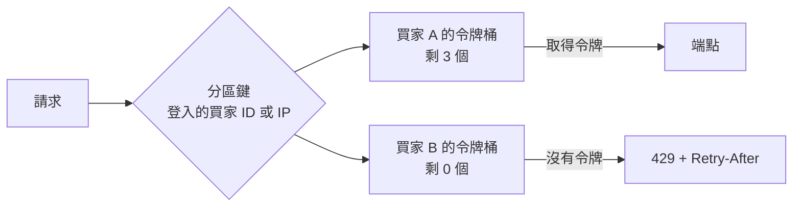

## 這是什麼

限時搶購開始的那一秒，某些用戶端（或惡意腳本）每秒送出上百個請求。如果全部照單全收，資料庫連線被佔滿，其他正常的買家也買不到。

**限流**（rate limiting）是在入口限制「某個對象在一段時間內能送多少請求」，超過的直接拒絕，回應 `429 Too Many Requests`。它保護的是兩件事：系統本身不被壓垮，以及資源公平地分給每一位買家。

ASP.NET Core 從 .NET 7 起內建限流中介軟體，不需要額外套件。

## 運作原理



內建四種演算法：

| 演算法 | 規則 | 適合 |
| --- | --- | --- |
| 固定時間窗 | 每分鐘最多 N 次，每分鐘重新計算 | 簡單的上限；窗口交界處可能短時間內通過 2N |
| 滑動時間窗 | 把窗口切成幾段，平滑地計算 | 比固定時間窗平均 |
| 令牌桶 | 桶子以固定速度補充令牌，每個請求取一個；允許短暫的突發 | 一般 API，最常用 |
| 並行限制 | 同時進行中的請求最多 N 個 | 保護昂貴的下游（例如資料庫），見 [連線池預算](/data-access/pool-capacity/) |

**分區**：同一個規則可以依「誰」分開計數，例如每個登入的買家各有自己的令牌桶，一位買家用完不影響其他人。

## 常見錯誤與正確寫法

### 1. 全站共用一個計數器

所有人共用「每秒 1000 次」，一個惡意用戶端就能把額度用光，正常買家全部被擋。依登入的買家分區，未登入的依 IP：

```csharp
builder.Services.AddRateLimiter(options =>
{
    options.RejectionStatusCode = StatusCodes.Status429TooManyRequests;

    options.AddPolicy("per-buyer", httpContext =>
    {
        var buyerId = httpContext.User.FindFirstValue(ClaimTypes.NameIdentifier);
        var key = buyerId ?? httpContext.Connection.RemoteIpAddress?.ToString() ?? "unknown";
        return RateLimitPartition.GetTokenBucketLimiter(key, _ => new TokenBucketRateLimiterOptions
        {
            TokenLimit = 20,                                  // 最多累積 20 個：允許短暫的連續操作
            TokensPerPeriod = 10,                             // 每秒補 10 個
            ReplenishmentPeriod = TimeSpan.FromSeconds(1),
            QueueLimit = 0,                                   // 不排隊，直接拒絕
        });
    });

    options.OnRejected = (context, ct) =>
    {
        if (context.Lease.TryGetMetadata(MetadataName.RetryAfter, out var retryAfter))
        {
            context.HttpContext.Response.Headers.RetryAfter = ((int)retryAfter.TotalSeconds).ToString();
        }
        return ValueTask.CompletedTask;
    };
});

app.UseRateLimiter();
app.MapPost("/orders", PlaceOrder).RequireRateLimiting("per-buyer");
```

在負載平衡器後面，`RemoteIpAddress` 是負載平衡器的 IP；要先啟用 Forwarded Headers 才拿得到真實的用戶端 IP，見 [一筆請求的網路路徑](/infrastructure/containers-networking/request-path/)。

### 2. 拒絕時沒告訴用戶端什麼時候再試

只回 429，用戶端只能猜，常見的結果是立刻重試，讓情況更糟。帶上 `Retry-After` 標頭（如上例），讓用戶端和 HTTP 彈性策略知道要等多久，見 [HTTP 彈性策略](/frameworks/aspnet-core/http-resilience/)。

### 3. 以為應用程式內的限流就是全站限流

內建限流的計數存在每個 Pod 的記憶體裡。部署 10 個 Pod、每個 Pod 限制每秒 10 次，一位買家實際上最多可能每秒通過 100 次（請求被分散到不同 Pod）。這對「保護這個 Pod 不被壓垮」足夠，但不是精確的全站限制。需要精確的跨 Pod 限制時，計數要放在共用的地方（例如 Redis，見 [Redis 併發控制](/infrastructure/redis/concurrency/)），代價是每個請求多一次網路往返。

## 使用邊界

- **在最外層先擋。** 明顯的濫用（單一 IP 每秒數千次）在負載平衡器的 WAF 就擋掉，不要讓它進到應用程式：GKE 用 Cloud Armor 的速率限制規則，EKS 用 AWS WAF 的速率型規則掛在 ALB 上。應用程式內的限流處理的是「已登入使用者」這類需要業務資訊的規則。
- 限流不能取代容量規劃。大促的正常流量本來就很高，要先確定系統撐得住，再用限流處理超出的部分。
- 限流與庫存保護是兩回事：限流讓請求變少，不保證不超賣；扣庫存仍要靠資料庫的條件更新，見 [樂觀並行與庫存競爭](/data-access/concurrency/)。
- 依業務流程的濫用（例如大量搶購轉賣）屬於 API 安全的範圍，見 [API 安全風險](/security/api-risks/)。
