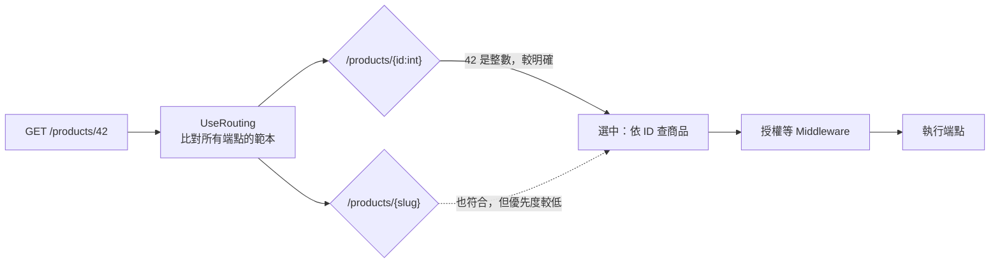

## 這是什麼

買家打 `GET /products/42`，ASP.NET Core 要決定這個請求交給哪一段程式處理。這個「網址對應到程式」的過程叫**路由**，負責處理的那段程式叫**端點**（endpoint），例如一個 Controller action 或一個 `MapGet` 委派。

路由範本裡可以加上**約束**，例如 `{id:int}` 表示這一段必須是整數，用來區分長得很像的網址。

## 運作原理



`UseRouting` 先選出端點，把結果放在 `HttpContext` 上，後面的授權、CORS 等 Middleware 才知道這個端點要求什麼。真正執行端點是在管線的最後。

當兩個範本都符合時，路由會選比較明確的那一個（例如有約束的、字面值多的）。如果無法分出高下，就丟出 `AmbiguousMatchException`，回應 500。

## 常見錯誤與正確寫法

### 1. 兩個範本分不出誰優先

```csharp
// 錯：/orders/abc 兩個都符合，執行時丟出 AmbiguousMatchException
app.MapGet("/orders/{id}", GetById);
app.MapGet("/orders/{code}", GetByCode);
```

用約束或不同的字面值把它們分開：

```csharp
app.MapGet("/orders/{id:guid}", GetById);            // 只接受 GUID
app.MapGet("/orders/by-code/{code}", GetByCode);     // 用字面值區分
```

### 2. 用約束檢查業務規則

```csharp
// 錯：數量超過 99 時回 404「找不到」，用戶端以為網址錯了
app.MapPost("/cart/items/{quantity:range(1,99)}", AddItem);
```

約束不符合時，路由會當作「沒有這個端點」，回應 404。數量太大是業務規則，應該進到端點後檢查，回應 400 或 422 並說明原因：

```csharp
app.MapPost("/cart/items", (AddCartItem request) =>
    request.Quantity is < 1 or > 99
        ? Results.ValidationProblem(new Dictionary<string, string[]>
            { ["quantity"] = ["數量必須介於 1 到 99"] })
        : Results.Ok());
```

### 3. 用複雜的正規表示式當約束

`{sku:regex(...)}` 每個請求都要執行一次正規表示式。寫得不好的正規表示式在特定輸入下可能耗費大量 CPU（ReDoS）。能用內建約束（`int`、`guid`、`alpha`、`length`）就用內建的；格式驗證放到端點裡做。

### 4. 每個端點都重複寫前綴與設定

```csharp
// 用路由群組整理：共用前綴、授權、標籤
var orders = app.MapGroup("/api/orders")
    .RequireAuthorization()
    .WithTags("Orders");

orders.MapGet("/{id:guid}", GetById);
orders.MapPost("/", PlaceOrder);
```

## 使用邊界

- 路由約束是「選端點」用的，不是驗證用的。它只該讓「網址格式根本不對」的請求得到 404。
- 網址大小寫預設不分；需要統一產生的連結格式時，設定 `RouteOptions.LowercaseUrls`。
- 參數怎麼從網址、查詢字串和 Body 取得，見 [模型綁定](/frameworks/aspnet-core/model-binding/)；錯誤回應的格式見 [HTTP 契約](/frameworks/aspnet-core/http-contracts/)。
