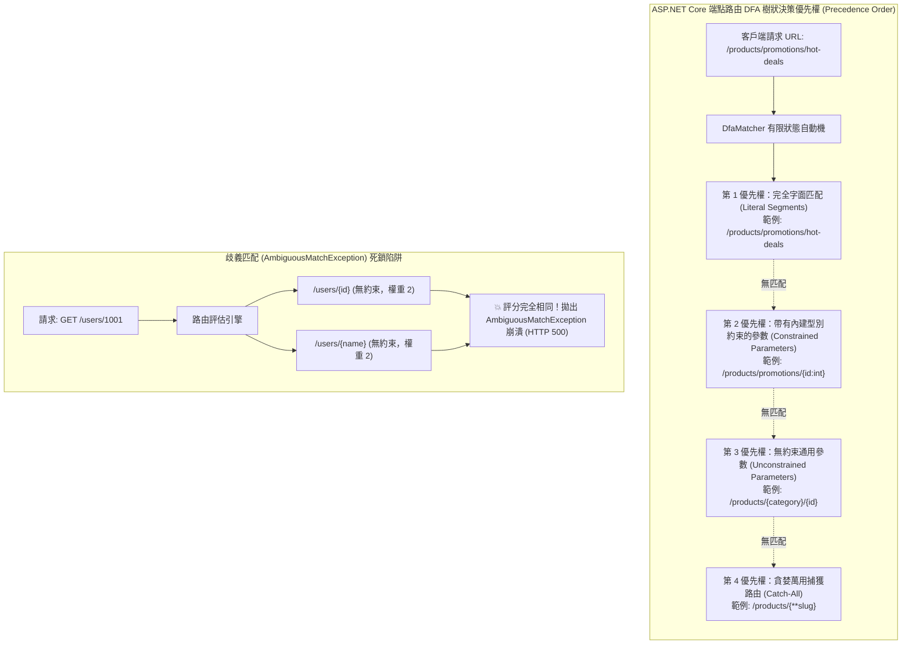

## 案發現場

某快速迭代的電商微服務在版本更新後，線上爆發了極度詭異的呼叫失敗：前端工程師回報，在查詢促銷活動特別清單 `GET /api/products/promotions/hot-deals` 時，伺服器竟然隨機回傳 `HTTP 404 Not Found (商品不存在)`；更糟的是，在另一個高頻用戶中心端點，當呼叫 `GET /api/users/9988` 時，伺服器連續狂噴 HTTP 500 內部崩潰，APM 監控捕獲了致命的：
`Microsoft.AspNetCore.Routing.Matching.AmbiguousMatchException: The request matched multiple endpoints. Matches: UsersController.GetById, UsersController.GetByName`

事故調查小組檢視控制器定義，發現該微服務的路由宣告如下：
```csharp
[HttpGet("products/{category}/{id}")] // 端點 A
public IActionResult GetByCategory(string category, string id) { ... }

[HttpGet("products/promotions/{slug}")] // 端點 B
public IActionResult GetPromotion(string slug) { ... }
```
由於端點 A 未在 `{id}` 參數上加入型別約束，端點路由比對引擎在處理 `/products/promotions/hot-deals` 時，無法判定靜態區段與動態參數的優先權，或者錯誤地將 `promotions` 視為 category、將 `hot-deals` 視為 id，導致促銷端點被商品端點無情遮蔽（Route Masking）！而在用戶控制器中，工程師宣告了 `users/{id}` 與 `users/{name}` 兩個無約束路由，路由器評估兩者權重完全相等，觸發了嚴重的**歧義匹配崩潰（AmbiguousMatchException）**。

更令架構團隊震驚的是，在同一個服務的舊版代碼中，工程師為了檢驗身分證號碼與手機格式，在數十個路由參數上標註了自定義的複雜正則表達式（Regex Constraint）。在一次黑色星期五促銷壓測中，攻擊者傳入特定精心構造的超長畸形字串，直接觸發了正則表達式災難性回溯（ReDoS），將伺服器 CPU 打滿至 100%，引發嚴重服務拒絕。

這起事故深刻證明：**端點路由不僅是字串路徑的映射，更是一個基於確定有限狀態自動機（DFA）的高效能樹狀決策系統**。忽視路由約束（Route Constraints）的職責邊界與比對優先權，將直接瓦解系統的穩定性。



---

## 致命反模式 vs. 正確解法

### 反模式一：無約束動態參數引發歧義衝突（AmbiguousMatchException）

當多個路由在相同層級宣告了未加約束的參數（例如 `GET /orders/{id}` 與 `GET /orders/{orderNo}`），端點路由引擎在計算 DFA 比對得分時判定兩者完全相等。一旦有請求命中該模式，ASP.NET Core 為了防止調用錯誤方法，會直接拋出 `AmbiguousMatchException` 中斷請求，導致全站噴發 HTTP 500。

### 反模式二：在路由約束中編寫昂貴的未快取正則，誘發 ReDoS 漏洞

在路由模式中直接撰寫 `"{phone:regex(^1[3-9]\\d{9}$)}"` 或複雜的巢狀正則，會讓每次 HTTP 請求在路由解析階段執行 CPU 密集的字串比對。若遇到惡意構造的畸形 URL，極易引發災難性回溯（Catastrophic Backtracking），耗盡伺服器算力。

### 反模式三：將商務規則驗證塞入路由約束，引發「誤報 404」反模式

路由約束（Route Constraint）的**唯一職責是消歧義（Disambiguation）**，決定哪個端點該處理該請求。若在路由中強加業務約束（例如 `{age:min(18)}` 或 `{status:alpha}`）：
- 當使用者輸入 `age=16` 時，路由引擎判定不匹配，直接回傳 `HTTP 404 Not Found`！
- 用戶端與前端工程師會誤以為「該 API 網址不存在或路徑拼錯」，徹底違背 REST 語意。正確做法應放行進入端點，並由 Model Validation 回傳明確的 `HTTP 422 Unprocessable Entity` 指出年齡未達法定標準。

### 正確解法：全面擁抱內建高速型別約束，杜絕歧義並將業務校驗分層

1. **優先使用內建型別約束**：在參數後綴標註 `:int`、`:long`、`:guid` 等。底層直接調用 `int.TryParse` 等高速 CPU 指令，開銷趨近於零且杜絕歧義。
2. **路由約束只管分派，領域驗證交由 DTO**：保持路由乾淨，業務校驗留給 DataAnnotations 或 FluentValidation。

```csharp
using System;
using System.Text.RegularExpressions;
using Microsoft.AspNetCore.Http;
using Microsoft.AspNetCore.Routing;

namespace DotNetPerformance.Routing;

/// <summary>
/// 高效能路由消歧義與型別約束驗證
/// </summary>
public static class RouteDisambiguationEngine
{
    /// <summary>
    /// 模擬端點路由選擇判定邏輯
    /// </summary>
    public static string ResolveEndpoint(string requestPath)
    {
        // 模擬正規化路徑分割: /products/{seg1}/{seg2}
        string[] segments = requestPath.Trim('/').Split('/');

        if (segments.Length != 3 || !string.Equals(segments[0], "products", StringComparison.OrdinalIgnoreCase))
        {
            return "404 Not Found (非 products 根路徑)";
        }

        string seg1 = segments[1];
        string seg2 = segments[2];

        // 規則 1：完全字面優先匹配 (Literal Segment)
        if (string.Equals(seg1, "promotions", StringComparison.OrdinalIgnoreCase) &&
            string.Equals(seg2, "hot-deals", StringComparison.OrdinalIgnoreCase))
        {
            return "端點 A: 專屬促銷清單端點 (/products/promotions/hot-deals) [最高優先權]";
        }

        // 規則 2：帶有 :int 型別約束的參數匹配
        if (int.TryParse(seg2, out int productId))
        {
            return $"端點 B: 一般商品數字 ID 端點 (/products/{{category}}/{{id:int}})，解析出類別: {seg1}, ID: {productId}";
        }

        // 規則 3：通用促銷 Slug 端點
        if (string.Equals(seg1, "promotions", StringComparison.OrdinalIgnoreCase))
        {
            return $"端點 C: 促銷動態 Slug 端點 (/products/promotions/{{slug}})，解析出 Slug: {seg2}";
        }

        // 規則 4：通用回退
        return $"端點 D: 泛用無約束端點 (/products/{{category}}/{{slug}})，類別: {seg1}, 標籤: {seg2}";
    }
}

public static class Program
{
    public static void Main()
    {
        Console.WriteLine("=== ASP.NET Core 端點路由 DFA 比對優先權實測 ===");

        // 測試一：完全靜態字面匹配（不受其他動態路由遮蔽）
        string result1 = RouteDisambiguationEngine.ResolveEndpoint("/products/promotions/hot-deals");
        Console.WriteLine($"[請求 1: /products/promotions/hot-deals]\n  -> 命中: {result1}\n");

        // 測試二：帶有 :int 強約束之匹配（成功消歧義，不落入泛用字串端點）
        string result2 = RouteDisambiguationEngine.ResolveEndpoint("/products/electronics/9988");
        Console.WriteLine($"[請求 2: /products/electronics/9988]\n  -> 命中: {result2}\n");

        // 測試三：促銷動態 Slug 匹配
        string result3 = RouteDisambiguationEngine.ResolveEndpoint("/products/promotions/summer-sale");
        Console.WriteLine($"[請求 3: /products/promotions/summer-sale]\n  -> 命中: {result3}\n");

        // 測試四：泛用非數字端點
        string result4 = RouteDisambiguationEngine.ResolveEndpoint("/products/books/csharp-guide");
        Console.WriteLine($"[請求 4: /products/books/csharp-guide]\n  -> 命中: {result4}");
    }
}
```

預期控制台輸出：

```text
=== ASP.NET Core 端點路由 DFA 比對優先權實測 ===");
[請求 1: /products/promotions/hot-deals]
  -> 命中: 端點 A: 專屬促銷清單端點 (/products/promotions/hot-deals) [最高優先權]

[請求 2: /products/electronics/9988]
  -> 命中: 端點 B: 一般商品數字 ID 端點 (/products/{category}/{id:int})，解析出類別: electronics, ID: 9988

[請求 3: /products/promotions/summer-sale]
  -> 命中: 端點 C: 促銷動態 Slug 端點 (/products/promotions/{slug})，解析出 Slug: summer-sale

[請求 4: /products/books/csharp-guide]
  -> 命中: 端點 D: 泛用無約束端點 (/products/{category}/{slug})，類別: books, 標籤: csharp-guide
```

---

## 踩坑與避坑指南

### 1. 內建高效路由約束對照矩陣

在路由參數中，永遠優先選用官方內建約束，杜絕未經快取的自製正則：

| 約束語法 | 底層驗證機制 | 適用場景 |
| :--- | :--- | :--- |
| `{id:int}` / `{id:long}` | `int.TryParse` / `long.TryParse` | 資料庫自增主鍵、雪花演算法 ID。極度高效，零 GC 配置。 |
| `{id:guid}` | `Guid.TryParse` | UUID / GUID v7 分散式主鍵。可區分 GUID 與普通純字串 Slug。 |
| `{enabled:bool}` | `bool.TryParse` | 功能開關或旗標參數（匹配 `true` / `false`）。 |
| `{date:datetime}` | `DateTime.TryParse` | 特定格式之日期時間區段。 |
| `{token:length(16)}` | 字串長度比對（`s.Length == 16`） | 限制 Token 固定長度。 |
| `{range:min(1):max(100)}` | 數值範圍比對 | **僅限用於消歧義**！嚴禁充當表單驗證。 |

### 2. URL 大小寫與結尾斜線規範（Trailing Slash & Lowercase）

在生產環境中，保持全站 URL 規範一致性對 CDN 快取與 SEO 極為關鍵：

```csharp
// Program.cs
builder.Services.Configure<RouteOptions>(options =>
{
    // 強制將生成的 URL 轉為小寫字母（避免大小寫產生重複快取）
    options.LowercaseUrls = true;
    
    // 強制在查詢字串前移除結尾斜線（統一 /orders 而非 /orders/）
    options.AppendTrailingSlash = false;
});
```

### 3. RouteGroup（路由群組）模組化切分

在 Minimal APIs 中，避免將數百個端點全數堆放在 `Program.cs` 頂層。利用 `MapGroup` 進行領域邊界隔離：

```csharp
var v1Group = app.MapGroup("/api/v1");

// 訂單領域專屬群組
var orderGroup = v1Group.MapGroup("/orders")
    .AddEndpointFilter<OrderAuditFilter>() // 該群組所有端點統一繼承此過濾器
    .WithTags("Orders");

orderGroup.MapGet("/{id:guid}", (Guid id) => ...);
orderGroup.MapPost("/", (CreateOrderDto dto) => ...);
```

---

## 線上排查指令

### 1. 開啟 Routing.Matching 的 Debug 日誌檢驗 DFA 決策樹

排查歧義匹配崩潰或非預期端點遮蔽的第一利器：

```bash
# 開啟路由匹配引擎詳細除錯日誌
export Logging__LogLevel__Microsoft.AspNetCore.Routing.Matching=Debug
```

標準輸出中將列出 DFA 收集到的所有候選端點評分（Candidates scoring）：
```text
dbug: Microsoft.AspNetCore.Routing.Matching.DfaMatcher[1]
      2 candidate(s) found for the request path '/api/users/9988'
dbug: Microsoft.AspNetCore.Routing.Matching.DfaMatcher[2]
      Endpoint 'UsersController.GetById' with score 2 selected.
```

### 2. 檢索生產環境中的 AmbiguousMatchException

快速定位兩個衝突的控制器 Action 或 Minimal API：

```bash
# 抓取歧義比對例外日誌
grep -A 10 -i "AmbiguousMatchException" /var/log/app/*.log | tail -n 20
```
