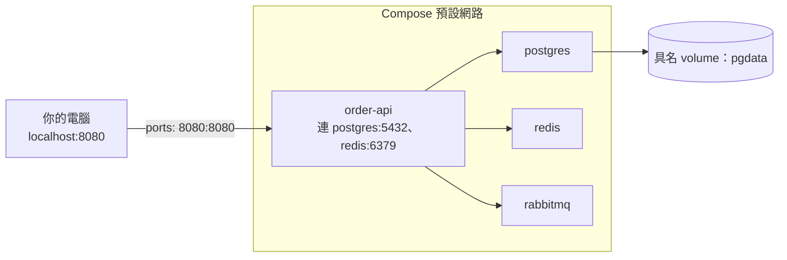

## 這是什麼

訂單 API 要跑起來，需要 PostgreSQL、Redis、RabbitMQ。每個開發者都在自己電腦上手動安裝這些服務，版本與設定各不相同。**Docker Compose** 用一個 `compose.yaml` 檔描述「要跑哪些容器、怎麼連、資料放哪」，一個指令就能把整套環境啟動。

Compose 適合本機開發與 CI；正式環境的編排交給 Kubernetes。但兩者的觀念很接近（服務、網路、設定、儲存），在 Compose 上理解清楚，搬到 Kubernetes 會更順。

## 運作原理



Compose 為同一個專案的所有服務建立一個網路，每個服務可以用**服務名稱**互相連線：API 連資料庫的主機名稱是 `postgres`，不是 `localhost`。在容器裡，`localhost` 指的是容器自己。

`ports` 把容器的 port 對應到你電腦上的 port，讓你從瀏覽器或工具連進去；容器之間的連線不需要 `ports`。

## 常見錯誤與正確寫法

### 1. depends_on 只保證「已啟動」，不保證「可以用」

```yaml
# 錯：postgres 容器啟動了，但資料庫可能還在初始化，API 一連就失敗
services:
  order-api:
    depends_on: [postgres]
```

為依賴的服務加上健康檢查，並等它變成健康：

```yaml
services:
  postgres:
    image: postgres:18
    environment:
      POSTGRES_DB: shop
      POSTGRES_USER: shop
      POSTGRES_PASSWORD: local-dev-only   # 只用於本機
    healthcheck:
      test: ["CMD-SHELL", "pg_isready -U shop -d shop"]
      interval: 5s
      retries: 10
    volumes:
      - pgdata:/var/lib/postgresql

  order-api:
    build: .
    ports: ["8080:8080"]
    environment:
      ConnectionStrings__Shop: "Host=postgres;Database=shop;Username=shop;Password=local-dev-only"
    depends_on:
      postgres:
        condition: service_healthy   # 等健康檢查通過才啟動

volumes:
  pgdata:
```

即使如此，應用程式本身仍要能在依賴暫時不可用時重試，因為正式環境中依賴隨時可能重啟。

### 2. 資料放在容器裡，重建就消失

沒有掛 volume 時，資料寫在容器自己的檔案層，`docker compose down` 後就不見了。要保留的資料（本機資料庫）放在**具名 volume**；需要每次都乾淨的環境（例如 CI），就不掛 volume，或用 `docker compose down -v` 一起刪除。

### 3. 容器要連你電腦上的服務

容器裡的 `localhost` 是容器自己。要連到主機上的服務（例如你在 IDE 裡執行的 API），Docker Desktop 與 OrbStack 提供 `host.docker.internal` 這個名稱；在 Linux 上要在服務加上 `extra_hosts: ["host.docker.internal:host-gateway"]`。

## 使用邊界

- **Compose 不是正式環境的部署工具。** 它沒有跨機器排程、自動擴縮、滾動更新；正式環境用 Kubernetes，見 [Kubernetes 工作負載](/platforms/kubernetes/workloads/)。
- 本機的密碼只用於開發，不要和任何雲端環境共用。
- 自動化測試需要獨立的資料庫時，Testcontainers 會為每次測試建立乾淨的容器，比共用的 Compose 環境更適合，見 [整合測試](/engineering/integration-tests/)。
