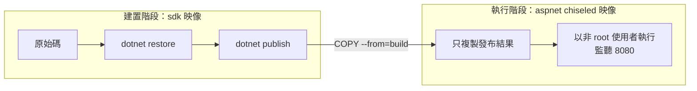

## 這是什麼

**映像**（image）是一個打包好的檔案系統：作業系統的基本檔案、.NET runtime、你的程式。**容器**是從映像啟動的一個執行中程序，被隔離在自己的檔案系統、網路與資源限制裡。

同一個映像在你的電腦、CI、GKE、EKS 上啟動，行為都一樣，這是容器最大的價值。但映像怎麼做，會影響它的大小、安全性，以及在 Kubernetes 上能不能正確使用記憶體、正確停止。

## 運作原理



**多階段建置**：第一階段用包含 SDK 的大映像編譯；第二階段用只有 runtime 的小映像，只複製編譯結果。SDK、原始碼、中間檔案都不會出現在最終映像裡。

**容器的記憶體上限**：Kubernetes 設定 `resources.limits.memory` 時，容器的程序被限制在這個上限內（透過 Linux 的 cgroup）；超過就被系統終止（OOMKilled）。.NET 會讀取這個上限，預設把 GC 堆積的上限設為容器上限的 75%，並依此決定何時回收記憶體。

**PID 1 與停止訊號**：Kubernetes 要停止 Pod 時，先送 SIGTERM 給容器中的第一個程序（PID 1），等待寬限期後才強制終止。如果 PID 1 是一個 shell 腳本，它可能不會把 SIGTERM 轉給 .NET 程序，程式就沒機會收尾。

## 常見錯誤與正確寫法

### 1. 單階段建置、以 root 執行

```dockerfile
# 錯：最終映像包含 SDK 與原始碼，體積大、可被利用的工具多，而且以 root 執行
FROM mcr.microsoft.com/dotnet/sdk:10.0
COPY . .
RUN dotnet publish -c Release -o /app
ENTRYPOINT ["dotnet", "/app/OrderApi.dll"]
```

改成多階段建置，最終映像使用 chiseled（精簡、沒有 shell 與套件管理器）變體：

```dockerfile
FROM mcr.microsoft.com/dotnet/sdk:10.0 AS build
WORKDIR /src
COPY ["OrderApi/OrderApi.csproj", "OrderApi/"]
RUN dotnet restore "OrderApi/OrderApi.csproj"        # 專案檔沒變就使用快取，不重新還原
COPY . .
RUN dotnet publish "OrderApi/OrderApi.csproj" -c Release -o /app/publish --no-restore

FROM mcr.microsoft.com/dotnet/aspnet:10.0-noble-chiseled
WORKDIR /app
COPY --from=build /app/publish .
USER $APP_UID                                        # 官方映像內建的非 root 使用者
ENTRYPOINT ["dotnet", "OrderApi.dll"]                # exec 形式：dotnet 就是 PID 1
```

先複製專案檔並還原，再複製其餘原始碼，可以讓「只改程式碼、沒改套件」的建置重用還原的快取層。

### 2. 記憶體上限設得太緊

容器上限 512 MiB，.NET 的 GC 堆積上限約 384 MiB，剩下的空間要給 runtime 本身、執行緒堆疊、原生記憶體與 JIT 使用。程式在尖峰時需要的記憶體超過這些，就會被 OOMKilled。依實際量測設定上限，必要時用 `DOTNET_GCHeapHardLimitPercent` 調整比例，見 [GC 與容器記憶體](/platforms/dotnet/gc-memory/)。

### 3. 用 shell 腳本啟動，收不到 SIGTERM

```dockerfile
# 錯：shell 形式，PID 1 是 /bin/sh，SIGTERM 不一定會轉給 dotnet
ENTRYPOINT dotnet OrderApi.dll
```

使用 exec 形式（JSON 陣列）。chiseled 映像沒有 shell，也從結構上避免了這個問題。

### 4. Alpine 映像的全球化設定

Alpine 版的 .NET 映像預設啟用「全球化不變模式」（沒有 ICU 文化資料），日期、貨幣格式與字串比較會和你在開發機上看到的不同。需要正確的在地化格式時，使用 Debian 或 Ubuntu 為基礎的映像，或在 Alpine 中安裝 ICU 並關閉不變模式。

## 使用邊界

- chiseled 映像沒有 shell，無法 `kubectl exec` 進去下指令；除錯改用 `kubectl debug` 掛一個臨時的除錯容器，見 [.NET 效能診斷](/platforms/dotnet/profiling/)。
- 映像標籤（例如 `10.0`）會隨安全更新而改變內容；部署時用 digest 固定版本，並定期重建以取得更新，見 [CI/CD](/engineering/ci-cd/)。
- 多個容器（API、資料庫、Redis）在本機一起執行，見 [Compose](/infrastructure/containers-networking/compose/)。

## 雲端排查

### 叢集層（GKE 與 EKS 相同）

```bash
# 容器是否因記憶體超過上限被終止
kubectl get pod <pod-name> -n shop -o jsonpath='{.status.containerStatuses[0].lastState.terminated.reason}'

# 停止時是否在寬限期內結束：137 代表被 SIGKILL 強制終止
kubectl get pod <pod-name> -n shop -o jsonpath='{.status.containerStatuses[0].lastState.terminated.exitCode}'

# 拉不到映像時，事件會說明原因（不存在、沒有權限）
kubectl describe pod <pod-name> -n shop | grep -A5 Events
```

### 託管服務層

#### GKE

Cloud Monitoring 的 `kubernetes.io/container/memory/limit_utilization`（記憶體用量佔上限的比例）長期接近 1，就快被 OOMKilled 了；`kubernetes.io/container/restart_count` 顯示重啟次數。

#### EKS

Container Insights 的 `pod_memory_utilization_over_pod_limit` 與 `pod_number_of_container_restarts`；EKS 節點拉取 ECR 映像需要節點角色有讀取權限，拉取失敗會在事件中出現權限錯誤。

### 應用程式層

```bash
# 在 Pod 內確認 .NET 看到的記憶體上限與目前的 GC 堆積大小
dotnet-counters monitor --process-id 1 --counters System.Runtime
```

觀察 `dotnet.gc.last_collection.heap.size` 與 `dotnet.process.memory.working_set`：working set 遠大於 GC 堆積，代表有大量非受控（原生）記憶體，要另外分析。
