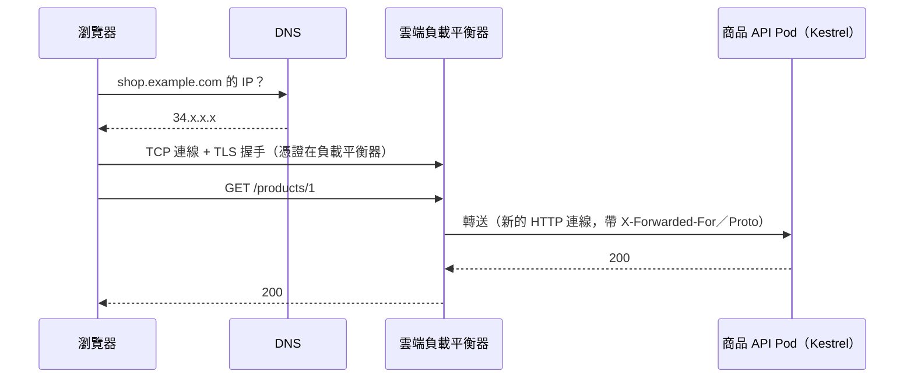

## 這是什麼

買家在瀏覽器打開 `https://shop.example.com/products/1`。從按下 Enter 到看到商品頁，請求要經過好幾個系統，每一段都有自己的責任，也都可能出錯：

1. **DNS**：把 `shop.example.com` 換成 IP 位址。
2. **TCP**：和那個 IP 建立連線。
3. **TLS**：驗證伺服器的憑證、建立加密通道。
4. **負載平衡器**：在雲端接收請求，決定送到哪個後端。
5. **Kubernetes**：把請求送到某個 Pod。
6. **Kestrel**：ASP.NET Core 的 Web 伺服器，讀取 HTTP 請求交給你的程式。

知道每一段在做什麼，出問題時才知道該看哪裡。

## 運作原理



**TLS 通常在負載平衡器結束。** 瀏覽器和負載平衡器之間是 HTTPS，負載平衡器到 Pod 之間可能是 HTTP。所以 Pod 看到的請求是 HTTP，來源 IP 也是負載平衡器的 IP。負載平衡器會用 `X-Forwarded-For`（原始用戶端 IP）與 `X-Forwarded-Proto`（原始協定）標頭告訴後端真實的情況。

**負載平衡器到 Pod 的連線會被重複使用。** 負載平衡器和 Kestrel 之間會保持連線（keep-alive），兩邊各自有閒置逾時：閒置超過就關閉。如果 Kestrel 先關閉，而負載平衡器剛好在同一瞬間送出新請求，請求就會失敗，負載平衡器回給買家 502。

## 常見錯誤與正確寫法

### 1. 直接讀取 RemoteIpAddress 當作買家的 IP

```csharp
// 錯：在負載平衡器後面，這裡拿到的是負載平衡器的 IP；限流與稽核都會出錯
var ip = context.Connection.RemoteIpAddress;
```

啟用 Forwarded Headers，並只信任來自負載平衡器的標頭：

```csharp
// 命名空間：Microsoft.AspNetCore.HttpOverrides
builder.Services.Configure<ForwardedHeadersOptions>(options =>
{
    options.ForwardedHeaders = ForwardedHeaders.XForwardedFor | ForwardedHeaders.XForwardedProto;
    // 把負載平衡器或叢集所在的網段加入信任清單（設定方式見參考來源）；
    // 不要信任任何來源，否則用戶端可以自己偽造 X-Forwarded-For
});

app.UseForwardedHeaders(); // 放在最前面，後面的元件才會看到正確的 IP 與協定
```

### 2. Kestrel 的閒置逾時比負載平衡器短，間歇出現 502

各負載平衡器到後端的閒置逾時不同：Google Cloud 的外部應用程式負載平衡器，後端連線的 keepalive 逾時是 600 秒；AWS ALB 的連線閒置逾時預設是 60 秒。Kestrel 的 `KeepAliveTimeout` 預設是 130 秒。

在 GKE 上，130 秒比負載平衡器的 600 秒短，Kestrel 會先關閉閒置連線，就可能偶發 502。把 Kestrel 的逾時設得比負載平衡器長：

```csharp
builder.WebHost.ConfigureKestrel(options =>
{
    // GKE（Google Cloud 負載平衡器 600 秒）：設得更長
    options.Limits.KeepAliveTimeout = TimeSpan.FromSeconds(620);
});
```

在 EKS 上使用 ALB 預設的 60 秒時，Kestrel 預設的 130 秒已經比它長；如果調高了 ALB 的閒置逾時，Kestrel 也要跟著調高。

### 3. 只說「很慢」，不知道慢在哪一段

`curl` 可以拆出每一段的時間：

```bash
curl -s -o /dev/null https://shop.example.com/products/1 -w \
  'DNS %{time_namelookup}s  TCP %{time_connect}s  TLS %{time_appconnect}s  首位元組 %{time_starttransfer}s  總計 %{time_total}s\n'
```

DNS 或 TLS 慢，問題在網路或憑證設定；「首位元組」減去 TLS 完成的時間很長，問題在負載平衡器之後（Pod 或應用程式）。

## 使用邊界

- 叢集內服務之間的呼叫不經過外部負載平衡器，而是透過 Kubernetes Service，見 [Service 與 Gateway](/platforms/kubernetes/services-gateway/)。
- HTTP/2、HTTP/3 主要改善瀏覽器到負載平衡器這一段；負載平衡器到後端常常仍是 HTTP/1.1。
- 負載平衡器的設定細節依雲端不同，見 [GKE Gateway](/platforms/gke/gateway-networking/)與 [EKS 對外流量](/platforms/eks/load-balancing/)。

## 雲端排查

### 叢集層（GKE 與 EKS 相同）

```bash
# 在叢集內直接打 Service，排除負載平衡器這一段
kubectl run curl -n shop --rm -it --image=curlimages/curl -- \
  curl -s -o /dev/null -w '%{http_code} %{time_total}s\n' http://product-api.shop.svc/products/1
```

叢集內正常、從外部卻失敗或很慢，問題在負載平衡器或它之前。

### 託管服務層

#### GKE

負載平衡器的記錄寫在 Cloud Logging，`statusDetails` 會說明 502 的原因：

```bash
gcloud logging read 'resource.type="http_load_balancer" AND httpRequest.status=502' \
  --freshness=1h --limit=20 --format='value(timestamp,jsonPayload.statusDetails)'
```

`backend_connection_closed_before_data_sent_to_client` 這類訊息，代表後端在負載平衡器使用連線時把它關掉了，正是 keep-alive 逾時不一致的典型症狀。

#### EKS

開啟 ALB 存取記錄（寫入 S3）後，`elb_status_code` 是 502、`target_status_code` 是 `-`，代表 ALB 沒有從目標收到有效回應。CloudWatch `AWS/ApplicationELB` 的 `HTTPCode_ELB_5XX_Count` 與 `TargetConnectionErrorCount` 可以看出發生的頻率。

### 應用程式層

在日誌中記錄 `X-Forwarded-For` 解析後的用戶端 IP 與 `X-Forwarded-Proto`。產生的重新導向網址變成 `http://`，或所有請求的 IP 都一樣，就是 Forwarded Headers 沒有生效。
