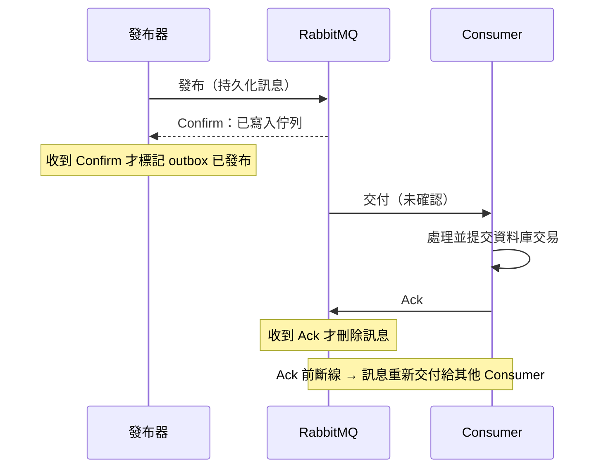

## 這是什麼

一則訊息從訂單 API 到通知 Worker，有兩段可能遺失：

1. **發布到 broker**：API 呼叫了發布，但網路中斷或 broker 剛好重啟，訊息根本沒存下來。
2. **從 broker 到處理完成**：Worker 取走了訊息，處理到一半當掉。

RabbitMQ 為這兩段各提供一種確認：

- **Publisher Confirm（發布確認）**：broker 收下並妥善保存訊息後，回覆給發布者「收到了」。
- **Consumer Ack（消費確認）**：Consumer 處理完成後，回覆給 broker「做完了」，broker 才刪除訊息。

## 運作原理



兩段確認都做對時，訊息不會遺失，但**可能重複**：

- 發布器收到 Confirm 前斷線，不知道 broker 收了沒，只好再發一次。
- Consumer 提交了資料庫交易，在 Ack 送出前斷線，broker 會把訊息再交付一次。

這叫「**至少一次**」交付。重複由消費端的冪等處理解決，見 [Outbox 與 Inbox](/architecture/outbox-inbox/)。

**Prefetch** 是 broker 一次最多推給一個 Consumer 多少則「還沒 Ack」的訊息。沒有設定時，broker 會盡量把佇列裡的訊息全推過去，Consumer 的記憶體可能被塞滿，其他 Consumer 卻分不到工作。

## 常見錯誤與正確寫法

### 1. 發布後不等確認

不開啟發布確認，`BasicPublishAsync` 回傳只代表訊息送進了本機的網路緩衝區。RabbitMQ.Client 7 建立 Channel 時開啟確認與追蹤，`BasicPublishAsync` 就會等到 broker 確認；被拒絕（nack）或無法路由（搭配 `mandatory`）時丟出例外：

```csharp
var channelOptions = new CreateChannelOptions(
    publisherConfirmationsEnabled: true,
    publisherConfirmationTrackingEnabled: true);
await using var channel = await publishConnection.CreateChannelAsync(channelOptions, ct);

var props = new BasicProperties
{
    MessageId = outbox.Id.ToString(),      // 穩定的 ID：重發時保持不變，讓消費端能去重
    Persistent = true,                     // 持久化：broker 重啟後仍在
    ContentType = "application/json",
};

try
{
    await channel.BasicPublishAsync("shop.events", "order.placed", mandatory: true, props, outbox.Payload, ct);
    outbox.MarkPublished(DateTimeOffset.UtcNow); // 確認後才標記
}
catch (PublishException ex)
{
    logger.LogWarning(ex, "Outbox {Id} 發布未被確認，稍後重試", outbox.Id);
}
```

每則訊息都等確認會降低吞吐量；量大時可以同時發出多則、再一起等待它們的確認。

### 2. 收到就 Ack，或用自動確認

```csharp
// 錯：autoAck: true，broker 一送出就刪除；Worker 處理到一半當掉，這則訊息就遺失了
await channel.BasicConsumeAsync("notification", autoAck: true, consumer, ct);
```

使用手動確認，在業務處理與資料庫交易提交**之後**才 Ack，寫法見 [.NET 整合 RabbitMQ](/infrastructure/rabbitmq/dotnet-integration/)。

### 3. 沒有設定 prefetch

```csharp
// 每個 Consumer 最多同時持有 20 則未確認的訊息
await channel.BasicQosAsync(prefetchSize: 0, prefetchCount: 20, global: false, ct);
```

prefetch 太小，Consumer 處理完一則要等 broker 送下一則，吞吐量低；太大，一個 Consumer 囤積大量訊息，當它卡住時這些訊息都無法交給別人。從「每則處理時間 × 想要的同時處理量」估一個起點，再依實際觀察調整。

### 4. 在不同的 Channel 上 Ack

`DeliveryTag` 只在收到訊息的那個 Channel 上有效。在別的 Channel 用它 Ack，broker 會把該 Channel 以錯誤關閉。Ack 一定要在同一個 Channel 上送出。

## 使用邊界

- 發布確認只保證 broker 收到了，不保證 Consumer 會處理成功；兩者是不同的責任。
- 持久化訊息要搭配持久化（durable）的佇列，broker 重啟後才會保留；quorum 佇列本身就會持久化並複寫到多個節點。
- 訂單與發布之間的「要嘛都成功」要靠 Outbox；發布確認無法讓資料庫交易與 broker 一起提交。

## 雲端排查

### 叢集層（GKE 與 EKS 相同）

```bash
# 發布未被確認的次數；持續出現代表 broker 有壓力或網路不穩
kubectl logs -n shop -l app=order-api --since=1h | grep -c "發布未被確認"
```

### 託管服務層

#### GKE

```bash
# 未確認的訊息集中在哪個佇列、哪個 Channel
kubectl exec -n messaging shop-mq-server-0 -- \
  rabbitmqctl list_queues name messages_ready messages_unacknowledged consumers
kubectl exec -n messaging shop-mq-server-0 -- \
  rabbitmqctl list_channels connection prefetch_count messages_unacknowledged
```

使用 Google Cloud Managed Service for Prometheus 收集 RabbitMQ 內建的 Prometheus 指標時，可以在 Cloud Monitoring 以 PromQL 查詢 `rabbitmq_queue_messages_unacked` 與 `rabbitmq_queue_messages_ready`。

#### EKS

CloudWatch `AWS/AmazonMQ` 的 `MessageUnacknowledgedCount` 與 `MessageReadyCount`（以 Broker、VirtualHost、Queue 為維度）。

| 看到什麼 | 代表什麼 |
| --- | --- |
| 未確認數接近「Consumer 數 × prefetch」且不下降 | Consumer 卡住，或處理時間很長 |
| 待處理數上升、未確認數很低 | Consumer 太少或沒有在消費 |
| 兩者都低、但下游沒收到結果 | 可能先 Ack 後處理失敗，檢查 Consumer 的確認時機 |

### 應用程式層

記錄每則訊息「發布到 Confirm」與「交付到 Ack」的耗時；前者升高看 broker，後者升高看 Consumer 的處理邏輯與下游依賴。
