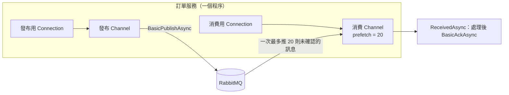

## 這是什麼

**RabbitMQ.Client** 是官方的 .NET 用戶端。從 7.0 版起，API 全面改為非同步（`CreateConnectionAsync`、`BasicPublishAsync`、`BasicAckAsync`）。

使用它要先分清兩個物件：

- **Connection**：一條 TCP 連線，建立成本高（握手、驗證、TLS），應該長期共用。
- **Channel**：建立在 Connection 上的輕量「虛擬連線」，實際的發布與消費都在 Channel 上進行。一條 Connection 可以有很多 Channel。

## 運作原理



**為什麼發布與消費要分開 Connection？** broker 記憶體或磁碟吃緊時，會對發布者施加流量控制，暫停讀取該 Connection 上的資料。如果消費也在同一條 Connection 上，Consumer 跟著被卡住、無法 Ack，佇列就永遠消化不掉。

**Channel 的使用規則。** Channel 不應該被多個執行緒同時使用來發布。常見做法是發布端用一個 Channel 搭配鎖，或依需求建立少量 Channel；消費端每個 Consumer 一個 Channel。

**停機時的訊息。** Consumer 已經取走但還沒 Ack 的訊息，在 Channel 關閉時會回到佇列，交給其他 Consumer。所以停機時，只要不 Ack 沒做完的訊息，它就不會遺失；代價是它可能被處理兩次，所以處理邏輯要冪等。

## 常見錯誤與正確寫法

### 1. 每次發布都建立新的 Connection

```csharp
// 錯：每則訊息都開一條 TCP 連線，broker 上的連線數暴增
await using var conn = await factory.CreateConnectionAsync(ct);
await using var ch = await conn.CreateChannelAsync(cancellationToken: ct);
await ch.BasicPublishAsync("shop.events", "order.placed", body, ct);
```

Connection 建立一次、註冊為 Singleton；發布端的 Channel 也重複使用，並在建立時開啟發布確認，見 [Ack 與 Publisher Confirm](/infrastructure/rabbitmq/acknowledgements/)。

### 2. 在 BackgroundService 中消費，卻沒處理停機

```csharp
// 套件：RabbitMQ.Client 7.x
public sealed class NotificationWorker(
    [FromKeyedServices("consume")] IConnection connection,
    IServiceScopeFactory scopes,
    ILogger<NotificationWorker> logger) : BackgroundService
{
    protected override async Task ExecuteAsync(CancellationToken stoppingToken)
    {
        await using var channel = await connection.CreateChannelAsync(cancellationToken: stoppingToken);
        await channel.BasicQosAsync(prefetchSize: 0, prefetchCount: 20, global: false, stoppingToken);

        var consumer = new AsyncEventingBasicConsumer(channel);
        consumer.ReceivedAsync += async (_, ea) =>
        {
            try
            {
                await using var scope = scopes.CreateAsyncScope();
                var handler = scope.ServiceProvider.GetRequiredService<OrderPlacedHandler>();
                await handler.HandleAsync(ea.BasicProperties.MessageId, ea.Body, stoppingToken);
                await channel.BasicAckAsync(ea.DeliveryTag, multiple: false); // 處理並提交後才 Ack
            }
            catch (OperationCanceledException) when (stoppingToken.IsCancellationRequested)
            {
                // 正在停機：不 Ack，Channel 關閉後訊息會回到佇列
            }
            catch (Exception ex)
            {
                logger.LogError(ex, "處理訊息 {MessageId} 失敗", ea.BasicProperties.MessageId);
                await channel.BasicNackAsync(ea.DeliveryTag, multiple: false, requeue: false); // 交給死信處理
            }
        };

        var tag = await channel.BasicConsumeAsync("notification", autoAck: false, consumer, stoppingToken);
        try
        {
            await Task.Delay(Timeout.Infinite, stoppingToken);
        }
        catch (OperationCanceledException)
        {
            await channel.BasicCancelAsync(tag); // 停止接收新訊息
        }
    }
}
```

重點：`autoAck: false`（手動確認）、處理完成才 Ack、停機時先 `BasicCancelAsync` 不再接收、未完成的不 Ack。失敗時如何重試，見 [重試與冪等](/infrastructure/rabbitmq/retries-idempotency/)。

### 3. 把 Body 留到事件處理結束之後使用

`ea.Body` 是 `ReadOnlyMemory<byte>`，它指向的緩衝區在事件處理器返回後可能被重複使用。要在處理器之外使用（例如丟到另一個佇列），先 `ea.Body.ToArray()` 複製一份。

## 使用邊界

- 預設會自動恢復連線與拓撲（`AutomaticRecoveryEnabled`），broker 重啟或網路中斷後會重新連線；但恢復期間的發布會失敗，發布端要能重試，見 [Outbox 與 Inbox](/architecture/outbox-inbox/)。
- Kubernetes 停止 Pod 時有寬限期（`terminationGracePeriodSeconds`），單則訊息的處理時間要明顯短於它，見 [探針與安全停止](/platforms/kubernetes/probes-resources/)。
- Amazon MQ 只接受 TLS 連線（AMQPS，port 5671），`ConnectionFactory` 要設定 `Ssl.Enabled = true` 與正確的伺服器名稱。

## 雲端排查

### 叢集層（GKE 與 EKS 相同）

```bash
# Worker 停止時是否在寬限期內結束（被強制終止會出現 exit code 137）
kubectl get pod -n shop -l app=notification-worker \
  -o jsonpath='{range .items[*]}{.metadata.name}{"\t"}{.status.containerStatuses[0].lastState.terminated.exitCode}{"\n"}{end}'
```

### 託管服務層

#### GKE

在自建的 RabbitMQ 上查看每條連線與 Channel：

```bash
kubectl exec -n messaging shop-mq-server-0 -- rabbitmqctl list_connections name state channels
kubectl exec -n messaging shop-mq-server-0 -- rabbitmqctl list_channels connection prefetch_count messages_unacknowledged
```

連線數遠大於「Pod 數 × 2」，代表有程式沒有共用 Connection。

#### EKS

CloudWatch `AWS/AmazonMQ` 的 `ConnectionCount` 與 `ChannelCount`（broker 層級）；隨部署次數不斷上升，通常是連線沒有被關閉或重複建立。

### 應用程式層

記錄每次停機時「被取消、未 Ack」的訊息數。這個數字持續偏高，代表處理時間太長或寬限期太短；這些訊息會被重新交付，也意味著冪等處理必須正確。
