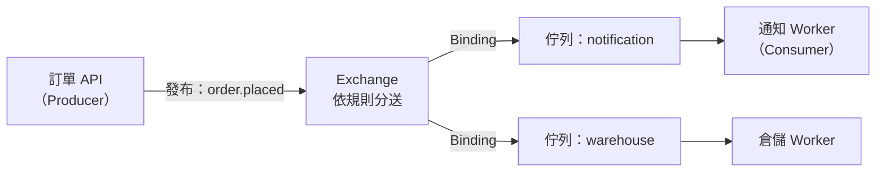

## 這是什麼

買家下單後，系統要寄確認信、通知倉庫、更新推薦資料。如果這些都在下單 API 裡同步完成，寄信服務慢，買家就跟著等；寄信服務停機，下單就失敗。

**訊息佇列**讓 API 只做必要的部分（建立訂單），然後把「要寄信」這件事寫成一則訊息丟進佇列，立刻回應買家。另一個背景程式（Consumer）從佇列取出訊息，慢慢處理。即使寄信服務暫時停機，訊息也會留在佇列裡，恢復後繼續處理。

**RabbitMQ** 是常用的訊息佇列服務（broker），使用 AMQP 協定。

## 運作原理



- **Producer（生產者）**：發布訊息的程式。它不直接把訊息放進佇列，而是送到 Exchange。
- **Exchange（交換器）**：依照規則決定訊息要送到哪些佇列。
- **Binding（綁定）**：Exchange 和佇列之間的規則，例如「routing key 是 `order.placed` 的訊息送到 notification 佇列」。
- **Queue（佇列）**：保存訊息，直到被 Consumer 取走並確認。
- **Consumer（消費者）**：從佇列取出訊息並處理，處理完回報確認（Ack），RabbitMQ 才刪除訊息。

一則訊息從發布到處理完成，經過好幾個階段：API 送出、broker 收下、送到佇列、Consumer 取走、處理完成、確認。每一段都可能失敗，所以「訊息送出了」不等於「工作做完了」。

## 常見錯誤與正確寫法

### 1. 回應讓用戶端以為事情已經完成

下單 API 發布了「寄確認信」的訊息後回應 `200 OK` 和「已寄出確認信」，但信其實還在佇列裡排隊，甚至可能失敗。

回應的內容要符合實際完成的階段。訂單已建立，就回 `201 Created`，並讓用戶端可以查詢通知狀態；整件工作都還沒開始處理（例如產生報表），回 `202 Accepted` 和查詢進度的網址：

```csharp
app.MapPost("/reports/sales", async (SalesReportRequest req, ReportQueue queue, CancellationToken ct) =>
{
    var jobId = await queue.EnqueueAsync(req, ct);
    // 202：已經收下，還沒完成；Location 指向可以查詢進度的端點
    return TypedResults.Accepted($"/reports/jobs/{jobId}", new { jobId, status = "queued" });
});
```

### 2. 把佇列當成資料庫

把幾百萬筆訂單紀錄放在佇列裡「需要時再取」。RabbitMQ 的設計是讓訊息盡快被消費掉，佇列越長，記憶體與磁碟用量越大，broker 的效能與恢復時間都會變差。佇列應該是「短的」：正常情況下，訊息在幾秒到幾分鐘內就被處理。

需要長期保存、可以重複讀取的事件，放資料庫，或使用 RabbitMQ 的 Stream 佇列類型，見 [佇列類型與順序](/infrastructure/rabbitmq/queues-ordering/)。

### 3. 在程式碼的各處宣告佇列，參數卻不一致

Producer 宣告佇列為 durable，Consumer 宣告同名佇列時忘了加，RabbitMQ 會因參數衝突而關閉 channel。佇列、Exchange 與 Binding 的宣告集中在一處（例如啟動時的拓撲設定，或由維運以設定檔管理），所有程式使用相同的參數。

## 使用邊界

- **需要立即知道結果的事，不適合丟進佇列。** 例如「這張卡能不能扣款」，買家必須等到答案。
- 同一個程序內、可以接受遺失的背景工作，用程序內佇列更簡單，見 [Channels](/languages/csharp/channels/)。
- 訂單建立與訊息發布要一起成功，需要 Outbox，見 [Outbox 與 Inbox](/architecture/outbox-inbox/)。
- 什麼時候用同步呼叫、什麼時候用訊息，見 [通訊方式的選擇](/architecture/communication-boundaries/)。

## 雲端排查

### 叢集層（GKE 與 EKS 相同）

```bash
# Consumer（Worker）是否在執行、是否反覆重啟
kubectl get pods -n shop -l app=notification-worker
kubectl logs -n shop -l app=notification-worker --since=15m | tail -30
```

### 託管服務層

#### GKE

本站假設 RabbitMQ 以 Cluster Operator 部署在 GKE 上，由你自己維運：

```bash
# 叢集狀態
kubectl get rabbitmqclusters -n messaging

# 各佇列的待處理、未確認訊息數與 Consumer 數
kubectl exec -n messaging shop-mq-server-0 -- \
  rabbitmqctl list_queues name messages_ready messages_unacknowledged consumers
```

#### EKS

Amazon MQ 不提供 `rabbitmqctl`，改看 CloudWatch 的 `AWS/AmazonMQ` 指標：佇列層級的 `MessageReadyCount`、`MessageUnacknowledgedCount`、`ConsumerCount`，以及 broker 層級的 `ConnectionCount`。

| 看到什麼 | 代表什麼 |
| --- | --- |
| 待處理訊息持續增加 | Consumer 處理不及，或 Consumer 數為 0 |
| 未確認訊息很多 | Consumer 取走了訊息卻沒有 Ack，可能卡住或 prefetch 太大 |
| Consumer 數為 0 | Worker 沒有在執行，或連不上 broker |

### 應用程式層

在訊息中帶上建立時間，Consumer 處理時記錄「從發布到開始處理花了多久」。這個延遲比佇列長度更貼近使用者的感受：佇列只有 100 則，但每則要處理 10 秒，買家仍然要等十幾分鐘才收到信。
