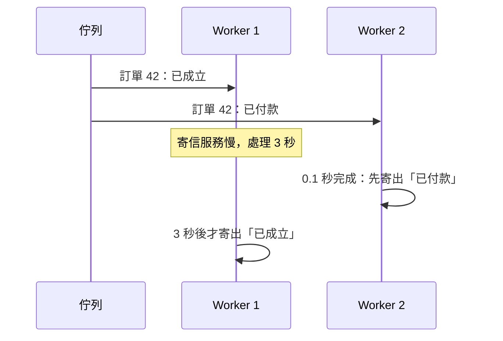

## 這是什麼

訂單會依序發出三個事件：「已成立」「已付款」「已出貨」。通知 Worker 要依這個順序寄信。佇列是先進先出的，所以順序沒問題嗎？

只有一個 Consumer、而且沒有重試時才沒問題。實際上會有多個 Worker 同時消費、會有失敗重試，完成的順序就會被打亂：「已付款」的信可能比「已成立」先寄出。

這篇先說明 RabbitMQ 的佇列類型，再說明怎麼處理順序。

## 運作原理

| 佇列類型 | 特性 | 適合 |
| --- | --- | --- |
| **Quorum** | 複寫到多個節點（Raft），節點故障不遺失；有投遞次數上限 | 不能遺失的工作，例如訂單事件（本站預設） |
| **Classic** | 單一節點，效能高；4.0 起不再支援跨節點鏡像 | 可以遺失的暫時性工作 |
| **Stream** | 像一份只能附加的紀錄，訊息被讀取後不會刪除，可以重複讀取 | 需要重播、或很多讀者讀同一份事件 |



佇列保證的是**交付的順序**，不是**完成的順序**。兩則訊息被交給不同的 Worker 後，誰先做完取決於各自的處理時間。重試也會讓訊息「回到佇列尾端」，排在後來的訊息之後。

而且通常也不需要「全域順序」：訂單 42 和訂單 43 的事件誰先誰後無所謂，真正重要的是**同一張訂單內**的事件順序。

## 常見錯誤與正確寫法

### 1. 為了順序只開一個 Consumer

只開一個 Worker 確實能保留順序，但吞吐量受限，那個 Worker 卡住整條佇列就停擺（隊頭阻塞）。只有在量很小時才適合。RabbitMQ 的 **Single Active Consumer**（`x-single-active-consumer`）可以讓多個 Worker 待命、同一時間只有一個在消費，至少解決了「唯一的 Worker 掛掉」的問題。

### 2. 依鍵分流，讓同一張訂單總是到同一個佇列

用 consistent hash exchange 外掛，以訂單 ID 作為雜湊鍵，把訊息分到多個佇列，每個佇列各一個 Consumer。同一張訂單的事件永遠到同一個佇列、依序處理；不同訂單則平行處理。代價是要管理多個佇列，增減佇列時分配會改變。Amazon MQ 能使用的外掛有限，採用前確認是否支援。

### 3. 用狀態轉移在消費端防守（最實用）

不管訊息以什麼順序到達，Consumer 依業務狀態決定能不能處理：

```csharp
public async Task HandleAsync(OrderShipped evt, CancellationToken ct)
{
    var order = await db.Orders.SingleAsync(o => o.Id == evt.OrderId, ct);

    // 還沒付款就收到出貨事件：順序錯了，丟回重試，稍後再處理
    if (order.Status < OrderStatus.Paid)
        throw new OutOfOrderEventException(evt.OrderId);

    // 已經處理過更新的狀態：這是舊事件或重複事件，直接略過
    if (order.Status >= OrderStatus.Shipped)
        return;

    order.MarkShipped(evt.TrackingNumber);
    await db.SaveChangesAsync(ct);
}
```

也可以在事件中帶上版本號，只處理版本比目前新的事件。這種做法不依賴佇列的任何保證，也自然處理了重複與重試。

## 使用邊界

- **quorum 佇列是預設選擇。** 它犧牲一點效能換取資料不遺失；佇列很多、每個都很小時，要注意節點的資源用量。
- **Stream 不是一般的工作佇列。** 訊息不會因為讀取而刪除，也沒有單則訊息的 Ack 與重試語意；適合事件紀錄與重播。
- Worker 的擴縮依佇列長度或延遲決定，但要和順序策略一致：依鍵分流的設計下，Worker 數不能超過佇列數，見 [自動擴縮](/platforms/kubernetes/autoscaling/)。

## 雲端排查

### 叢集層（GKE 與 EKS 相同）

```bash
# 順序錯誤而重試的次數；持續偏高代表事件經常亂序到達
kubectl logs -n shop -l app=notification-worker --since=1h | grep -c "OutOfOrderEventException"
```

### 託管服務層

#### GKE

在自建叢集上檢查 quorum 佇列的副本狀態（每個成員是否健康、誰是 leader）：

```bash
kubectl exec -n messaging shop-mq-server-0 -- rabbitmq-queues quorum_status notification
kubectl exec -n messaging shop-mq-server-0 -- \
  rabbitmqctl list_queues name type leader members consumers messages
```

成員數少於預期，代表有節點離線，佇列仍可運作但容錯能力降低。

#### EKS

Amazon MQ 的叢集部署由 AWS 管理節點。在 CloudWatch `AWS/AmazonMQ` 觀察各佇列的 `MessageReadyCount` 與 `ConsumerCount`；使用依鍵分流時，某一個佇列的待處理數特別高，代表雜湊分配不均或該佇列的 Consumer 卡住。

### 應用程式層

為每張訂單記錄事件的處理順序與狀態轉移失敗的次數；某個事件類型的亂序比例突然升高，通常和重試延遲或 Worker 數量的調整有關。
