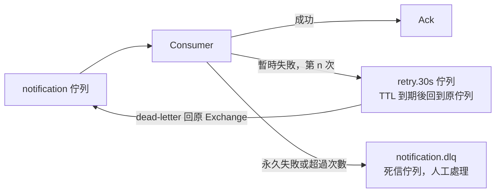

## 這是什麼

通知 Worker 處理訊息時會遇到兩種失敗：

- **暫時性失敗**：寄信服務暫時逾時、資料庫正在容錯移轉。等一下再試通常就會成功。
- **永久性失敗**：訊息格式錯誤、引用的訂單根本不存在。重試一百次結果都一樣，這種訊息叫**毒訊息**（poison message）。

處理失敗的原則是：暫時性的**有限度地重試**，永久性的**移到一旁**（死信佇列）等人處理，而且不管重試幾次，**業務結果只能發生一次**。

## 運作原理



**為什麼不能直接 requeue？** `BasicNack` 加上 `requeue: true` 會把訊息立刻放回佇列，Consumer 馬上又拿到它、又失敗，形成一個高速的無限迴圈。毒訊息會一直佔著 Consumer，CPU 打滿，後面正常的訊息也處理不到。

**延遲重試**：把失敗的訊息發到一個設定了 TTL 的重試佇列，它沒有 Consumer；訊息在裡面等 TTL 到期後，透過 dead-letter 設定回到原本的佇列，再被處理一次。可以準備多個不同延遲的重試佇列（例如 30 秒、5 分鐘），讓間隔逐次拉長。

**死信佇列（DLQ）**：Consumer 以 `requeue: false` 拒絕訊息，或訊息過期、佇列滿了時，訊息會被送到該佇列設定的 dead-letter exchange，最後進入死信佇列。

**quorum 佇列的投遞上限**：quorum 佇列會計算每則訊息被重新交付的次數。RabbitMQ 4.0 起預設上限是 20 次，超過就丟棄，或在設定了 dead-letter 時送進死信佇列。這是最後一道防線，避免毒訊息無限循環。

## 常見錯誤與正確寫法

### 1. 失敗就 requeue

依錯誤類型決定去向：

```csharp
catch (Exception ex) when (IsTransient(ex))
{
    var attempt = GetRetryCount(ea.BasicProperties) + 1;
    if (attempt <= 3)
    {
        // 送進延遲重試佇列，保留原本的 MessageId，並記錄重試次數
        var props = new BasicProperties
        {
            MessageId = ea.BasicProperties.MessageId,
            Persistent = true,
            Headers = new Dictionary<string, object?> { ["x-retry-count"] = attempt },
        };
        await publishChannel.BasicPublishAsync("", $"notification.retry.{RetryDelay(attempt)}", true, props, ea.Body, ct);
        await channel.BasicAckAsync(ea.DeliveryTag, false); // 重試副本已確認送出，才 Ack 原訊息
    }
    else
    {
        await channel.BasicNackAsync(ea.DeliveryTag, false, requeue: false); // 進死信佇列
    }
}
catch (Exception)
{
    await channel.BasicNackAsync(ea.DeliveryTag, false, requeue: false); // 永久失敗：直接進死信佇列
}
```

重試佇列的宣告：沒有 Consumer，訊息到期後回到原本的佇列。

```csharp
await channel.QueueDeclareAsync("notification.retry.30s", durable: true, exclusive: false, autoDelete: false,
    arguments: new Dictionary<string, object?>
    {
        ["x-queue-type"] = "quorum",
        ["x-message-ttl"] = 30_000,                 // 等 30 秒
        ["x-dead-letter-exchange"] = "",            // 預設 exchange
        ["x-dead-letter-routing-key"] = "notification", // 回到原本的佇列
    }, cancellationToken: ct);
```

### 2. 重試會讓業務結果發生兩次

重試、重新交付都會讓同一則訊息被處理不只一次。在同一個資料庫交易裡記錄「這則訊息處理過了」與業務結果，重複時就能辨認並略過，寫法見 [Outbox 與 Inbox](/architecture/outbox-inbox/)。

### 3. 死信佇列沒人看

訊息進了死信佇列就被遺忘，買家的通知永遠沒有寄出。為死信佇列的訊息數設定告警，並準備處理流程：查明原因、修正程式或資料後，把訊息重新發布回原佇列（保留原本的 MessageId，讓冪等繼續有效）。

## 使用邊界

- 重試只對暫時性錯誤有意義。分辨不出錯誤類型時，寧可少重試、早點進死信佇列由人判斷。
- 多層都在重試時（HTTP 用戶端重試、訊息重試），次數會相乘；外部 HTTP 呼叫的重試見 [HTTP 彈性策略](/frameworks/aspnet-core/http-resilience/)。
- 重試會改變訊息的處理順序；依賴順序的處理見 [佇列類型與順序](/infrastructure/rabbitmq/queues-ordering/)。

## 雲端排查

### 叢集層（GKE 與 EKS 相同）

```bash
# 依錯誤類型統計：大量相同的永久錯誤，通常是某次發布的資料格式問題
kubectl logs -n shop -l app=notification-worker --since=1h | grep -o 'Exception: [A-Za-z]*' | sort | uniq -c
```

### 託管服務層

#### GKE

```bash
# 死信與重試佇列的訊息數
kubectl exec -n messaging shop-mq-server-0 -- \
  rabbitmqctl list_queues name messages | grep -E "dlq|retry"

# 查看死信佇列中的訊息（不移除，取出後重新放回）
kubectl exec -n messaging shop-mq-server-0 -- \
  rabbitmqadmin get queue=notification.dlq count=5 ackmode=reject_requeue_true
```

#### EKS

CloudWatch `AWS/AmazonMQ` 中死信佇列的 `MessageCount`，為它設定「大於 0」的告警。檢視死信訊息內容可以使用 Amazon MQ 提供的 RabbitMQ 管理介面。

### 應用程式層

記錄每則失敗訊息的 MessageId、重試次數與錯誤類型。同一個 MessageId 反覆出現在日誌中、但從未進入死信佇列，代表程式在用 requeue 無限重試。
