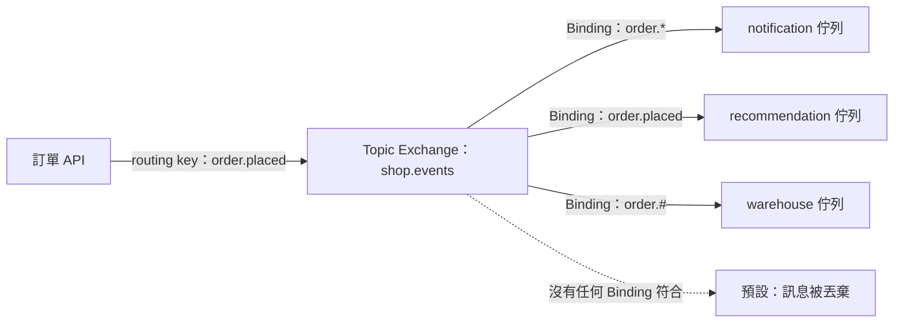

## 這是什麼

訂單 API 發布一則「訂單已成立」的訊息，通知服務、倉儲服務、推薦服務都需要收到；「訂單已取消」只有倉儲和通知需要。這種「哪些訊息送給誰」的規則叫**路由**。

在 RabbitMQ 裡，Producer 不知道有哪些佇列。它只把訊息送到一個 **Exchange**，並附上一個 **routing key**（例如 `order.placed`）。每個佇列透過 **Binding** 告訴 Exchange「我要哪些訊息」。新增一個訂閱的服務，只要新增一個佇列與 Binding，Producer 的程式不需要修改。

## 運作原理



四種 Exchange：

| 類型 | 分送規則 | 用途 |
| --- | --- | --- |
| Direct | routing key 完全相等 | 依任務類型分派到特定佇列 |
| Topic | routing key 符合萬用字元的樣式 | 事件依類別訂閱（本站主要使用） |
| Fanout | 不看 routing key，全部送給所有綁定的佇列 | 廣播 |
| Headers | 依訊息標頭比對 | 很少使用 |

Topic 的 routing key 以 `.` 分段，萬用字元有兩種：`*` 代表**剛好一段**，`#` 代表**零或多段**。所以 `order.*` 符合 `order.placed`，但不符合 `order.payment.failed`；`order.#` 兩者都符合。

## 常見錯誤與正確寫法

### 1. Producer 直接指定要送到哪些佇列

訂單 API 為了通知三個服務，自己對三個佇列各發一次。每新增一個訂閱者，就得修改 API。改成發布一次到 Topic Exchange，由各服務自己綁定：

```csharp
// 啟動時宣告拓撲（冪等：已存在且參數相同時不會出錯）
await channel.ExchangeDeclareAsync("shop.events", ExchangeType.Topic, durable: true, cancellationToken: ct);
await channel.QueueDeclareAsync("notification", durable: true, exclusive: false, autoDelete: false,
    arguments: new Dictionary<string, object?> { ["x-queue-type"] = "quorum" }, cancellationToken: ct);
await channel.QueueBindAsync("notification", "shop.events", routingKey: "order.*", cancellationToken: ct);
```

### 2. routing key 打錯，訊息默默消失

Exchange 找不到任何符合的佇列時，預設會直接丟棄訊息，Producer 不會收到任何錯誤。有兩種方式接住：

- **mandatory 旗標**：發布時設定 `mandatory: true`，無法路由的訊息會退回給 Producer。RabbitMQ.Client 7 開啟發布確認追蹤後，退回會讓 `BasicPublishAsync` 丟出例外，見 [Ack 與 Publisher Confirm](/infrastructure/rabbitmq/acknowledgements/)。
- **備用 Exchange（Alternate Exchange）**：在 Exchange 上設定 `alternate-exchange`，無法路由的訊息改送到備用 Exchange，再綁到一個「無法路由」佇列，供事後檢查。建議用 policy 設定，不必改程式。

```bash
# 對 shop.events 設定備用 Exchange（policy 由維運管理）
rabbitmqctl set_policy AE '^shop\.events$' '{"alternate-exchange":"shop.unroutable"}' --apply-to exchanges
```

### 3. 用 `*` 卻期待它符合多段

`order.*` 不會收到 `order.payment.failed`。routing key 的命名要事先定好規則（例如固定 `領域.事件`），並在新增事件時確認現有的 Binding 是否需要調整。

## 使用邊界

- routing key 是 Producer 和訂閱者之間的契約，修改時要像修改 API 一樣考慮相容性。
- Binding 太多、太複雜的路由會讓「這則訊息會到哪裡」難以追蹤；路由規則保持簡單，並把拓撲集中管理。
- 同一則訊息被送到多個佇列，每個佇列各有一份，各自確認與重試；一個 Consumer 失敗不影響其他佇列。

## 雲端排查

### 叢集層（GKE 與 EKS 相同）

```bash
# 發布端日誌中，被退回（無法路由）的訊息
kubectl logs -n shop -l app=order-api --since=1h | grep -i "unroutable\|returned"
```

### 託管服務層

#### GKE

在自建的 RabbitMQ 上列出 Binding，並確認備用佇列有沒有累積訊息：

```bash
kubectl exec -n messaging shop-mq-server-0 -- \
  rabbitmqctl list_bindings source_name destination_name routing_key
kubectl exec -n messaging shop-mq-server-0 -- \
  rabbitmqctl list_queues name messages | grep unroutable
```

#### EKS

Amazon MQ 透過 RabbitMQ 管理介面（HTTPS）查詢 Binding：

```bash
curl -s -u "$MQ_USER:$MQ_PASSWORD" \
  "https://<broker-id>.mq.<region>.amazonaws.com/api/exchanges/%2F/shop.events/bindings/source"
```

CloudWatch `AWS/AmazonMQ` 中「無法路由」佇列的 `MessageCount` 大於 0，代表有訊息沒有被任何訂閱者接收。

### 應用程式層

在發布時記錄 routing key 與訊息 ID；某個訂閱者回報「沒收到」時，先確認發布的 routing key，再對照該佇列的 Binding，通常就能找到不符合的那一段。
