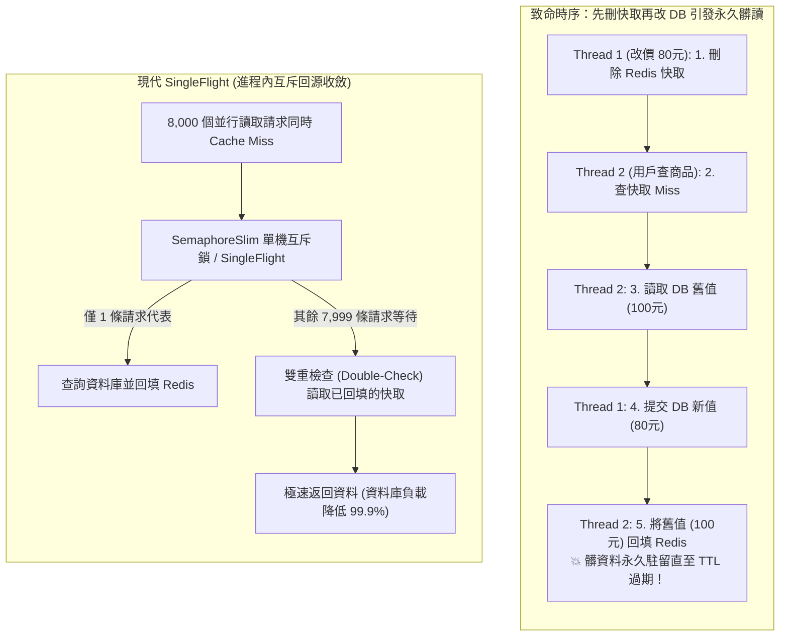

## 案發現場

某中大型電商平台在年中大促活動開跑前夕，運維與商品營運團隊在後台緊急將某熱銷爆款商品的售價由原價 100 元調整為特惠價 80 元。然而促銷開跑後，客服系統被大量投訴灌爆：前台數萬名買家在商品詳情頁反覆重新整理，畫面依然頑固地顯示 100 元舊價格！直到半小時後 Redis 快取設定的 TTL（存活時間）自然到期，新價格才姍姍來遲生效，引發嚴重的價格爭議與退單客訴。

更為致命的連鎖災難在當晚 20:00 秒殺正式引爆時上演：該熱賣商品的快取 Key 恰好在 20:00:00 到期失效。在短短 500 毫秒內，湧入了超過 8,000 個高併發讀取請求。由於快取未命中（Cache Miss），這 8,000 個請求如同未經分流的洪水，全數直衝後端 PostgreSQL 資料庫！資料庫連線集區（Connection Pool）在 2 秒內被瞬間抽乾，伺服器 CPU 使用率飆至 100%，引發資料庫死結與集體超時，骨牌效應迅速蔓延至全站所有業務，整座購物平台陷入癱瘓。

經架構小組緊急搶修與事後復盤，確認這起重大事故是業界最典型的兩大分散式快取設計缺陷所致：
1. **雙寫時序錯亂引發的永久髒讀**：開發者採用了直覺卻致命的「先刪快取，再更資料庫」策略，在讀寫交錯並行時被讀取請求回填了舊資料。
2. **熱點快取擊穿（Dog-piling / Cache Breakdown）**：缺乏進程內回源收斂機制（SingleFlight / 互斥鎖），在熱點 Key 失效的毫秒瞬間引發資料庫擊穿。



---

## 致命反模式 vs. 正確解法

### 反模式一：先刪除快取，再更新資料庫（永久髒讀陷阱）

許多開發者直覺地認為「先清空舊快取，再去改資料庫，可以保證後續請求讀到新資料」。但在分散式高並發環境下，這是一種毀滅性的反模式：
1. 執行緒 A 刪除了 Redis 快取。
2. 執行緒 B 發起讀取請求，發現 Redis 快取未命中。
3. 執行緒 B 查詢資料庫，此時執行緒 A 尚未完成更新，因此執行緒 B 讀出舊資料（100 元）。
4. 執行緒 A 完成資料庫更新（寫入 80 元）並提交交易。
5. 執行緒 B 將讀出的舊資料（100 元）寫入 Redis 快取！
結果：**資料庫已是 80 元，但 Redis 快取卻被覆蓋回 100 元舊值**。若未設定 TTL，此錯誤資料將在快取中永久駐留！

### 反模式二：快取失效後無防護直接透傳查詢資料庫（快取擊穿）

當存取頻率極高（例如首頁 Banner、秒殺商品）的熱點 Key 剛好過期失效時，若系統未對回源操作進行節流收斂，所有的並行請求會同時判定快取未命中，並同時發起資料庫查詢。這會瞬間打爆資料庫的最大連線數限制（Max Connections），引發連鎖雪崩。

### 正確解法：先更新資料庫再刪除快取，搭配 SingleFlight 進程內互斥回源

1. **先更 DB 再刪 Cache（Cache-Aside 核心鐵律）**：
   在資料庫事務成功 Commit 之後，才執行 `KeyDeleteAsync`。雖然在極端極微小的時間差內讀取者可能讀到舊資料，但絕不會發生「舊資料長期反向覆蓋新資料」的髒讀事故。
2. **進程內 SingleFlight 互斥鎖（Double-Checked Locking）**：
   在單機應用程式內，使用 `ConcurrentDictionary` 搭配 `SemaphoreSlim`，針對同一個 Key 只允許單一請求進入資料庫查詢，其餘並行請求排隊等待，並在獲得鎖後進行二次快取檢查（Double-Check）。

```csharp
// 💣 Bad：先刪快取再改 DB，讀寫並行時舊值會被回填卡死
await cache.KeyDeleteAsync($"product:{id}");
await store.UpdatePriceAsync(id, newPrice, ct);

// ✅ Good：資料庫成功提交後，才使快取失效
bool updated = await store.UpdatePriceAsync(id, newPrice, ct);
if (updated)
{
    try 
    { 
        await cache.KeyDeleteAsync($"product:{id}").WaitAsync(ct); 
    }
    catch (RedisException ex) 
    { 
        logger.LogWarning(ex, "快取清除失敗，依賴 TTL 自然失效"); 
    }
}
```

在基礎 Cache-Aside 讀取邏輯中，必須具備底層降級彈性，確保在 Redis 網路抖動或短暫故障時，業務不中斷並降級回源：

~~~csharp title="CachedProducts.cs"
Interlocked.Increment(ref databaseReads);
Product? current = await store.GetProductAsync(id, token);
if (current is null) return null;
if (!unavailable)
{
    try
    {
        await cache.StringSetAsync(Key(id), JsonSerializer.Serialize(current, JsonDefaults.Options), lifetime).WaitAsync(token);
    }
    catch (RedisException)
    {
        unavailable = true;
        Diagnostics.CacheErrors.Add(1);
    }
}
return new ProductRead(current, unavailable ? "database-fallback" : "database");
~~~

更進一步，面對每秒數千 QPS 的極高頻熱點，應在單機進程內使用 `SemaphoreSlim` 實作 SingleFlight 機制，並進行雙重檢查（Double-Checked Locking）：

```csharp
// ✅ Good：單實例內同 Key 僅單一請求回源，其餘等待並複用結果
var semaphore = locks.GetOrAdd(id, _ => new SemaphoreSlim(1, 1));
await semaphore.WaitAsync(ct);
try
{
    var cached = await cache.StringGetAsync(key).WaitAsync(ct);
    if (cached.HasValue) return Deserialize(cached!); // 雙重檢查：前一個請求可能已填補

    var data = await store.GetProductAsync(id, ct);
    if (data != null)
    {
        await cache.StringSetAsync(key, Serialize(data), GetJitteredTtl(TimeSpan.FromMinutes(10))).WaitAsync(ct);
    }
    return data;
}
finally { semaphore.Release(); }
```

---

## 踩坑與避坑指南

### 1. 快取穿透（Penetration）vs 快取擊穿（Breakdown）vs 快取雪崩（Avalanche）

| 故障型別 | 定義與現象 | 核心根源 | 生產級最佳防禦架構 |
| :--- | :--- | :--- | :--- |
| **快取擊穿** (Breakdown) | 單一熱點 Key 到期瞬間，巨量請求同時直衝 DB | 熱點 Key TTL 自然過期或被刪除 | **進程內 SingleFlight 互斥鎖**、或採用「邏輯過期（Logical Expiration）」由背景非同步更新。 |
| **快取穿透** (Penetration) | 查詢一個在資料庫與快取中都**絕對不存在**的資料（如 `id = -9999`） | 惡意掃描攻擊或爬蟲遍歷無效 ID | **快取空值物件（Null Cache）**：查無資料時寫入空標記，設定極短 TTL（如 30 秒）；或在前置層架設布隆過濾器（Bloom Filter）。 |
| **快取雪崩** (Avalanche) | 大量不同業務的 Key 在**同一秒鐘集體過期**，或 Redis 整體實例宕機 | 批次預熱時所有 Key 設置了完全相同的靜態 TTL | **TTL 隨機抖動（Jitter）**：基礎 TTL 疊加 ±10%~20% 隨機值；搭配 Redis Cluster 高可用架構。 |

### 2. TTL 隨機抖動（Jitter）演算法實踐

批次初始化商品快取時，絕對禁止撰寫 `TimeSpan.FromHours(1)` 這種整齊劃一的過期時間：

```csharp
public static TimeSpan GetJitteredTtl(TimeSpan baseTtl)
{
    // 在基礎 TTL 上疊加 90% 到 110% 的隨機浮動，徹底打散失效時間點
    double factor = 0.9 + (Random.Shared.NextDouble() * 0.2);
    return TimeSpan.FromMilliseconds(baseTtl.TotalMilliseconds * factor);
}
```

### 3. 避坑原則：何時不該使用快取？

- **高強一致性要求的扣款與庫存交易**：
  防範商品超賣（Overselling）或虛擬錢包扣款，必須直接由資料庫行級排他鎖（`SELECT ... FOR UPDATE`）或分散式樂觀鎖（樂觀版本號）在事務內進行原子檢查。快取僅能用作唯讀展示，絕不可作為扣款決策的唯一依據。
- **寫多讀少的極端情境**：
  若某業務資料每秒更新數百次，但讀取頻率極低，頻繁維護快取只會白白浪費 CPU 序列化開銷與 Redis 網路頻寬。

---

## 線上排查指令

當線上突發資料庫 CPU 100% 飆高或懷疑快取擊穿、大 Key 阻塞時，依照下列 SOP 進行排查救火：

### 1. 檢測 Redis 伺服器即時網路與回應延遲

確認是否為 Redis 單執行緒事件循環（Event Loop）卡死引發的逾時：

```bash
# 1. 檢測客戶端與 Redis 伺服器之間的即時網路延遲
redis-cli -h <redis-host> -p 6379 --latency

# 2. 檢測 Redis 事件循環自身內部歷史最大固有延遲 (Intrinsic Latency)
redis-cli -h <redis-host> -p 6379 --intrinsic-latency 5
```

### 2. 檢視阻塞單執行緒的慢查詢命令（Slowlog）

快速排查是否有工程師在線上誤用 `KEYS *` 或對巨型 Hash 執行 `HGETALL`：

```bash
# 抓取最近 10 筆耗時超過慢查詢門檻（預設 10ms）的命令
redis-cli -h <redis-host> -p 6379 slowlog get 10
```

### 3. 排查大 Key（Big Keys）與記憶體碎裂

找出佔用數十 MB 頻寬的巨型字串或未切分集合：

```bash
# 採用漸進式掃描（SCAN）分析各資料型別之最大 Key，絕不卡死生產服務
redis-cli -h <redis-host> -p 6379 --bigkeys

# 檢視目前記憶體佔用與淘汰統計
redis-cli -h <redis-host> -p 6379 info memory
```

### 4. 監控快取命中率與每秒查詢 QPS

評估快取穿透或雪崩嚴重度：

```bash
# 檢視快取命中（keyspace_hits）與未命中（keyspace_misses）累積計數
redis-cli -h <redis-host> -p 6379 info stats
```

**監控警報閾值參考**：快取命中率（$\frac{\text{hits}}{\text{hits} + \text{misses}}$）5 分鐘平均低於 85%、Redis P99 延遲大於 20ms、或資料庫回源 QPS 陡增超過平常基準線 3 倍時，應立即觸發 PagerDuty 緊急告警。
