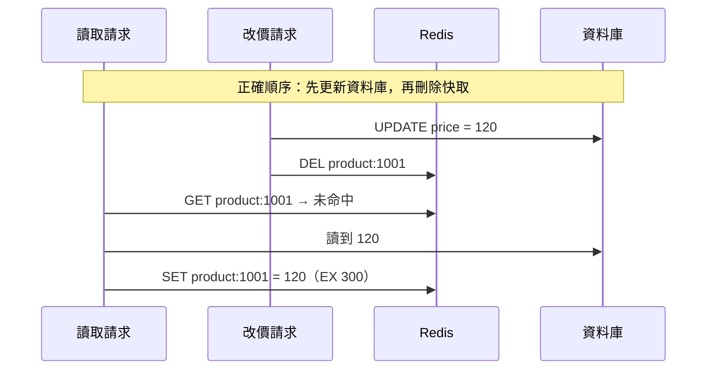

## 這是什麼

店家把保溫杯從 150 元改成 120 元，後台顯示成功，但前台商品頁還是 150 元。原因是商品資料被快取了，資料庫改了，快取裡的副本還沒變。

**Cache-Aside** 是最常用的快取做法：讀取時先查快取，沒有再查資料庫並寫回；更新時先改資料庫，再讓快取失效。這篇說明這個流程中哪些順序與細節決定了「舊資料會留多久」，以及流量很大時快取失效會帶來什麼問題。

## 運作原理



**為什麼不能先刪快取再更新資料庫？** 刪掉快取之後、資料庫還沒更新之前，另一個讀取請求未命中，從資料庫讀到舊的 150，再寫回快取。接著資料庫才更新成 120。結果快取裡是 150，而且要等到 TTL 到期才會修正。

**先更新資料庫再刪快取也不是完美的**：一個讀取請求在更新前讀到 150，還沒寫回快取；更新與刪除完成後，它才把 150 寫回。這個時間窗很小但存在。所以 **TTL 是最後的防線**：即使發生了，舊值最多存活一個 TTL。

**擊穿**：一個熱門商品的 key 過期的瞬間，幾百個請求同時未命中，全部去查資料庫。

**穿透**：查詢一個根本不存在的商品 ID，快取永遠未命中，每次都打到資料庫；惡意的大量隨機 ID 可以用這個方式繞過快取。

**雪崩**：大量 key 在同一時間過期（例如全部在整點寫入、TTL 都是一小時），同一時刻全部回源。

## 常見錯誤與正確寫法

### 1. 更新順序錯誤，或更新後沒有讓快取失效

```csharp
public async Task ChangePriceAsync(int productId, decimal price, CancellationToken ct)
{
    var product = await db.Products.SingleAsync(p => p.Id == productId, ct);
    product.ChangePrice(price);
    await db.SaveChangesAsync(ct);                               // 1. 先提交資料庫

    await cache.RemoveAsync($"catalog:product:{productId}", ct); // 2. 再讓快取失效
}
```

刪除快取失敗（例如 Redis 暫時連不上）時，要記錄並重試，或接受舊值會在 TTL 到期後消失。對一致性要求更高的情況，可以把「刪除快取」也寫成 outbox 事件，由背景程序確保執行，見 [Outbox 與 Inbox](/architecture/outbox-inbox/)。

### 2. 熱門 key 過期時大量請求同時回源

同一個 Pod 內，讓同一個 key 只有一個請求去載入、其他請求等它的結果。`HybridCache` 已經內建這個保護：

```csharp
var product = await hybridCache.GetOrCreateAsync(
    $"catalog:product:{id}",
    async token => await LoadProductAsync(id, token), // 同一個 key 同時只會執行一次
    cancellationToken: ct);
```

這只限制單一 Pod 內的重複；20 個 Pod 仍可能同時各自回源一次，通常資料庫承受得了。真的不行時，才考慮跨 Pod 的鎖，見 [併發控制](/infrastructure/redis/concurrency/)。

### 3. 查不存在的資料每次都打到資料庫

把「不存在」也快取起來，給較短的 TTL：

```csharp
var product = await hybridCache.GetOrCreateAsync(
    $"catalog:product:{id}",
    async token => await LoadProductAsync(id, token) ?? ProductDto.NotFound, // 用特定值代表不存在
    new HybridCacheEntryOptions { Expiration = TimeSpan.FromMinutes(1) },
    cancellationToken: ct);
```

另外在入口驗證 ID 的格式與範圍，並對異常的請求來源限流。

### 4. 所有 key 的 TTL 都一樣

```csharp
// 基準 5 分鐘，加上 0～60 秒的隨機值，讓過期時間分散
var ttl = TimeSpan.FromMinutes(5) + TimeSpan.FromSeconds(Random.Shared.Next(0, 60));
```

## 使用邊界

- **結帳時不讀快取的價格。** 顯示可以接受短暫的舊價，但成立訂單時要從資料庫讀最新價格，並在價格改變時讓買家確認。
- 對「改了要立刻生效」的資料（例如商品下架），TTL 設短一點，並確保失效流程有監控。
- 快取的資料不能比它所依據的資料更權威。庫存、訂單狀態不要從快取做決策。
- Redis 整個不可用時的降級方式，見 [Redis 可靠性](/infrastructure/redis/reliability/)。

## 雲端排查

### 叢集層（GKE 與 EKS 相同）

```bash
# 確認快取失效有沒有失敗（例如 Redis 暫時不可用時的錯誤）
kubectl logs -n shop -l app=catalog-api --since=1h | grep -i -E "cache.*(remove|invalidate).*fail"
```

### 託管服務層

#### 兩邊相同：某個 key 現在的值與剩餘期限

```text
GET catalog:product:1001
TTL catalog:product:1001
INFO stats            # keyspace_misses 在某個時間點暴增，常是大量 key 同時過期
```

#### GKE

Memorystore 的 `redis.googleapis.com/stats/cache_hit_ratio` 在整點或部署後突然下降、同時 Cloud SQL 的 CPU 上升，是雪崩或大量失效的典型樣子。

#### EKS

ElastiCache 的 `CacheMisses` 與 `CacheHitRate`，對照 RDS 的 `CPUUtilization` 與 `DatabaseConnections` 是否在同一時間上升。

### 應用程式層

為「回源次數」建立指標，並標上快取的類別（商品、價格）。回源次數在某一刻暴增，對照當時是否有大量資料更新或部署清空了程序內快取。
