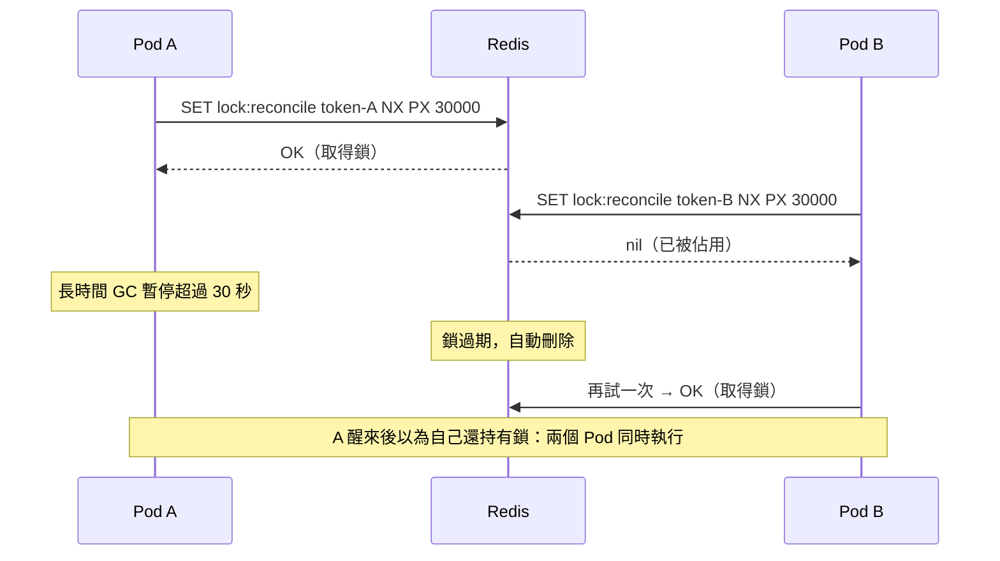

## 這是什麼

C# 的 `lock` 只能保護同一個程序。API 部署成 10 個 Pod，就有 10 把各自獨立的鎖。需要「所有 Pod 之間只能有一個在做這件事」時，就需要一個共用的地方來協調，Redis 是常見的選擇：

- **分散式鎖**：多個 Pod 搶同一個 key，搶到的才能執行。例如每天凌晨的對帳作業，只讓一個 Pod 執行。
- **限流**：用 Redis 的計數器記錄某個使用者在一段時間內的請求次數，超過就拒絕。

這兩者都很好用，但都**不是正確性的保證**。理解它們的限制，比會寫它們更重要。

## 運作原理



`SET key value NX PX 30000` 的意思是：key 不存在才設定（NX），並在 30 秒後自動過期（PX）。設定期限是為了避免持有鎖的 Pod 當掉後鎖永遠不會釋放。

但期限也帶來問題：持有者因為 GC 暫停、網路延遲或節點被暫停，超過期限還沒做完，鎖就過期了，另一個 Pod 會取得鎖。這時兩者會同時執行。Redis 主從切換時，鎖也可能因為非同步複製而遺失。所以 Redis 鎖只能說「大部分時候只有一個」，不能說「一定只有一個」。

## 常見錯誤與正確寫法

### 1. 用 DEL 釋放鎖

A 的鎖已經過期、B 取得了新的鎖，A 做完後執行 `DEL`，刪掉的是 B 的鎖。釋放時要確認「這把鎖還是我的」，而且檢查與刪除必須是同一個原子操作，用 Lua 腳本：

```csharp
// 套件：StackExchange.Redis
public sealed class RedisLock(IConnectionMultiplexer mux)
{
    private const string ReleaseScript = """
        if redis.call('GET', KEYS[1]) == ARGV[1] then
            return redis.call('DEL', KEYS[1])
        end
        return 0
        """;

    public async Task<string?> TryAcquireAsync(string key, TimeSpan ttl)
    {
        var token = Guid.NewGuid().ToString("N"); // 每次取得都用新的識別碼
        var acquired = await mux.GetDatabase().StringSetAsync(key, token, ttl, When.NotExists);
        return acquired ? token : null;
    }

    public Task ReleaseAsync(string key, string token) =>
        mux.GetDatabase().ScriptEvaluateAsync(ReleaseScript, [new RedisKey(key)], [new RedisValue(token)]);
}
```

### 2. 用 Redis 鎖保護扣庫存

```csharp
// 錯：鎖過期或主從切換時，兩個請求可能同時扣同一件商品的庫存
var token = await redisLock.TryAcquireAsync($"lock:stock:{productId}", TimeSpan.FromSeconds(5));
var stock = await db.Stocks.SingleAsync(s => s.ProductId == productId, ct);
stock.Available -= quantity;
await db.SaveChangesAsync(ct);
```

正確性要由資料庫保證：一句帶條件的 UPDATE，檢查影響筆數，見 [樂觀並行與庫存競爭](/data-access/concurrency/)。這樣即使沒有任何鎖，也不會超賣。

Redis 鎖適合的是「重複做也不會錯，只是浪費」的情況，例如避免多個 Pod 同時重建同一份快取、同時執行同一個排程作業。被保護的工作本身也要能安全地重複執行。

### 3. 用簡單的 INCR 做限流卻沒設期限

```csharp
// 固定時間窗：每個買家每分鐘最多 60 次
var key = $"ratelimit:buyer:{buyerId}:{DateTimeOffset.UtcNow:yyyyMMddHHmm}";
var db = mux.GetDatabase();
var count = await db.StringIncrementAsync(key);
if (count == 1) await db.KeyExpireAsync(key, TimeSpan.FromMinutes(2)); // 第一次就設定期限
if (count > 60) return TypedResults.Problem(statusCode: 429, title: "請求太頻繁");
```

固定時間窗在交界處可能允許短時間內兩倍的請求；需要更平滑的效果，用滑動窗口或令牌桶。單一 Pod 內的限流，ASP.NET Core 內建的限流中介軟體就夠了，不需要 Redis。

## 使用邊界

- **Redis 鎖不是正確性保證。** 需要「一定只有一個」時，用資料庫的唯一約束、條件更新或 `SELECT ... FOR UPDATE`，或加上 fencing token（每次取得鎖時遞增的序號，由被保護的資源檢查）。
- Lua 腳本在 Redis 裡是原子執行的，執行期間會擋住其他所有命令。腳本要短，不要在裡面處理大量資料。
- Redis 叢集模式下，一個 Lua 腳本用到的所有 key 必須在同一個 slot，用 hash tag（例如 `{order:42}`）把相關的 key 放在一起。

## 雲端排查

### 叢集層（GKE 與 EKS 相同）

```bash
# 排程作業是否被多個 Pod 同時執行（以作業日誌中的開始訊息計數）
kubectl logs -n shop -l app=reconcile-worker --since=24h | grep -c "reconcile started"
```

### 託管服務層

#### 兩邊相同：鎖的狀態與慢腳本

```text
GET lock:reconcile       # 目前持有者的 token
PTTL lock:reconcile      # 剩餘毫秒；-2 代表沒有人持有
SLOWLOG GET 10           # 執行時間過長的 Lua 腳本會出現在這裡
```

#### GKE

Memorystore 的 `redis.googleapis.com/stats/cpu_utilization`；Lua 腳本或大量限流計數讓 Redis 單執行緒忙碌時，CPU 會接近單核滿載，所有命令的延遲一起升高。

#### EKS

ElastiCache 的 `EngineCPUUtilization`（Redis 主執行緒的 CPU）；超過約 90% 時，所有用戶端都會感受到延遲。

### 應用程式層

記錄「取得鎖失敗」與「鎖在工作完成前過期」的次數。後者出現時，代表工作時間超過鎖的期限，要縮短工作、延長期限並定期續期，或改用資料庫保證正確性。
