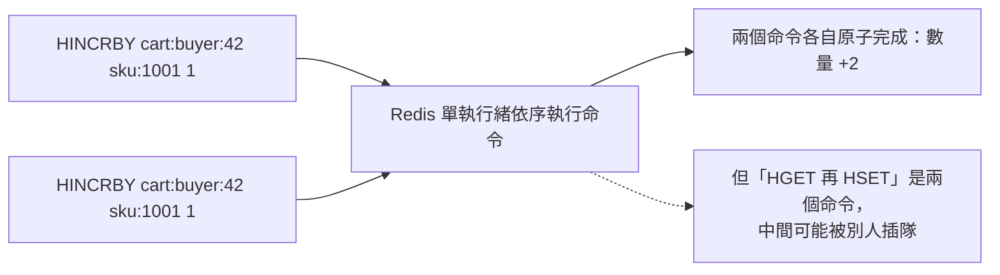

## 這是什麼

Redis 不只能存字串。它提供好幾種資料結構，每一種都有對應的原子操作：

| 型別 | 是什麼 | 電商例子 |
| --- | --- | --- |
| String | 一個值（字串、數字、序列化後的 JSON） | 商品快取、計數器 |
| Hash | 一組欄位與值，像一個小物件 | 購物車（商品 ID → 數量） |
| List | 有順序的清單，兩端可以推入或取出 | 最近瀏覽的商品 |
| Set | 不重複的集合 | 已領取優惠券的買家 |
| Sorted Set | 每個元素帶一個分數，依分數排序 | 熱銷排行榜 |

**Key** 是資料的名字，**TTL** 是它的存活時間，到期後 Redis 自動刪除。這三者（key 的命名、資料結構、TTL）一起構成一份快取資料的「契約」。

## 運作原理



Redis 依序執行命令，每一個命令本身是原子的：`HINCRBY`（把 Hash 裡的某個欄位加一）不會被其他命令打斷。但「先讀出來、在程式裡算好、再寫回去」是兩個命令，中間可能被其他用戶端插入，就會有競爭問題。所以能用單一原子命令完成的事，就不要拆成「讀、改、寫」。

TTL 是 key 的屬性，不是值的屬性。用 `SET` 覆寫一個 key 時，如果沒有再指定期限，原本的 TTL 會被清除，這個 key 就永遠不會過期。

## 常見錯誤與正確寫法

### 1. 整個物件存成 JSON 字串，改一個欄位就要整份重寫

購物車存成一個 JSON 字串，每次加一件商品都要讀出整份、反序列化、修改、序列化、寫回。兩個裝置同時加商品，後寫入的會蓋掉先寫入的。改用 Hash，每個商品是一個欄位：

```csharp
// 套件：StackExchange.Redis
var key = $"cart:buyer:{buyerId}";
await redis.HashIncrementAsync(key, $"sku:{sku}", quantity); // 原子地增加數量
await redis.KeyExpireAsync(key, TimeSpan.FromDays(7));       // 每次活動都延長期限
```

### 2. 覆寫時把 TTL 弄丟了

```text
SET product:1001 "{...}" EX 300     # 有 5 分鐘期限
SET product:1001 "{...新內容...}"    # 錯：沒指定期限，這個 key 從此不會過期
```

覆寫時一併指定期限；只想改值、保留原本剩餘的期限，就加 `KEEPTTL`：

```text
SET product:1001 "{...新內容...}" EX 300
SET product:1001 "{...新內容...}" KEEPTTL
```

用 StackExchange.Redis 時，`StringSetAsync(key, value, expiry)` 一定要帶上 `expiry`。沒有期限的 key 會一直累積，最後讓記憶體滿到開始淘汰其他有用的資料。

### 3. Key 沒有命名規則

用一致的命名空間，例如 `{服務}:{用途}:{ID}`：`catalog:product:1001`、`cart:buyer:42`。好處是一眼看出 key 屬於誰，也能用 SCAN 依前綴找出某一類 key；資料格式改版時，在名稱裡加版本號（`catalog:product:v2:1001`），新舊格式就不會互相讀錯。

### 4. 線上執行 KEYS，或刪除巨大的 key

`KEYS catalog:*` 會一次掃描所有 key。Redis 是單執行緒，這個命令執行期間，其他所有請求都要等。用 `SCAN` 分批遍歷：

```text
SCAN 0 MATCH catalog:product:* COUNT 500
```

刪除一個有幾百萬個元素的 Set 或 Hash，`DEL` 也會阻塞。用 `UNLINK`，Redis 會立即移除 key 的名字，在背景釋放記憶體。

## 使用邊界

- 單一 key 不要太大（例如超過幾 MB，或元素數超過數萬）。大 key 讀寫都慢、在叢集模式下無法分散，也讓複寫與刪除變得困難。
- 需要多個命令一起原子執行，用 Lua 腳本或交易（`MULTI`／`EXEC`），見 [併發控制](/infrastructure/redis/concurrency/)。
- 快取一致性的完整流程見 [Cache-Aside](/infrastructure/redis/cache-aside/)。

## 雲端排查

### 叢集層（GKE 與 EKS 相同）

連線方式同 [Redis 入門](/infrastructure/redis/getting-started/)的雲端排查，從叢集內的暫時 Pod 執行 `redis-cli`。

### 託管服務層

#### 兩邊相同：找大 key 與沒有期限的 key

```bash
# 以 SCAN 為基礎找出各型別中最大的 key（不會像 KEYS 一樣阻塞）
redis-cli -h <快取端點> --tls --insecure --bigkeys

# 某個 key 剩餘的存活秒數：-1 代表沒有設定期限，-2 代表不存在
redis-cli -h <快取端點> --tls --insecure TTL catalog:product:1001
```

`INFO keyspace` 中 `keys` 與 `expires` 差距很大，代表有很多 key 沒有設定期限。

#### GKE

Memorystore 的 `redis.googleapis.com/keyspace/keys` 顯示 key 數量；持續上升沒有回落，通常是有程式寫入了沒有期限的 key。記憶體用量看 `redis.googleapis.com/stats/memory/usage_ratio`。

#### EKS

ElastiCache 的 `CurrItems`（key 數量）與 `DatabaseMemoryUsagePercentage`。`EngineCPUUtilization` 出現尖峰，對照當時是否有人執行了 `KEYS` 或刪除大 key。

### 應用程式層

在寫入快取的共用方法裡強制要求傳入期限，例如包一層只接受 `TimeSpan expiry` 的方法，從程式結構上避免寫出沒有 TTL 的 key。
