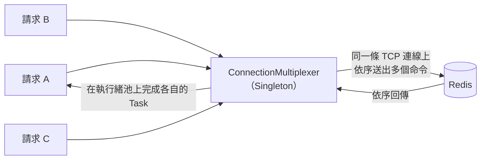

## 這是什麼

.NET 連 Redis 最常用的是 **StackExchange.Redis**。它的核心是 `ConnectionMultiplexer`：一個物件管理對 Redis 的連線，讓整個應用程式的所有請求共用。

在它之上，微軟提供兩層抽象：

- **`IDistributedCache`**：最基本的分散式快取介面，只有存取位元組陣列與期限，適合簡單的快取需求。
- **`HybridCache`**（.NET 9 起）：結合程序內快取與分散式快取，並在多個請求同時查同一個 key 時，只讓一個去載入資料。

需要 Redis 特有的資料結構（Hash、Sorted Set）或原子操作時，直接使用 `IConnectionMultiplexer`。

## 運作原理



`ConnectionMultiplexer` 用很少的連線服務所有請求：多個命令在同一條連線上依序送出（多工），回應回來後，在執行緒池上完成對應的 `Task`。

這帶來兩個重點：

- **建立 `ConnectionMultiplexer` 很貴**（連線、握手、取得拓撲），整個應用程式只建一次。
- **它依賴執行緒池處理回應。** 執行緒池被其他程式碼卡住時（例如 `.Result` 造成的耗盡），Redis 的回應已經到了，卻沒有執行緒去完成它，就會出現逾時，看起來像 Redis 很慢。

## 常見錯誤與正確寫法

### 1. 每次使用都建立新的連線

```csharp
// 錯：每次都建立 ConnectionMultiplexer，耗費連線與時間，還可能洩漏連線
using var mux = await ConnectionMultiplexer.ConnectAsync(configuration);
```

註冊成 Singleton，`IDistributedCache` 與原生操作共用同一個：

```csharp
// 套件：StackExchange.Redis、Microsoft.Extensions.Caching.StackExchangeRedis、Microsoft.Extensions.Caching.Hybrid
var options = ConfigurationOptions.Parse(builder.Configuration.GetConnectionString("Redis")!);
options.AbortOnConnectFail = false; // 啟動時 Redis 暫時不可用，也能先啟動並在背景重連
options.ConnectTimeout = 3000;
options.SyncTimeout = 1000;         // 同步呼叫逾時（毫秒）
options.AsyncTimeout = 1000;        // 非同步呼叫逾時（毫秒），預設值比快取能接受的等待時間長

var mux = await ConnectionMultiplexer.ConnectAsync(options);
builder.Services.AddSingleton<IConnectionMultiplexer>(mux);
builder.Services.AddStackExchangeRedisCache(o => o.ConnectionMultiplexerFactory = () => Task.FromResult<IConnectionMultiplexer>(mux));
builder.Services.AddHybridCache(); // 程序內 + Redis 兩層
```

快取讀取等 1 秒還沒結果，通常寧可直接回資料庫，也不要讓請求一直等。

### 2. 自己手寫兩層快取與防止重複載入

先查 `IMemoryCache`、再查 Redis、再查資料庫、寫回兩層、還要處理多個請求同時未命中，這些 `HybridCache` 已經做好了：

```csharp
public sealed class ProductReader(HybridCache cache, ShopDbContext db)
{
    public ValueTask<ProductDto?> GetAsync(int id, CancellationToken ct) =>
        cache.GetOrCreateAsync(
            $"catalog:product:{id}",
            async token => await db.Products.AsNoTracking()
                .Where(p => p.Id == id).Select(p => new ProductDto(p.Id, p.Name, p.Price))
                .SingleOrDefaultAsync(token),
            new HybridCacheEntryOptions
            {
                Expiration = TimeSpan.FromMinutes(5),          // Redis 中的期限
                LocalCacheExpiration = TimeSpan.FromSeconds(30) // 程序內快取較短，減少各 Pod 間的不一致
            },
            cancellationToken: ct);
}
```

### 3. 把 RedisTimeoutException 當成 Redis 很慢

StackExchange.Redis 的逾時錯誤訊息裡會帶出很多資訊，例如佇列中還有多少命令、執行緒池的忙碌與最小執行緒數。先讀錯誤訊息：

- 執行緒池的忙碌數（`Busy`）大於最小值（`Min`）：問題在應用程式的執行緒池，不在 Redis，見 [ThreadPool 耗盡](/platforms/dotnet/threadpool/)。
- 佇列中等待送出的命令很多：可能有大 key 或慢命令卡住連線，或頻寬不足。

## 使用邊界

- 多數快取需求用 `HybridCache` 即可；需要排行榜、計數、原子操作時才直接使用 `IDatabase`。
- 程序內快取讓各 Pod 的資料可能不一致；`LocalCacheExpiration` 設短，或在資料更新時以標籤或 key 移除，見 [Cache-Aside](/infrastructure/redis/cache-aside/)。
- 在 Kubernetes 上，Redis 的端點用服務提供的主要端點或設定端點，容錯移轉後才會自動指向新的主節點。

## 雲端排查

### 叢集層（GKE 與 EKS 相同）

```bash
# Redis 逾時錯誤的次數與時間分布
kubectl logs -n shop -l app=catalog-api --since=30m | grep -c "RedisTimeoutException"
```

### 託管服務層

#### 兩邊相同：連線數與慢命令

```text
INFO clients        # connected_clients：異常多代表有用戶端沒有共用連線
SLOWLOG GET 10      # 最近執行最久的 10 個命令
CLIENT LIST         # 每條連線的來源位址與最後執行的命令
```

`connected_clients` 遠大於「Pod 數 × 少數幾條」，代表有程式在重複建立 `ConnectionMultiplexer`。

#### GKE

Memorystore 的 `redis.googleapis.com/clients/connected`（連線數）與 `redis.googleapis.com/stats/cpu_utilization`；連線數隨部署次數一路增加，通常是連線洩漏。

#### EKS

ElastiCache 的 `CurrConnections` 與 `NewConnections`。`NewConnections` 持續很高，代表用戶端不斷建立新連線，而不是重複使用。

### 應用程式層

逾時錯誤和執行緒池指標一起看：`dotnet-counters monitor --process-id 1 --counters System.Runtime` 中的 `dotnet.thread_pool.queue.length` 同時升高，問題在執行緒池；佇列長度正常而 Redis 的 `SLOWLOG` 有慢命令，問題在 Redis 端。
