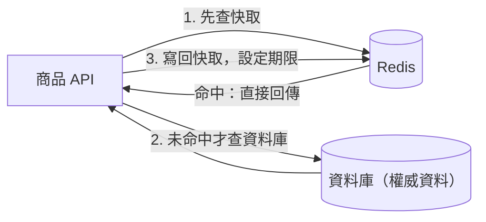

## 這是什麼

商品頁每秒被查詢上千次，但商品資料一天只改幾次。每次都去資料庫查同樣的資料，浪費資料庫的資源。**快取**就是把常用的資料複製一份放在讀取更快的地方，下次直接拿副本。

**Redis** 是一個把資料放在記憶體裡的資料庫，常被用作**分散式快取**：所有 API Pod 共用同一份快取。它和程序內快取（`IMemoryCache`）的差別是：

| | 程序內快取 | Redis（分散式快取） |
| --- | --- | --- |
| 位置 | 每個 Pod 自己的記憶體 | 獨立的服務，所有 Pod 共用 |
| 速度 | 最快，不經過網路 | 要經過網路，約次毫秒到毫秒 |
| 一致性 | 每個 Pod 各一份，可能彼此不同 | 所有 Pod 看到同一份 |
| Pod 重啟 | 快取全部消失 | 不受影響 |

不管哪一種，快取裡的都是**副本**。權威的資料（真正算數的那一份）永遠在資料庫。

## 運作原理



最常見的用法叫 **Cache-Aside**（旁路快取）：應用程式先查快取，沒有才查資料庫，再把結果寫回快取並設定過期時間（TTL）。資料更新時，先更新資料庫，再刪除快取，讓下一次讀取重新載入。細節見 [Cache-Aside](/infrastructure/redis/cache-aside/)。

快取帶來一個取捨：副本可能是舊的。在 TTL 到期、或更新後刪除快取之前，讀到的都是舊值。所以導入快取前要先回答：**這份資料可以舊多久？**

## 常見錯誤與正確寫法

### 1. 把 Redis 當成唯一的資料來源

把購物車、訂單狀態只存在 Redis，Redis 一重啟或記憶體不足開始淘汰資料，這些資料就消失了。Redis 預設是為速度設計的，持久化與淘汰策略都可能讓資料遺失，見 [Redis 可靠性](/infrastructure/redis/reliability/)。

需要長期保存、不能遺失的資料放資料庫；Redis 只放「遺失了也能從資料庫重建」的資料。

### 2. 什麼都放快取

不同資料對「舊」的容忍度不同，要分開決定：

| 資料 | 可以舊多久 | 做法 |
| --- | --- | --- |
| 商品描述、圖片網址 | 幾分鐘 | 快取，TTL 數分鐘，更新時刪除 |
| 商品價格（顯示用） | 幾秒到一分鐘 | 快取，更新時刪除；結帳時重新從資料庫讀 |
| 庫存（下單判斷） | 不能舊 | 不放快取，由資料庫的條件更新決定 |
| 訂單狀態 | 不能舊 | 不放快取，直接查資料庫 |

結帳、扣款、扣庫存這類決策，一定以資料庫為準。

### 3. 快取故障時整個服務跟著掛

Redis 連不上時，查詢應該改回資料庫，而不是直接回錯誤。但要注意：所有原本命中快取的流量一下子全打到資料庫，資料庫可能承受不住。回源要有限流或併發上限，見 [Redis 可靠性](/infrastructure/redis/reliability/)。

## 使用邊界

- 資料庫本身還應付得來的時候，不一定需要快取。快取增加了「資料不一致」與「多一個要維運的服務」的成本。
- 只在單一 Pod 內使用、可以接受各 Pod 不一致的資料（例如設定表），程序內快取就夠了。兩者都想要時，.NET 9 起的 `HybridCache` 結合兩層，見 [.NET 整合 Redis](/infrastructure/redis/dotnet-integration/)。
- Redis 也能做計數、排行榜、限流等，不只是快取，見 [資料型別與 TTL](/infrastructure/redis/data-types-ttl/)。

## 雲端排查

### 叢集層（GKE 與 EKS 相同）

```bash
# 從叢集內用 redis-cli 連到 Memorystore 或 ElastiCache（兩者都在私有網路）
kubectl run redis-cli -n shop --rm -it --image=redis:8 -- \
  redis-cli -h <快取端點> -p 6379 --tls --insecure
```

`--insecure` 只用於臨時診斷時略過憑證驗證；正式連線要驗證服務提供的 CA 憑證。若服務啟用了 AUTH，另外帶上 `-a`。

### 託管服務層

#### 兩邊相同：命中率與記憶體

```text
INFO stats      # keyspace_hits、keyspace_misses：命中率 = hits / (hits + misses)
INFO memory     # used_memory 與 maxmemory 的比例
INFO keyspace   # 每個資料庫的 key 數量與設定了過期時間的數量
```

命中率很低，代表快取幫不上忙：TTL 太短、key 設計讓每次查詢都不同，或快取的資料根本很少被重複讀取。

#### GKE

Memorystore 的 Cloud Monitoring 指標：`redis.googleapis.com/stats/cache_hit_ratio`（命中率）、`redis.googleapis.com/stats/memory/usage_ratio`（記憶體使用比例）。

#### EKS

ElastiCache 的 CloudWatch 指標：`CacheHitRate`、`DatabaseMemoryUsagePercentage`、`CurrItems`（key 數量）。

### 應用程式層

在 API 端為快取的「命中、未命中、Redis 錯誤後回源」各建立計數器。Redis 端的命中率看的是全部用戶端，應用程式端的指標才能看出是哪一種資料的命中率有問題。
