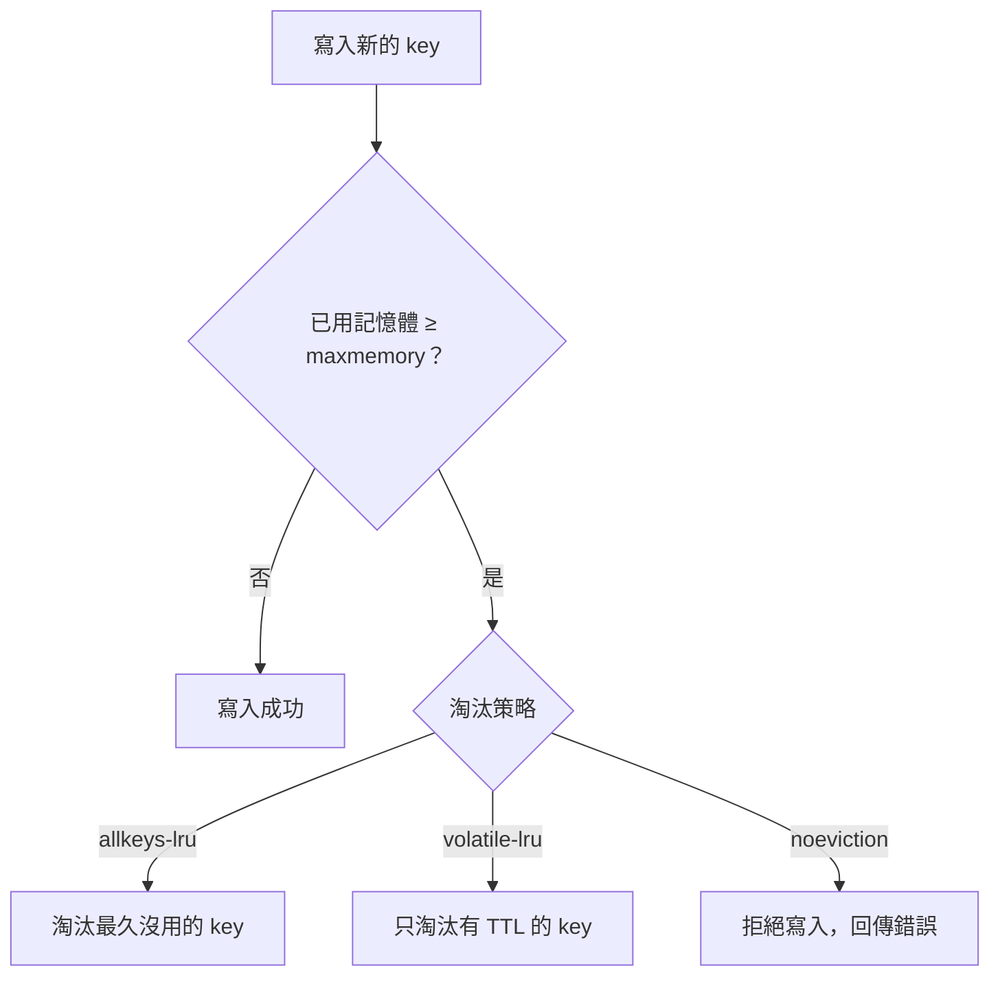

## 這是什麼

Redis 把資料放在記憶體裡，速度很快，但記憶體有限、伺服器會重啟、主節點會故障。這篇回答三個問題：

- **記憶體滿了怎麼辦？** 依**淘汰策略**刪掉一些 key，或拒絕新的寫入。
- **重啟後資料還在嗎？** 取決於**持久化**的設定。
- **主節點故障時呢？** 副本會被提升為新的主節點，但最近幾毫秒到幾秒的寫入可能沒來得及複製過去。

對快取來說，答案都可以接受，因為資料能從資料庫重建。真正的風險是：應用程式沒想過這些情況，Redis 一出狀況，整個服務就跟著出錯。

## 運作原理



**淘汰策略**決定記憶體滿時刪誰：

| 策略 | 行為 | 適合 |
| --- | --- | --- |
| `allkeys-lru` | 從所有 key 中淘汰最久沒被使用的 | 純快取 |
| `volatile-lru` | 只淘汰設了 TTL 的 key | 快取與少量不能淘汰的資料混用 |
| `noeviction` | 不淘汰，寫入直接失敗 | 不能遺失資料的用途（但 Redis 不是這類資料的好選擇） |

**持久化**有兩種：**RDB** 定期把整個資料存成快照，重啟後載入，會遺失最後一次快照之後的寫入；**AOF** 把每個寫入命令記下來，可以設定每秒同步一次，最多遺失約一秒。純快取用途通常不需要持久化，重啟後從資料庫重新載入即可。

**主從切換**：寫入先到主節點，再非同步複製到副本。主節點突然故障，已經回應「成功」但還沒複製的寫入就遺失了。

## 常見錯誤與正確寫法

### 1. 純快取卻用了不會淘汰的策略

`noeviction` 下記憶體滿了，所有寫入都會失敗，應用程式開始出錯。純快取用途使用 `allkeys-lru` 或 `allkeys-lfu`（淘汰最少被使用的）。託管服務的預設策略不一定是你要的，建立執行個體時確認。

### 2. Redis 不可用時直接回錯誤

快取讀取失敗時，改從資料庫讀；但要限制同時回源的數量，否則所有原本命中快取的流量一起打到資料庫，資料庫也跟著倒：

```csharp
private static readonly SemaphoreSlim FallbackGate = new(initialCount: 32); // 同時最多 32 個回源

public async Task<ProductDto?> GetAsync(int id, CancellationToken ct)
{
    try
    {
        var cached = await _redis.StringGetAsync($"catalog:product:{id}");
        if (cached.HasValue) return JsonSerializer.Deserialize<ProductDto>(cached.ToString());
    }
    catch (RedisException ex)
    {
        _logger.LogWarning(ex, "Redis 不可用，改由資料庫讀取商品 {ProductId}", id);
    }

    if (!await FallbackGate.WaitAsync(TimeSpan.FromMilliseconds(200), ct))
        throw new ServiceBusyException(); // 回源也滿了：快速失敗，回 503
    try { return await _db.LoadProductAsync(id, ct); }
    finally { FallbackGate.Release(); }
}
```

讀取失敗時，也要能辨識「快取裡的資料損壞」（例如反序列化失敗）的情況，刪掉那個 key 並回源，而不是把錯誤的資料回給使用者。

### 3. 用 Redis 存不能遺失的狀態

把「付款成功」只寫在 Redis 等背景程序處理，主從切換時這筆紀錄可能遺失。不能遺失的狀態寫進資料庫，Redis 只當作加速的副本。

## 使用邊界

- 開啟高可用（副本與自動容錯移轉）可以縮短 Redis 的停機時間，但不能保證零資料遺失。
- 持久化與備份主要用於「重啟後不想冷啟動」的大型快取；冷啟動時資料庫是否承受得住，要事先測試。
- 自己在 Kubernetes 上架 Redis 時，記憶體上限、持久化磁碟、Pod 被驅逐都要自己處理；託管服務（Memorystore、ElastiCache）代為處理節點與複寫。

## 雲端排查

### 叢集層（GKE 與 EKS 相同）

```bash
# 降級（回源）發生的次數與時間
kubectl logs -n shop -l app=catalog-api --since=1h | grep -c "Redis 不可用"
```

### 託管服務層

#### 兩邊相同：記憶體、淘汰與複寫

```text
INFO memory        # used_memory、maxmemory、maxmemory_policy、mem_fragmentation_ratio
INFO stats         # evicted_keys：持續增加代表記憶體不夠，有用的資料正在被淘汰
INFO replication   # role、connected_slaves、各副本的 offset 與延遲
```

#### GKE

Memorystore 的 `redis.googleapis.com/stats/memory/usage_ratio` 接近 1 時，`redis.googleapis.com/stats/evicted_keys` 會開始增加。執行個體資訊與維護時段：

```bash
gcloud redis instances describe shop-cache --region=asia-east1 \
  --format='value(tier,memorySizeGb,redisConfigs,maintenancePolicy)'
```

#### EKS

ElastiCache 的 `DatabaseMemoryUsagePercentage`、`Evictions` 與 `ReplicationLag`。事件紀錄可以看到容錯移轉的時間：

```bash
aws elasticache describe-events --source-type replication-group \
  --source-identifier shop-cache --duration 1440
```

### 應用程式層

把容錯移轉事件的時間和應用程式的 Redis 錯誤、回源次數、資料庫負載放在同一張圖上，就能看出這次切換對使用者實際造成了多大的影響，以及回源上限是否設得恰當。
