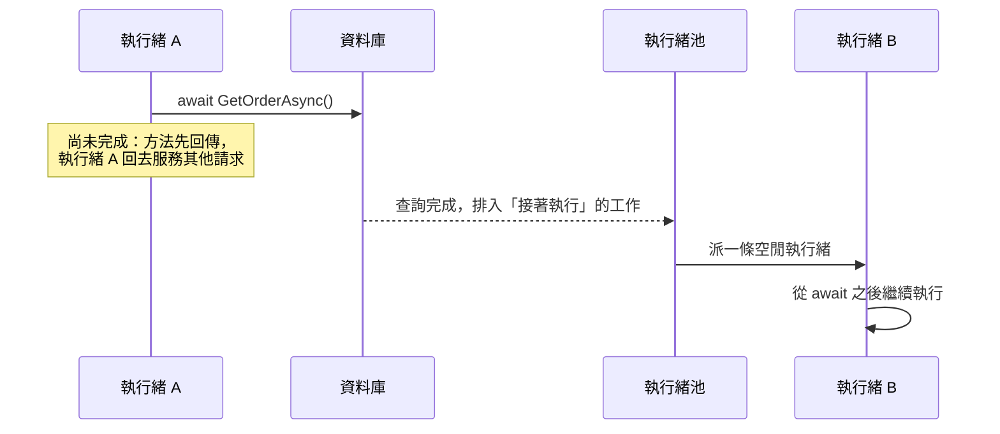

## 這是什麼

ASP.NET Core 用「執行緒池」裡的執行緒處理請求。一個請求在等資料庫回應時，如果執行緒就停在那裡等，它就沒辦法去處理別的請求。

`async` 和 `await` 讓執行緒在等待 I/O 時先離開，去做別的事；等資料庫回應了，再找一條空閒的執行緒接著往下執行。這樣少量的執行緒就能同時服務大量請求。

這個機制只有在「一路 await 到底」時才有效。只要中間有一處用 `.Result` 把它卡住，效果就會反過來：執行緒被佔住，服務在 CPU 很閒的情況下全部變慢。

## 運作原理

編譯器會把 `async` 方法改寫成一個「狀態機」：一個記住「目前執行到哪一步」的物件。遇到 `await` 一個還沒完成的工作時，方法先回傳，執行緒回到執行緒池；工作完成後，執行緒池派一條執行緒，從記住的那一步繼續。



**卡住會怎樣：** 如果在 await 的位置改用 `.Result`，執行緒 A 會停在原地等。查詢完成後，「接著執行」的工作要排隊等空閒執行緒。尖峰時每個請求都這樣卡住一條執行緒，執行緒池很快就沒有空閒的執行緒。執行緒池會慢慢補新的執行緒，但補的速度遠追不上請求湧入的速度。結果是：CPU 使用率很低，請求卻一個個逾時。這種情況叫做執行緒池耗盡（starvation）。

ASP.NET Core 沒有 `SynchronizationContext`，所以不會出現舊版 ASP.NET 那種「回不到原執行緒而死結」的情況，但耗盡的問題一樣存在。

## 常見錯誤與正確寫法

### 1. 用 .Result 或 .Wait() 等非同步結果

```csharp
// 錯：執行緒在這裡停住，等查詢完成
public OrderDto GetOrder(long id) =>
    _repository.GetOrderAsync(id).GetAwaiter().GetResult();
```

改成整條呼叫鏈都是非同步：Controller、Service、Repository 一路回傳 `Task` 並 `await`。

```csharp
public async Task<OrderDto> GetOrderAsync(long id, CancellationToken ct)
{
    var order = await _repository.GetOrderAsync(id, ct); // 等待時執行緒先離開
    return OrderDto.From(order);
}
```

建構子、`Dispose` 這類不能寫 `async` 的地方，不要硬叫 `.Result`；把非同步初始化移到 `IHostedService.StartAsync` 或工廠方法裡。

### 2. 寫 async void

`async void` 方法無法被 `await`。它丟出的例外不會回到呼叫端的 `try/catch`，而是直接丟到執行緒池；在 .NET 中，執行緒池上未處理的例外會讓整個程序結束。

```csharp
// 錯：例外會讓程序結束
public async void RecordAuditLog(OrderEvent evt) { await _audit.WriteAsync(evt); }

// 對：回傳 Task，讓呼叫端可以 await 並處理例外
public async Task RecordAuditLogAsync(OrderEvent evt, CancellationToken ct)
{
    await _audit.WriteAsync(evt, ct);
}
```

`async void` 只適合 UI 框架的事件處理器。後端如果需要「丟出去不等結果」的背景工作，交給 `BackgroundService` 或佇列，見 [BackgroundService](/platforms/dotnet/background-services/)。

### 3. 獨立的工作一個接一個 await

```csharp
// 十個互不相干的查詢，每個 100ms，總共約 1 秒
foreach (var id in ids)
{
    results.Add(await _catalog.GetAsync(id, ct));
}
```

互相獨立的工作可以一起開始，再一起等：

```csharp
// 同時發出，總時間約等於最慢的那一個
var results = await Task.WhenAll(ids.Select(id => _catalog.GetAsync(id, ct)));
```

數量很多時要限制同時進行的數量，避免一次打爆下游服務或連線池：

```csharp
await Parallel.ForEachAsync(orders, new ParallelOptions
{
    MaxDegreeOfParallelism = 10, // 最多同時 10 個
    CancellationToken = ct,
}, async (order, token) => await _processor.ProcessAsync(order, token));
```

## 使用邊界

- `async` 對 I/O（資料庫、HTTP、檔案）有幫助；純 CPU 計算加上 `async` 不會變快。CPU 密集的工作要考慮的是平行化，或移到背景處理。
- `ConfigureAwait(false)` 在 ASP.NET Core 應用程式裡沒有必要；發布成通用函式庫給其他類型程式使用時才需要加。
- 不要用 `[ThreadStatic]` 保存請求資料，因為 await 之後可能換了執行緒；需要跨 await 的環境資料，用 `AsyncLocal<T>`。
- 執行緒池如何補執行緒、如何診斷耗盡，見 [ThreadPool 耗盡](/platforms/dotnet/threadpool/)。取消請求的傳遞方式，見 [取消與資源釋放](/languages/csharp/cancellation-disposable/)。
