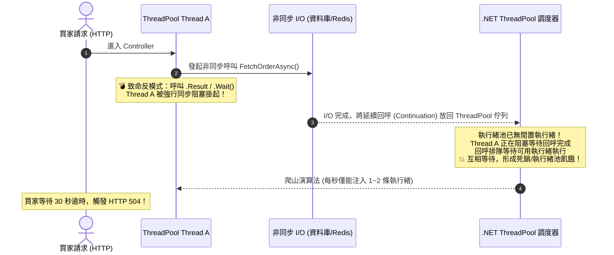

在現代 C# 高併發後端服務中，`async/await` 是提升系統吞吐量（Throughput）與 I/O 伸縮性（Scalability）的核心利器。然而，許多工程師誤以為「用了 async 就不會卡死」或「async 等於多執行緒加速」，因而在程式碼中混用同步與非同步，埋下了後端系統中最致命的 **Sync-over-Async（同步阻塞非同步）** 與 **ThreadPool 執行緒池飢餓（Starvation）** 隱患。

## 案發現場

某電商核心結帳微服務在年中慶秒殺活動開跑 3 分鐘後，對外 API 呼叫的 P99 延遲突然由 45ms 呈垂直飆升至 30,000ms 以上，前端買家全面遭遇 HTTP 504 Gateway Timeout 錯誤。監控儀表板呈現極其詭異的現象：

1. **CPU 負載極低，但請求全部卡死**：Kubernetes 節點與容器的 CPU 使用率僅有 12%~15%，記憶體亦未達上限，看似系統非常悠閒，但所有新進的 HTTP 請求卻無法獲得回應。
2. **ThreadPool 執行緒數呈階梯式暴增**：.NET Runtime 監控指標顯示，執行緒池的 Worker Threads 數量從平時的 25 條一路被拉升到 800 條以上，而 ThreadPool Queue Length（排隊等待執行緒的任務數）積壓了數萬筆。
3. **客戶端連鎖重試風暴**：由於請求未及時回應，前端網頁與 App 自動發起重試，更多的 HTTP 請求湧入已陷入飢餓的執行緒池，最終導致整座 Kestrel 伺服器徹底無響應，引發容器存活探針（Liveness Probe）超時而遭 Kubernetes 不斷強制重啟。



## 反模式與正確解法

### 反模式一：Sync-over-Async（在同步環境呼叫 `.Result` 或 `.GetAwaiter().GetResult()`）

最常見於遺留程式碼改造或建構子（Constructor）中。工程師為了「在不能寫 async 的地方取得資料」，強行在 `Task` 上呼叫 `.Result`、`.Wait()` 或 `.GetAwaiter().GetResult()`。

#### 崩潰機理：執行緒池爬山演算法（Hill Climbing）的延遲陷阱
當你在 Thread A 呼叫 `.Result` 時，Thread A 會被作業系統暫停（Blocked）。當底層非同步 I/O 完成時，其後續的回呼（Continuation）會被投遞至 ThreadPool 工作佇列。若此時併發請求升高，執行緒池中所有可用的 Thread 都被類似的 `.Result` 佔用阻塞，回呼任務就只能在佇列中排隊。
雖然 .NET ThreadPool 具備動態調整能力，但其內建的「爬山演算法」為了避免頻繁 Context Switch 損耗效能，**每秒鐘僅會注入 1 到 2 條新執行緒**。當佇列積壓了數百個任務時，需要等待數十秒甚至數分鐘才能輪到該回呼執行，造成全系統災難性的集體超時！

#### 正確解法：一路非同步到底（Async all the way down）

將整個調用鏈路全面改為非同步，透過 `await` 釋放執行緒：

```csharp
// 💣 Bad：在同步方法硬叫 .Result 或 .GetAwaiter().GetResult()
public OrderDto GetOrderDetails(long orderId)
{
    // 強行阻塞當前執行緒，高併發時引發執行緒池飢餓
    return _orderRepository.GetOrderAsync(orderId).GetAwaiter().GetResult();
}

// ✅ Good：一路非同步到底，await 遇未完成操作立即釋放執行緒
public async Task<OrderDto> GetOrderDetailsAsync(long orderId, CancellationToken ct = default)
{
    // await 會在底層 I/O 尚未就緒時立即交還 Thread 给 ThreadPool 去服務其他 HTTP 請求
    return await _orderRepository.GetOrderAsync(orderId, ct);
}
```

### 反模式二：使用 `async void` 進行非同步執行（未捕捉例外將崩潰進程）

除了 WPF / WinForms 等 UI 元件的按鈕點擊事件處理器（Event Handlers）之外，在後端服務中**絕對禁止**宣告 `async void`。

#### 崩潰機理：
`async void` 方法無法被呼叫端 `await`，其內部若拋出任何未處理例外，呼叫端外層的 `try-catch` **完全無法捕獲**。該例外會直接被拋給當前的執行緒上下文或根排程器，觸發 .NET Runtime 的 `AppDomain.UnhandledException`，導致整個伺服器處理程序（Process）立即發生致命 Crash 退出！

#### 正確解法：回傳 `Task` 並受控處理

```csharp
// 💣 Bad：拋出例外時整座 Kestrel API 行程直接崩潰退出
public async void FireAndForgetAuditBad(OrderEvent evt)
{
    await Task.Delay(100);
    throw new InvalidOperationException("稽核日誌寫入失敗！"); // 💥 整座進程瞬間 Crash！
}

// ✅ Good：回傳 Task，由呼叫端明確處理，或透過背景佇列妥善隔離
public async Task FireAndForgetAuditGood(OrderEvent evt, ILogger logger)
{
    try
    {
        await _auditService.RecordEventAsync(evt);
    }
    catch (Exception ex)
    {
        // 確保例外被妥善記錄，不外溢至未受控環境
        logger.LogError(ex, "非同步稽核寫入失敗，事件識別碼: {EventId}", evt.EventId);
    }
}
```

### 反模式三：在迴圈中逐筆 `await` 造成不必要的串行延遲

在電商批次查詢或更新情境中，對著集合使用 `foreach` 並在內部逐個 `await`，會強制所有原本獨立的非同步 I/O 依序排隊執行：

```csharp
// 💣 Bad：10 個獨立商品查詢，每個耗時 100ms，總延遲長達 1000ms！
public async Task<List<ProductDto>> GetProductsSequentiallyAsync(List<int> ids)
{
    var list = new List<ProductDto>();
    foreach (var id in ids)
    {
        list.Add(await _productClient.GetByIdAsync(id)); // 串行阻塞
    }
    return list;
}

// ✅ Good：使用 Task.WhenAll 並行執行，總延遲僅約 100ms
public async Task<List<ProductDto>> GetProductsConcurrentlyAsync(List<int> ids)
{
    var tasks = ids.Select(id => _productClient.GetByIdAsync(id));
    ProductDto[] results = await Task.WhenAll(tasks);
    return results.ToList();
}

// 🚀 Best Practice：若數量極大（如 10,000 筆），應使用 Parallel.ForEachAsync 限制最大並行度，防止打爆下游資料庫或連線池！
public async Task ProcessOrdersSafelyAsync(List<Order> orders, CancellationToken ct)
{
    var options = new ParallelOptions 
    { 
        MaxDegreeOfParallelism = 10, // 限制同時最多 10 個非同步作業在執行
        CancellationToken = ct 
    };

    await Parallel.ForEachAsync(orders, options, async (order, token) =>
    {
        await _orderProcessor.ProcessAsync(order, token);
    });
}
```

## 踩坑與避坑指南

### 1. 編譯器狀態機（IAsyncStateMachine）的記憶體配置開銷
當你將方法宣告為 `async Task` 時，C# 編譯器會為該方法生成一個隱藏的結構體狀態機，並在堆積上配置 `Task` 物件。
- **過度包裝反模式（Unnecessary async/await）**：如果一個方法內部只是單純把另一個非同步操作回傳，完全沒有在 `await` 之後執行後續程式碼，也沒有被 `using` 或 `try-catch` 包裹，**可以直接回傳 Task**，省去編譯器生成狀態機的開銷：

```csharp
// 稍微浪費：額外產生了一層狀態機與包裝 Task
public async Task<User> GetUserAsync(int id)
{
    return await _userRepo.FindByIdAsync(id);
}

// 零開銷省略（Eliding async/await）：直接穿透回傳 Task
public Task<User> GetUserFast(int id)
{
    // 注意：若有 using 或 try-catch 區塊，則絕對不能省略 await，否則 using 會在非同步完成前提前 Dispose！
    return _userRepo.FindByIdAsync(id);
}
```

### 2. ASP.NET Core 與 `ConfigureAwait(false)` 的真相
- 在舊時代的 .NET Framework（ASP.NET 傳統 MVC/WebForms）中，存在全域的 `SynchronizationContext`，若不加 `ConfigureAwait(false)`，延續步驟必須回到原始 Request 執行緒，非常容易引發死鎖。
- **現代 ASP.NET Core（.NET 6 / 8 / 10）已經完全廢除了 `SynchronizationContext`**！在 Controller、Minimal API、Middleware、業務 Service 層，加不加 `ConfigureAwait(false)` 都不會引發死鎖。
- **唯一建議加上的地方**：通用底層類別庫（如發布至 NuGet 的 SDK 或開源套件），加上 `ConfigureAwait(false)` 能避免被外部呼叫端在舊型環境（如 WinForms/WPF）使用時遭遇死鎖，同時能微幅減少執行緒上下文流動的代價。

### 3. ExecutionContext 的流動性與 `AsyncLocal<T>`
非同步操作在經過 `await` 之後，可能會被分配到完全不同的執行緒繼續執行。因此，**絕對不要使用 `[ThreadStatic]` 儲存非同步請求狀態**！
- **正確做法**：使用 `AsyncLocal<T>`。`ExecutionContext` 會隨非同步狀態機自動跨執行緒流動，確保鏈路追蹤 ID（TraceId）、租戶資訊（TenantId）安全傳遞。

## 線上排查指令

當懷疑線上環境發生 ThreadPool 飢餓、非同步鎖定或延遲異常時，可使用下列診斷指令排查：

```bash
# 1. 即時監控執行緒池健康狀態（重點觀察 queue-length 與 thread-count）
# 若 queue-length 持續大於 0 且 thread-count 不斷增加，即代表發生 Sync-over-Async 或 ThreadPool 飢餓！
dotnet-counters monitor --process-id <PID> \
    --counters System.Runtime[threadpool-thread-count,threadpool-queue-length,threadpool-completed-items-count]

# 2. 線上採集記憶體傾印檔案 (Core Dump)
dotnet-dump collect --process-id <PID> --type Full --output /tmp/app_hang.dump

# 3. 進入 dotnet-dump 分析執行緒呼叫堆疊
dotnet-dump analyze /tmp/app_hang.dump

# 在 dump 分析互動命令列中檢查所有執行緒是否卡在 Wait / GetResult：
> clrstack -all
# 尋找輸出中包含以下關鍵字的大量堆疊：
# System.Threading.Tasks.Task.GetResultCore
# System.Threading.Tasks.Task.Wait
# System.Threading.Monitor.Enter

# 4. 使用 dotnet-trace 採集 30 秒的非同步執行緒切換分析檔案
dotnet-trace collect --process-id <PID> --duration 00:00:30 --profile cpu-sampling
```
