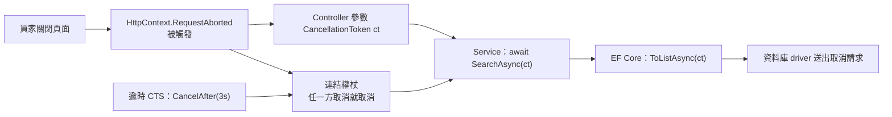

## 這是什麼

買家在商品搜尋頁輸入關鍵字，又馬上改了另一個字。第一個請求已經沒人要看了，但伺服器上的資料庫查詢還在跑，佔著連線和 CPU。

`CancellationToken` 是 .NET 用來傳遞「這件事不用做了」的訊號。ASP.NET Core 在用戶端斷線時會觸發請求的取消權杖；你把它一路傳到資料庫查詢、HTTP 呼叫，這些底層操作就能提早停止，把資源還回來。

另一半是**資源釋放**：連線、檔案、計時器這類資源用完要明確歸還。非同步的資源用 `await using` 釋放。

## 運作原理

`CancellationTokenSource`（CTS）是發出取消訊號的一方，`CancellationToken` 是收訊號的一方。一個 CTS 可以發給很多人；呼叫 `Cancel()` 或時間到了（`CancelAfter`），所有拿著這個權杖的操作都會收到通知。



在 Controller 或 Minimal API 的參數上宣告 `CancellationToken`，ASP.NET Core 會自動填入 `HttpContext.RequestAborted`。

需要「請求被取消，或超過 3 秒，任一發生就停止」時，用 `CreateLinkedTokenSource` 把兩個權杖連起來。連結的方式是在原本的權杖上登記回呼；如果不 Dispose，這些登記會一直留在原本的權杖上。

## 常見錯誤與正確寫法

### 1. 收到權杖卻沒有往下傳

```csharp
// 錯：買家斷線後，查詢仍然跑完
public async Task<IReadOnlyList<ProductDto>> SearchAsync(string keyword, CancellationToken ct)
{
    return await _db.Products.Where(p => p.Name.Contains(keyword))
        .Select(p => new ProductDto(p.Id, p.Name))
        .ToListAsync(); // 沒有傳 ct
}
```

每一個接受 `CancellationToken` 的非同步方法都把它傳下去：`ToListAsync(ct)`、`SaveChangesAsync(ct)`、`httpClient.GetAsync(url, ct)`。

### 2. 建立連結權杖卻不釋放

```csharp
public async Task<Quote> GetQuoteAsync(CancellationToken requestToken)
{
    // using：方法結束時取消登記，避免留在 requestToken 上
    using var cts = CancellationTokenSource.CreateLinkedTokenSource(requestToken);
    cts.CancelAfter(TimeSpan.FromSeconds(3));

    try
    {
        return await _shippingClient.GetQuoteAsync(cts.Token);
    }
    catch (OperationCanceledException) when (!requestToken.IsCancellationRequested)
    {
        // 不是買家取消的，那就是逾時：轉成業務上看得懂的錯誤
        throw new TimeoutException("運費查詢超過 3 秒未回應");
    }
}
```

`when` 條件用來區分「買家取消」和「逾時」，兩者在日誌和回應上應該不同。

如果原本的權杖活得很久，例如主機的 `ApplicationStopping` 或 `BackgroundService` 的 `stoppingToken`，忘記 Dispose 的連結權杖會一直累積，造成記憶體洩漏。

### 3. 已經扣款了，卻被取消打斷

取消適合「還沒產生效果」的工作。一旦付款服務已經扣款成功，接下來「把付款結果寫進資料庫」就不該因為買家關掉頁面而中斷，否則會出現「錢扣了、訂單沒更新」。

```csharp
var payment = await _paymentGateway.CaptureAsync(order.PaymentId, ct); // 還沒扣款前可以取消

// 扣款已成功：之後的記錄改用自己的逾時，不再跟著請求取消
using var saveCts = new CancellationTokenSource(TimeSpan.FromSeconds(10));
order.MarkAsPaid(payment.TransactionId);
await _db.SaveChangesAsync(saveCts.Token);
```

### 4. 非同步資源用同步的 Dispose

連線、串流這類資源的釋放可能需要 I/O，例如把緩衝區的資料寫出去。實作了 `IAsyncDisposable` 的物件，用 `await using` 釋放，避免在 `Dispose` 裡同步等待：

```csharp
await using var connection = await _dataSource.OpenConnectionAsync(ct);
// ... 使用 connection
// 離開範圍時自動 await connection.DisposeAsync()，連線回到連線池
```

## 使用邊界

- 取消是「請求」，不是強制中斷。底層操作要自己檢查權杖才會停；純 CPU 的長迴圈要定期呼叫 `ct.ThrowIfCancellationRequested()`。
- 在 ASP.NET Core 裡，取消造成的 `OperationCanceledException` 不需要記成錯誤；可以在例外處理 middleware 裡辨識並降低日誌等級，見 [Middleware](/frameworks/aspnet-core/middleware/)。
- 資料庫交易收到取消時會回滾；但「COMMIT 已送出、還沒收到回應」時取消，結果不確定，處理方式見 [交易](/data-access/transactions/)。
- 背景服務停止時的取消與收尾，見 [BackgroundService](/platforms/dotnet/background-services/)。
