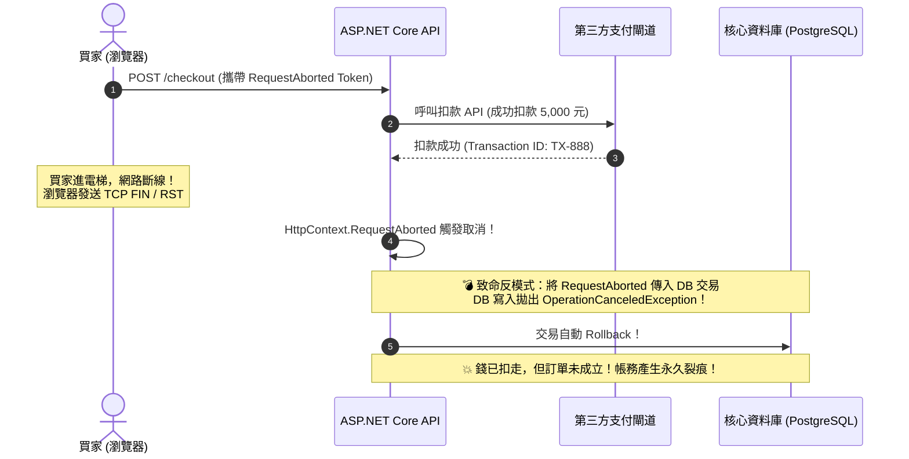

在 ASP.NET Core 微服務與分散式電商架構中，「使用者關閉瀏覽器」或「網路中斷」是極為常見的常態行為。若後端應用程式未將用戶端的取消信號串聯到底層 I/O，不僅會產生持續空轉的「幽靈查詢（Ghost Queries）」迅速耗盡資料庫連線池；更危險的是，若未釐清取消信號的「不可撤銷臨界點（Point of No Return）」，往往會造成外部金流已請款但資料庫交易卻遭取消回滾的嚴重帳務分裂！

## 案發現場

某電商平台在促銷活動期間，資料庫連線池與 CPU 突然告急，與此同時客服中心湧入大量投訴電話：

1. **使用者狂按 F5 刷新引發資料庫暴斃**：促銷商品查詢較慢，許多焦急的買家在 3 秒內連續點擊重新整理 5 次。前端瀏覽器雖然立即中斷了前 4 次的 HTTP 連線，但 ASP.NET Core 後端 API 完全沒有將 `HttpContext.RequestAborted` 傳遞給 Entity Framework Core。後台資料庫一口氣並行執行了 5 個完全相同的沉重 SQL 查詢，導致資料庫 CPU 衝上 100%，連線池（Max Pool Size）瞬間被幽靈查詢佔滿。
2. **Linked Token 記憶體洩漏**：為了設定 5 秒超時，工程師在全域快取服務中使用 `CancellationTokenSource.CreateLinkedTokenSource`，卻未對產生的 CTS 實例呼叫 `Dispose()`。在數百萬次請求累積下，CTS 內部的委派註冊將長生命週期的根物件死死抓住，產生了數百萬個無法被 GC 回收的物件，引發容器 OOMKilled 崩潰。
3. **已扣款卻被中斷回滾（重大資安帳務事故）**：在結帳流程中，程式碼呼叫第三方支付成功扣款 5,000 元後，正在執行 `await dbContext.SaveChangesAsync(ct)` 寫入訂單。此時剛好買家因手機進電梯斷網，`RequestAborted` 觸發，資料庫寫入拋出 `OperationCanceledException` 觸發交易回滾。結果造成「買家信用卡被扣款成功，但系統內完全沒有任何訂單記錄」的災難性事故。



## 反模式與正確解法

### 反模式一：丟棄客戶端取消權杖，放任資料庫執行無效查詢

許多開發者在撰寫 API 時，忽視了 Controller / Minimal API 中的 `CancellationToken` 參數，或在呼叫 EF Core / HttpClient 時傳入 `CancellationToken.None`：

```csharp
// 💣 Bad：丟棄取消權杖，前端中斷連線後，後台依然默默執行 30 秒昂貴查詢
[HttpGet("orders/report")]
public async Task<IActionResult> GetReportBad()
{
    // CancellationToken.None 阻斷了信號傳播
    var data = await _dbContext.Orders
        .Where(o => o.CreatedAt >= DateTime.UtcNow.AddYears(-1))
        .ToListAsync(CancellationToken.None);

    return Ok(data);
}
```

#### 正確解法：將 CancellationToken 一路向下傳遞

ASP.NET Core 會自動在請求連線中斷時觸發 `HttpContext.RequestAborted`。控制器只需宣告 `CancellationToken ct` 參數，框架便會自動注入該權杖：

~~~csharp title="Program.cs"
// ✅ Good：非同步資源釋放與取消權杖串聯實作
using var cts = new CancellationTokenSource();
cts.CancelAfter(TimeSpan.FromMilliseconds(50));

try
{
    await using var session = new DatabaseSession();
    await session.ExecuteQueryAsync(cts.Token);
}
catch (OperationCanceledException)
{
    Console.WriteLine("作業已依取消請求及時中止");
}

public sealed class DatabaseSession : IAsyncDisposable
{
    public async Task ExecuteQueryAsync(CancellationToken cancellationToken)
    {
        Console.WriteLine("查詢開始執行");
        // 將 Token 一路向下傳遞給支援取消的非同步 API
        await Task.Delay(200, cancellationToken);
        Console.WriteLine("查詢完成");
    }

    public async ValueTask DisposeAsync()
    {
        // 非同步釋放連線或清空緩衝區，不阻塞 ThreadPool
        await Task.Delay(10);
        Console.WriteLine("連線已非同步安全釋放");
    }
}
~~~

預期輸出：
```text
查詢開始執行
連線已非同步安全釋放
作業已依取消請求及時中止
```

### 反模式二：未 Dispose `CreateLinkedTokenSource` 釀成記憶體洩漏

當我們需要結合「使用者取消」與「自訂逾時時間」時，通常會使用聯合權杖：

```csharp
// 💣 Bad：CTS 未被 Dispose，內部註冊回呼永久滯留在全域 Token 上，引發記憶體洩漏！
public async Task<string> FetchWithTimeoutBad(CancellationToken userToken)
{
    var cts = CancellationTokenSource.CreateLinkedTokenSource(userToken);
    cts.CancelAfter(TimeSpan.FromSeconds(5));
    
    return await _httpClient.GetStringAsync("https://api.internal/data", cts.Token);
}
```

#### 崩潰機理：
`CreateLinkedTokenSource` 在底層會向 `userToken` 註冊一個事件回呼（Callback）。如果不呼叫 `cts.Dispose()`，該委派物件與 CTS 會一直被 `userToken` 的內部清單強烈引用（Strong Reference）。若 `userToken` 生命週期很長（例如全域的 `IHostApplicationLifetime.ApplicationStopping`），這會讓每次呼叫產生的 CTS 永久無法被垃圾回收，最終拖垮記憶體。

#### 正確解法：強制使用 `using` 確保 CTS 及時釋放

```csharp
// ✅ Good：using 確保在方法結束時，CTS 內部的登錄項被乾淨解除
public async Task<string> FetchWithTimeoutGood(CancellationToken userToken)
{
    using var cts = CancellationTokenSource.CreateLinkedTokenSource(userToken);
    cts.CancelAfter(TimeSpan.FromSeconds(5));

    return await _httpClient.GetStringAsync("https://api.internal/data", cts.Token);
}
```

### 反模式三：在「不可撤銷邊界」盲目傳遞取消權杖

這是分散式交易中最常被忽視的重大業務 Bug！
- 在資料庫查詢、快取讀取階段，使用者隨時取消完全無害。
- **一旦執行了產生外部副作用（Side-Effect）的操作（如已完成信用卡請款、已向第三方供應商鎖定庫存）**，後續將該結果持久化到本地資料庫的步驟，就進入了**「不可撤銷區（Point of No Return）」**。此時若依舊傳入客戶端的 `RequestAborted`，使用者斷線就會將剛成功的扣款記錄抹除！

#### 正確解法：在不可撤銷點脫鉤取消權杖，改用受控超時

```csharp
public async Task<CheckoutResult> ProcessCheckoutAsync(CheckoutCommand cmd, CancellationToken clientToken)
{
    // 階段 1：前期驗證與查詢，完全尊重使用者取消
    var cart = await _cartRepo.GetCartAsync(cmd.CartId, clientToken);

    // 階段 2：外部第三方金流扣款（扣款前檢查是否已取消）
    clientToken.ThrowIfCancellationRequested();
    var payResult = await _paymentGateway.ChargeAsync(cart.TotalAmount, clientToken);

    // ─────────────────────────────────────────────────────────────
    // 🚨 進入「不可撤銷區段」！絕對不能再使用 clientToken！
    // ─────────────────────────────────────────────────────────────
    
    // 階段 3：寫入訂單與 Outbox 事件。與買家斷線脫鉤，改用受控的 10 秒內部超時權杖
    using var persistCts = new CancellationTokenSource(TimeSpan.FromSeconds(10));
    
    try
    {
        var order = Order.CreateFromCart(cart, payResult.TransactionId);
        await _orderDbContext.Orders.AddAsync(order, persistCts.Token);
        await _orderDbContext.SaveChangesAsync(persistCts.Token);

        return CheckoutResult.Success(order.Id);
    }
    catch (Exception ex)
    {
        // 若本地儲存因 DB 死鎖等故障失敗，必須立即發起自動衝正退款（Compensating Action）
        _logger.LogCritical(ex, "訂單持久化失敗，觸發自動沖正退款，交易編號: {TxId}", payResult.TransactionId);
        await _paymentGateway.RefundAsync(payResult.TransactionId, CancellationToken.None);
        throw;
    }
}
```

## 踩坑與避坑指南

### 1. 區分 `TimeoutException` 與 `OperationCanceledException`
在 .NET 6 以前，`HttpClient` 逾時會直接拋出 `TaskCanceledException`，造成開發者無法區分究竟是「網路逾時」還是「使用者點擊了取消」。
- **.NET 8+ 原生改進**：當 `HttpClient` 發生自身超時（`Timeout` 屬性觸發）時，拋出的 `TaskCanceledException` 內部 `InnerException` 會是 `TimeoutException`。
- **排查判斷技巧**：

```csharp
try
{
    await client.GetAsync(url, ct);
}
catch (OperationCanceledException ex) when (ex.InnerException is TimeoutException)
{
    // 這是 HttpClient 逾時引起的！
}
catch (OperationCanceledException) when (ct.IsCancellationRequested)
{
    // 這是使用者主動取消引起的！
}
```

### 2. 實作 `IAsyncDisposable` 釋放非同步連線資源
當類別持有網路連線（如 Socket、資料庫連線、檔案緩衝流）時，在關閉時呼叫同步 `Dispose()` 會阻塞執行緒。
- **最佳實踐**：優先實作 `IAsyncDisposable` 並提供 `DisposeAsync()`，使用 `await using` 進行非同步釋放：

```csharp
public sealed class MessageBrokerSession : IAsyncDisposable
{
    private readonly Channel<Message> _channel;

    public async ValueTask DisposeAsync()
    {
        // 非同步等待剩餘緩衝區排空並關閉連線，不佔用 ThreadPool 執行緒
        await _channel.Writer.CompleteAsync();
        await _connection.CloseAsync();
        GC.SuppressFinalize(this);
    }
}
```

### 3. 中介軟體處理 `OperationCanceledException` 的正確回應
在 ASP.NET Core 中，若 Controller 拋出 `OperationCanceledException` 且未被中介層攔截，框架會認知為連線已中斷，並將連線直接關閉（客戶端會收到 TCP RST，Nginx/Envoy 日誌記錄為 HTTP 499 Client Closed Request）。
- **避坑建議**：全域例外處理中介軟體（Global Exception Handler）**切勿將 OperationCanceledException 轉換為 HTTP 500**，那會嚴重污染 SRE 監控指標與錯誤預算！

## 線上排查指令

針對線上取消信號丟失、慢查詢堆積與 CTS 記憶體洩漏問題，使用下列指令排查：

```bash
# 1. 監控當前進程的例外拋出速率（重點關注 OperationCanceledException 是否異常暴增）
dotnet-counters monitor --process-id <PID> \
    --counters System.Runtime[exception-count,active-timer-count]

# 2. 傾印記憶體快照並分析 CTS 註冊回呼是否有洩漏
dotnet-dump collect --process-id <PID> --output /tmp/cts_leak.dump
dotnet-dump analyze /tmp/cts_leak.dump

# 在 dump 分析命令行中查詢 CancellationTokenSource 物件數量
> dumpheap -type System.Threading.CancellationTokenSource -stat
# 檢查是否有數萬個 CTS 殘留在 Gen 2 堆積中

# 3. 檢查資料庫端是否有因為後端未傳遞 Token 而持續運行的孤兒慢查詢 (PostgreSQL 範例)
SELECT pid, now() - query_start AS duration, query, state 
FROM pg_stat_activity 
WHERE state != 'idle' AND (now() - query_start) > interval '10 seconds'
ORDER BY duration DESC;
```
