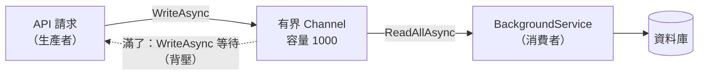

## 這是什麼

訂單 API 收到下單請求後，要寫稽核紀錄、更新統計。這些工作不需要讓買家等，可以先丟到一個「待辦佇列」，由背景的消費者慢慢處理。

`System.Threading.Channels` 就是 .NET 內建、給同一個程序內使用的非同步佇列。一邊（生產者）寫入，一邊（消費者）讀出；兩邊都可以用 `await` 等待，不需要自己寫鎖或輪詢。

## 運作原理



**有界與無界。** 無界 Channel 永遠接受寫入。消費者如果比生產者慢，佇列會無限長大，最後記憶體用光。有界 Channel 設定容量上限；滿了以後，`WriteAsync` 會等到有空位才完成。這種「下游塞車時讓上游放慢」的效果叫**背壓**。

**結束訊號。** 生產者寫完後呼叫 `Writer.Complete()`。消費者的 `await foreach (var x in reader.ReadAllAsync())` 會在讀完剩下的項目後結束迴圈。忘了 `Complete()`，消費者就會永遠等下去。

## 常見錯誤與正確寫法

### 1. 用無界 Channel，尖峰時記憶體暴增

```csharp
// 容量 1000；滿了就讓寫入者等待，不丟資料
var channel = Channel.CreateBounded<AuditEntry>(new BoundedChannelOptions(1000)
{
    FullMode = BoundedChannelFullMode.Wait,
    SingleReader = true,   // 只有一個消費者：讓 Channel 用較簡單的實作
    SingleWriter = false,  // 多個請求同時寫入
});
```

`FullMode` 也可以設成丟掉最舊或最新的項目（`DropOldest`、`DropNewest`），適合「最新狀態比較重要、舊的可以捨棄」的資料，例如即時位置。稽核紀錄這種不能丟的資料，用 `Wait`。

### 2. 逐筆寫資料庫，消費者永遠追不上

每讀到一筆就呼叫一次 `SaveChangesAsync`，每次都有一來一回的網路延遲。先等到至少有一筆，再把當下已在佇列裡的資料一次取出，批次寫入：

```csharp
public sealed class AuditWriter(Channel<AuditEntry> channel, IServiceScopeFactory scopes) : BackgroundService
{
    protected override async Task ExecuteAsync(CancellationToken stoppingToken)
    {
        var reader = channel.Reader;
        var batch = new List<AuditEntry>(100);

        // 等到有資料（或 Channel 已完成且讀空時回傳 false）
        while (await reader.WaitToReadAsync(stoppingToken))
        {
            // 把目前已經在佇列裡的項目取出，最多 100 筆
            while (batch.Count < 100 && reader.TryRead(out var entry))
            {
                batch.Add(entry);
            }

            await using var scope = scopes.CreateAsyncScope();
            var db = scope.ServiceProvider.GetRequiredService<ShopDbContext>();
            db.AuditEntries.AddRange(batch);
            await db.SaveChangesAsync(stoppingToken);
            batch.Clear();
        }
    }
}
```

`DbContext` 是 Scoped 服務，在 Singleton 的 BackgroundService 裡要自己建立 scope 取得。

### 3. 停機時沒有排空

應用程式停止時，`stoppingToken` 被觸發，迴圈立刻結束，Channel 裡還沒處理的項目就消失了。如果這些資料重要，停止流程要先讓生產者停止寫入並呼叫 `Complete()`，再讓消費者在停機時限內把剩下的讀完。停機時限與做法見 [BackgroundService](/platforms/dotnet/background-services/)。

## 使用邊界

- **Channel 只存在記憶體裡。** 程序重啟、Pod 被替換，裡面的資料就沒了。不能遺失的工作，例如「訂單成立後要寄通知」，要放進資料庫（Outbox）或 RabbitMQ 這類持久化的佇列，見 [Outbox 與 Inbox](/architecture/outbox-inbox/)。
- Channel 只在同一個程序內有效，不能在多個 Pod 之間分配工作。
- 只需要「同時最多 N 個」的限制，用 `SemaphoreSlim` 或 `Parallel.ForEachAsync` 比較簡單；需要「排隊並緩衝」時才用 Channel。
- 什麼時候該用同步呼叫、程序內佇列或訊息佇列，見 [通訊方式的選擇](/architecture/communication-boundaries/)。
