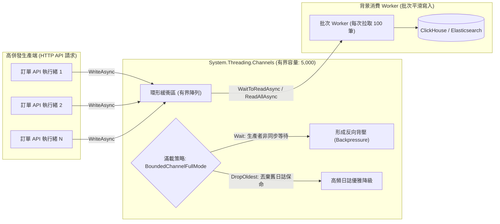

在電商微服務或高吞吐事件驅動架構中，我們經常需要在同一應用程序進程內處理「生產者-消費者（Producer-Consumer）」模式（例如：每筆訂單結帳後需非同步收集用戶行為軌跡、向外部推送 Webhook、或批次匯入資料庫）。傳統使用 `ConcurrentQueue<T>` 或 `BlockingCollection<T>` 的做法，容易在下游變慢時引發無界記憶體膨脹，或因同步阻塞讓 ThreadPool 耗盡。`System.Threading.Channels` 提供了原生的非同步、低配置（Low Allocation）與精確**流量背壓（Backpressure）**控制能力。

## 案發現場

某電商平台的商品瀏覽與點擊流分析服務，在晚間促銷高峰時段發生了災難性的容器重啟崩潰：

1. **無界記憶體膨脹引發 OOMKilled**：工程師在 API 內部採用 `ConcurrentQueue<ClickEvent>` 收集前端傳來的海量商品點擊事件，並啟動一個定時的 `BackgroundService` 定期將事件批次寫入 ClickHouse 資料庫。然而，當晚資料庫發生了一次 30 秒的磁碟 I/O 尖峰，批次寫入耗時由 50ms 激增至 5,000ms。生產端的 HTTP 點擊流量以每秒 20,000 筆持續湧入，佇列在 2 分鐘內堆積了超過 200 萬個物件，容器記憶體衝破 Kubernetes 配置的 2Gi Limit，觸發 Linux 核心 OOM Killer（Exit Code 137）直接無情撲殺！
2. **記憶體內未處理資料全面蒸發**：容器強制重啟後，記憶體內積壓的數百萬筆使用者點擊日誌全部化為烏有，推薦系統模型訓練因此遺失了整晚的黃金黃金指標。
3. **優雅停機時 Worker 死鎖或資料丟失**：當維運人員發布新版本觸發 Pod 滾動更新時，由於背景 Worker 在 `while (!stoppingToken.IsCancellationRequested)` 中使用了傳統的 `Thread.Sleep` 或 `Task.Delay`，未能及時感知停機信號，且未正確排空（Drain）殘留資料，造成數千筆日誌在進程退出時遭到強行切斷。



## 反模式與正確解法

### 反模式一：使用無界佇列，缺乏背壓保護機制

使用 `ConcurrentQueue<T>` 或 `Channel.CreateUnbounded<T>()` 時，若下游消費者處理速率（例如每秒 1,000 筆）低於上游生產速率（例如每秒 5,000 筆），佇列會無限膨脹，直到把伺服器記憶體吞噬殆盡。

#### 正確解法：採用 `Channel.CreateBounded<T>` 顯式設定容量與背壓策略

透過 `BoundedChannelOptions` 定義有界容量與滿載行為（`FullMode`）：

```csharp
// 💣 Bad：無界佇列下游塞車時必定 OOM
private readonly ConcurrentQueue<AuditLog> _unboundedQueue = new();
```

~~~csharp title="Program.cs"
// ✅ Good：有界佇列提供背壓防護，並優雅消費
using System.Threading.Channels;

var options = new BoundedChannelOptions(capacity: 2)
{
    FullMode = BoundedChannelFullMode.Wait, // 滿載時生產者非同步等待（背壓）
    SingleWriter = true,
    SingleReader = true
};
var channel = Channel.CreateBounded<string>(options);

// 啟動消費者 Worker
var consumerTask = Task.Run(async () =>
{
    await foreach (var item in channel.Reader.ReadAllAsync())
    {
        Console.WriteLine($"消費事件: {item}");
    }
});

// 生產者寫入事件
await channel.Writer.WriteAsync("訂單付款完成");
await channel.Writer.WriteAsync("庫存扣減通知");

// 生產完畢，明確告知管線關閉
channel.Writer.Complete();

// 等待所有排隊事件消費完畢
await consumerTask;
Console.WriteLine("所有通道事件處理完畢");
~~~

預期輸出：
```text
消費事件: 訂單付款完成
消費事件: 庫存扣減通知
所有通道事件處理完畢
```

### 反模式二：消費者盲輪詢（Busy-Wait Spin）或遺漏 `Complete()` 導致永久掛起

傳統寫法常在 `while(true)` 中呼叫 `queue.TryDequeue`，失敗時 `Task.Delay(100)`。這不僅浪費 CPU，還會增加不必要的非同步喚醒延遲。而在關閉流程中，若生產者未呼叫 `Writer.Complete()`，消費者的 `await foreach` 將永遠等待，導致優雅關機超時被 SIGKILL 殺死。

#### 正確解法：使用 `ReadAllAsync()` 搭配明確的管線關閉協議

```csharp
public sealed class OrderAuditPipeline : IAsyncDisposable
{
    private readonly Channel<AuditLog> _channel;
    private readonly Task _consumerTask;
    private readonly CancellationTokenSource _cts = new();

    public OrderAuditPipeline(int capacity = 5000)
    {
        var options = new BoundedChannelOptions(capacity)
        {
            FullMode = BoundedChannelFullMode.Wait,
            SingleWriter = false,
            SingleReader = true
        };
        _channel = Channel.CreateBounded<AuditLog>(options);

        // 啟動單一消費者執行緒
        _consumerTask = Task.Run(ProcessQueueAsync);
    }

    public async ValueTask PublishAsync(AuditLog log, CancellationToken ct)
    {
        // 若通道已關閉，WriteAsync 會拋出 ChannelClosedException
        await _channel.Writer.WriteAsync(log, ct);
    }

    private async Task ProcessQueueAsync()
    {
        // ReadAllAsync 會在 Writer.Complete() 且所有積壓訊息排空後，優雅自動退出迴圈！
        await foreach (var item in _channel.Reader.ReadAllAsync(_cts.Token))
        {
            await SaveToStorageAsync(item);
        }
    }

    public async ValueTask DisposeAsync()
    {
        // 1. 標記生產完畢，拒絕新寫入
        _channel.Writer.Complete();

        // 2. 等待消費者將剩餘排隊中的所有資料完全處理完畢 (Drain)
        await _consumerTask;

        _cts.Dispose();
    }
}
```

### 反模式三：高頻逐筆寫入資料庫，未利用 Channel 批次聚合能力

如果每個進入 Channel 的事件都單獨發起一次資料庫 INSERT，即使採用了非同步佇列，底層資料庫的連線池與網路 RTT 依然會成為嚴重瓶頸。

#### 正確解法：利用 `WaitToReadAsync` 實現高效批次聚攏（Batch Draining）

在消費者端，先非同步等待第一筆資料抵達，隨後利用同步的 `TryRead` 將當前通道內已排隊的資料一次性拉出（例如最多湊齊 100 筆），執行單次批次寫入：

```csharp
private async Task BatchConsumerLoopAsync(CancellationToken ct)
{
    var batch = new List<AuditLog>(capacity: 100);

    // 當通道中有資料時喚醒
    while (await _channel.Reader.WaitToReadAsync(ct))
    {
        // 同步快速掏空佇列中的現成資料，湊成批次
        while (batch.Count < 100 && _channel.Reader.TryRead(out var item))
        {
            batch.Add(item);
        }

        if (batch.Count > 0)
        {
            await BulkInsertToDatabaseAsync(batch, ct);
            batch.Clear();
        }
    }
}
```

## 踩坑與避坑指南

### 1. `SingleWriter` 與 `SingleReader` 參數優化機理
當你在建立 Channel 時指定 `SingleWriter = true` 或 `SingleReader = true` 時：
- .NET 內部會放棄耗費較高的多執行緒並行 CAS（Compare-And-Swap）樂觀鎖，切換為專屬的單寫者/單讀者輕量演算法，幾乎達到零鎖定開銷。
- **避坑警告**：若多個執行緒同時呼叫設定了 `SingleWriter = true` 的 Channel，會破壞內部計數器狀態，產生不可預期的競態錯誤（Race Condition）！只有在 100% 確定只有單一調用者時才能開啟。

### 2. 應用程式停機（Host Shutdown）與排空策略（Draining）
在 ASP.NET Core `IHostedService` 或 `BackgroundService` 中：
- 當收到停機信號時，應該先停止接收新的 Web 請求，並呼叫 `channel.Writer.Complete()`。
- 給予足夠的寬限期（例如 10 秒），等待消費者完成已在記憶體中的批次儲存，最後才退出。若直接呼叫 `cts.Cancel()`，會強行中斷消費者，導致排隊資料被拋棄。

### 3. 行程內 Channels vs. 外部分散式訊息佇列（RabbitMQ）
- **Channels**：純本機記憶體記憶體佇列，吞吐量極高（每秒可達數百萬次操作），但**不具備跨機器持久化**。若服務 Crash 或 Pod 重啟，記憶體中未處理資料全數遺失。
- **RabbitMQ / Kafka**：具備磁碟持久化、分散式集群與 Consumer ACK 保證。
- **架構選型**：核心交易事件（如「訂單已扣款」）必須送入 RabbitMQ；本機內部日誌聚合、批次落庫或指標收集，優先選用 Channels。

## 線上排查指令

針對 Channel 緩衝區積壓、記憶體物件分析與背壓卡死問題，使用下列指令排查：

```bash
# 1. 抓取進程 Core Dump 快照
dotnet-dump collect --process-id <PID> --output /tmp/channel_leak.dump
dotnet-dump analyze /tmp/channel_leak.dump

# 2. 在 dump 分析命令中查詢當前堆積中積壓的 Channel 物件與陣列緩衝
> dumpheap -type System.Threading.Channels -stat
# 檢視 BoundedChannel 內部的 _items 陣列佔用記憶體大小

# 3. 透過 dotnet-counters 監控自定義的 Channel 積壓指標（需在程式碼中註冊 Meter）
dotnet-counters monitor --process-id <PID> \
    --counters DevWiki.Ecommerce.AuditPipeline[channel-queue-depth,channel-dropped-count]

# 4. 分析消費者執行緒是否處於等待或死鎖狀態
> clrstack -all
# 尋找是否停在 System.Threading.Channels.AsyncOperation.GetResult
```
