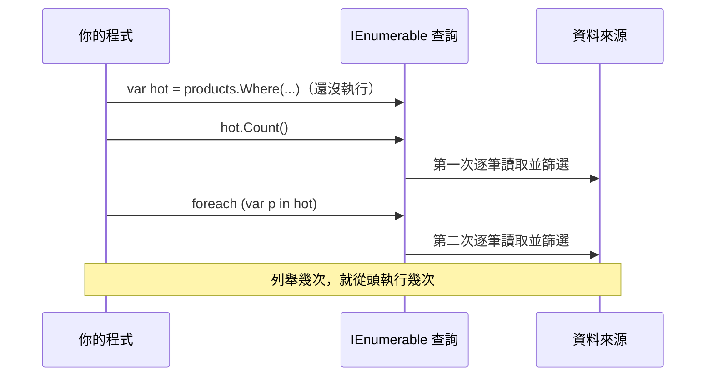

## 這是什麼

LINQ 讓你用 `Where`、`Select` 這類方法處理集合，寫起來像在描述「我要什麼」。但大多數 LINQ 方法回傳的不是結果，而是一份「查詢的做法」。真正去跑資料，要等到你用 `foreach`、`ToList`、`Count` 這些方法把它列舉出來。

這個設計叫**延遲執行**。它讓你可以先把查詢組好再執行，但也讓「同一個查詢被不小心跑了好幾次」變得很常見。在電商後端，這可能代表同一批商品被重新計算三次，或同一個遠端呼叫被打三次。

## 運作原理



`IEnumerable<T>` 每被列舉一次，就從頭跑一次整條管線。如果來源是記憶體裡的 List，代價是重複計算；如果來源是會打 API 或讀檔的迭代器，代價就是重複的 I/O。

`IQueryable<T>`（例如 EF Core 的 `DbSet`）也是延遲執行，但它會把整條查詢翻譯成 SQL，在列舉時送到資料庫，見 [EF Core 查詢](/data-access/ef-core/)。

## 常見錯誤與正確寫法

### 1. 對同一個查詢列舉多次

```csharp
// 每次讀取 Prices 都會呼叫一次遠端報價服務
IEnumerable<ProductPrice> prices = productIds.Select(id => pricingClient.GetPrice(id));

if (prices.Any(p => p.IsOnSale))      // 第一次：逐一呼叫，直到找到特價品
{
    var total = prices.Sum(p => p.Amount); // 第二次：全部重新呼叫一遍
}
```

要重複使用結果，先用 `ToList()` 把它「具體化」成一份資料，之後的操作都對這份資料進行：

```csharp
List<ProductPrice> prices = productIds.Select(id => pricingClient.GetPrice(id)).ToList();
```

方法參數若需要多次讀取，型別就宣告成 `IReadOnlyList<T>` 或 `IReadOnlyCollection<T>`，讓呼叫端知道要傳已經算好的資料。

### 2. 已知數量卻沒給容量

`List<T>` 內部用陣列存資料，裝滿時會配置一個約兩倍大的新陣列，再把舊資料複製過去。一次轉換一萬筆訂單，會經歷多次「配置新陣列、複製、丟掉舊的」。

```csharp
// 事先知道會有幾筆，就直接給容量
var dtos = new List<OrderDto>(orders.Count);
foreach (var order in orders)
{
    dtos.Add(OrderDto.From(order));
}
```

`Dictionary<TKey, TValue>` 和 `HashSet<T>` 也有同樣的容量參數。

### 3. 解析字串時產生大量短命物件

`Split` 和 `Substring` 每次都會建立新的字串。在每秒處理上萬筆請求的熱路徑上，這些短命字串會讓 GC 更頻繁地執行。`ReadOnlySpan<char>` 讓你直接指向原字串的一段，不複製：

```csharp
// SKU 格式：「1001-WHITE-L」；只取出商品編號，不建立新字串
static int ParseProductId(string sku)
{
    ReadOnlySpan<char> span = sku.AsSpan();
    int dash = span.IndexOf('-');
    return int.Parse(span[..dash]);
}
```

### 4. 以為 ConcurrentDictionary.GetOrAdd 的工廠只會執行一次

多個執行緒同時對同一個鍵呼叫 `GetOrAdd`，工廠委派可能被執行多次，只是最後只有一個結果被存進去。如果工廠會建立連線或打遠端服務，就會重複做。用 `Lazy<T>` 包起來，確保真正昂貴的部分只執行一次：

```csharp
private readonly ConcurrentDictionary<string, Lazy<Task<TaxTable>>> _tables = new();

public Task<TaxTable> GetTableAsync(string region) =>
    _tables.GetOrAdd(region, r => new Lazy<Task<TaxTable>>(() => LoadTableAsync(r))).Value;
```

## 使用邊界

- 只列舉一次的查詢，不需要 `ToList()`；多一次具體化反而多一次配置。
- 處理大量資料時，`ToList()` 會把所有資料一次放進記憶體。資料量大時改用分批或串流處理，例如 EF Core 的 `AsAsyncEnumerable()` 搭配 `await foreach`。
- `Span<T>` 是 `ref struct`，不能存進欄位、不能跨越 `await`。非同步方法裡需要切片時，改用 `Memory<T>`。
- 預給容量是在已知數量時的小優化；不確定數量時不需要猜。
