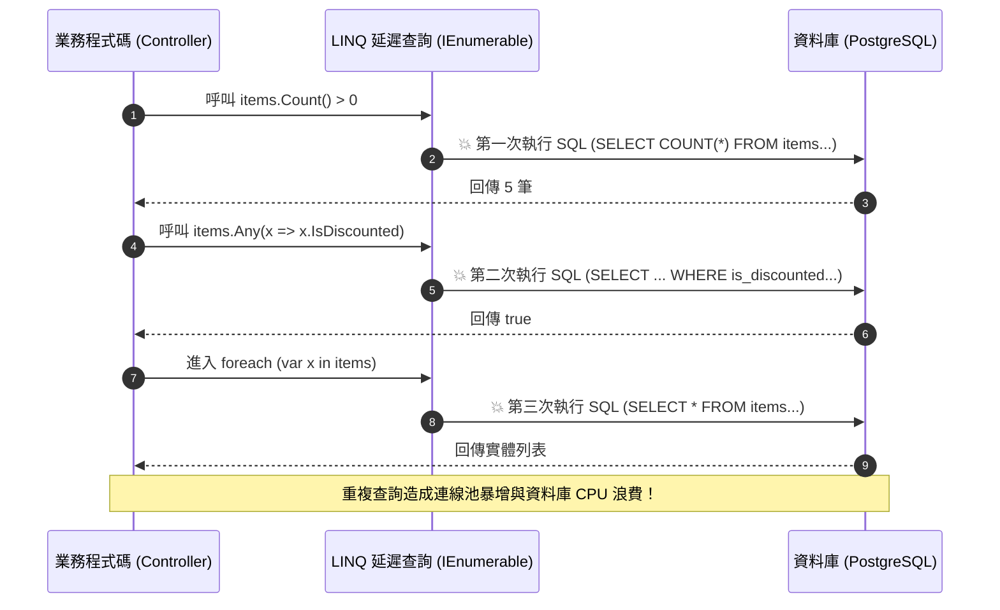

在 C# 後端開發中，LINQ（Language Integrated Query）與集合類別庫以優雅的聲明式語法極大地提升了開發效率。然而，高層次的抽象往往掩蓋了底層記憶體配置與求值時序的真實代價。如果未深刻理解**延遲求值（Deferred Execution）**、**集合擴容機制**與**字串不可變性（String Immutability）**，看似簡潔的幾行代碼很可能在高併發環境下造成資料庫重複查詢風暴、大物件堆（LOH）碎裂與頻繁的 GC 暫停。

## 案發現場

某電商結帳與促銷計算中台在一次週末行銷活動中，應用伺服器的記憶體使用量與資料庫連線數突然異常飆高，引發全站警報：

1. **同一筆訂單重複發起三次資料庫查詢**：在促銷驗證模組中，工程師寫了一個接受 `IEnumerable<OrderItem>` 的檢驗函式。程式碼先執行 `if (items.Count() > 0)` 判斷非空，接著執行 `if (items.Any(x => x.IsDiscounted))` 檢查折扣，最後用 `foreach (var item in items)` 計算總金額。由於傳入的 `items` 是一個關聯到 EF Core 的延遲查詢，每一次呼叫都向資料庫發起了一次完整的 SQL 查詢，單次結帳莫名發起了 3 次完全相同的 SQL 請求！
2. **大批量報表匯出引發 GC 暫停（Stop-The-World）**：在訂單 CSV 匯出排程中，程式迴圈處理 50 萬筆資料，頻繁使用 `new List<ExportRow>()` 未預給容量，且使用 `line.Split(',')[2].Substring(0, 8)` 解析訂單日期與金額。在 10 分鐘內產生了數千萬個暫存字串與陣列垃圾，引發嚴重的 Gen 2 GC 收集，API 延遲出現數十次長達 800ms 的毛刺凍結。
3. **ConcurrentDictionary 工廠重複執行造成重複扣款**：在優惠券領取計數器中，開發者使用 `_couponCounts.GetOrAdd(couponId, id => CalculateRemaining(id))`，誤以為該委派一定是執行緒安全的單次執行，結果在突發併發下該委派被執行了 4 次，超額發放了限量優惠券。



## 反模式與正確解法

### 反模式一：對 `IEnumerable<T>` 進行多次列舉（Multiple Enumeration）

LINQ 的多數操作符（如 `Where`、`Select`、`OrderBy`）都是**延遲求值（Deferred Execution）**的 iterator，每次進行列舉時（例如呼叫 `Count()`、`Any()`、`First()` 或進入 `foreach` 迴圈），整條管線都會從頭到尾重新執行一遍。

```csharp
// 💣 Bad：重複觸發多次列舉，若是資料庫查詢或遠端呼叫將造成災難
public decimal CalculateTotalBad(IEnumerable<CartItem> items)
{
    // 第一次枚舉：執行 Count() 計算總數
    if (items.Count() == 0) return 0;

    // 第二次枚舉：檢查是否有特殊商品
    if (items.Any(x => x.IsVipOnly)) 
    {
        ApplyVipDiscount();
    }

    // 第三次枚舉：遍歷計算金額
    decimal total = 0;
    foreach (var item in items) 
    {
        total += item.Price;
    }
    return total;
}
```

#### 正確解法：在進入業務前明確具體化（Materialize）

如果集合需要被多次讀取，或者大小固定，應先透過 `.ToArray()` 或 `.ToList()` 將資料載入記憶體；若僅是判斷集合是否有元素，優先使用 `Any()` 而非 `Count() > 0`：

~~~csharp title="Program.cs"
// ✅ Good：具體化快取查詢、預給容量與 ReadOnlySpan 零配置解析
var source = new[] { 10, 20, 30, 40 };

// 1. 具體化（Materialize）：避免多次列舉重跑
var materialized = source.Where(x => x > 15).ToArray();
Console.WriteLine($"符合筆數: {materialized.Length}");
Console.WriteLine($"首筆數據: {materialized[0]}");

// 2. 集合預估容量：避免 4 -> 8 -> 16 反覆擴容拷貝
var resultList = new List<int>(capacity: materialized.Length);
resultList.AddRange(materialized);

// 3. ReadOnlySpan 零拷貝解析字串（不產生額外堆積物件）
string rawHeader = "ORDER-20261010-999";
ReadOnlySpan<char> span = rawHeader.AsSpan();
ReadOnlySpan<char> orderDate = span.Slice(6, 8); // 僅切片指標，0 堆積配置
Console.WriteLine($"解析日期: {orderDate.ToString()}");
~~~

預期輸出：
```text
符合筆數: 3
首筆數據: 20
解析日期: 20261010
```

### 反模式二：集合未預設容量（Capacity），引發連鎖擴容與陣列拷貝

`new List<T>()` 的預設初始容量僅為 4。每當新增項目超過容量時，.NET CLR 會配置一個**兩倍大**的新陣列，並將舊陣列內容全量拷貝至新陣列。如果你要加入 10,000 個項目，底層會經歷十幾次陣列重分配與拷貝，產生大量垃圾物件。

#### 正確解法：已知大小時，務必在建構子指定 `capacity`

```csharp
// 💣 Bad：容量從 4 -> 8 -> 16 -> 32... 不斷動態擴容拷貝
var orderList = new List<Order>();
foreach (var raw in rawData)
{
    orderList.Add(ParseOrder(raw));
}

// ✅ Good：在已知大小時顯式提供 capacity，完全消除擴容記憶體開銷
var orderList = new List<Order>(capacity: rawData.Count);
foreach (var raw in rawData)
{
    orderList.Add(ParseOrder(raw));
}
```

同樣地，`Dictionary<TKey, TValue>` 在未給容量時亦會經歷 Rehashing 重新雜湊代價，已知筆數時務必提供初始容量。

### 反模式三：字串解析濫用 `Split` 與 `Substring` 產生海量短暫物件

字串在 .NET 中是不可變的（Immutable）。呼叫 `str.Split(',')` 會配置一個字串陣列以及數十個子字串物件；呼叫 `str.Substring()` 會配置全新字串。在日誌解析、報表匯出等熱路徑中，這會迅速填滿 Gen 0 GC 堆。

#### 正確解法：採用 `ReadOnlySpan<char>` 達成零配置（Zero-Allocation）解析

利用 `Span<T>` 與 `ReadOnlySpan<T>`，所有字串切割與數值解析均基於指標切片，完全不產生任何堆積物件配置：

```csharp
// 💣 Bad：產生 3 個新字串物件與 1 個陣列
public static (string prefix, int id) ParseOrderNumberBad(string raw)
{
    var parts = raw.Split('-'); // 配置 string[] 和 2 個 string
    return (parts[0], int.Parse(parts[1]));
}

// ✅ Good：使用 ReadOnlySpan<char> 零拷貝解析，零記憶體配置 (0 B Alloc)
public static (string prefix, int id) ParseOrderNumberGood(string raw)
{
    ReadOnlySpan<char> span = raw.AsSpan();
    int separatorIndex = span.IndexOf('-');

    if (separatorIndex == -1) 
        throw new FormatException("無效的訂單編號格式");

    ReadOnlySpan<char> prefixSpan = span.Slice(0, separatorIndex);
    ReadOnlySpan<char> idSpan = span.Slice(separatorIndex + 1);

    // .NET 8/10 原生支援直接解析 Span，無需轉為字串！
    int id = int.Parse(idSpan);

    return (prefixSpan.ToString(), id);
}
```

## 踩坑與避坑指南

### 1. `ConcurrentDictionary.GetOrAdd` 的工廠委派競態
許多開發者以為 `ConcurrentDictionary.GetOrAdd(key, k => ExpensiveFactory(k))` 是絕對互斥的。
- **真相**：`ConcurrentDictionary` 為了最大化讀取效能，**其工廠委派（Factory Delegate）是不受鎖定保護的**！當多個執行緒同時請求一個不存在的 Key 時，該委派可能會被並行執行多次，最後僅有一筆結果會被寫入字典。
- **避坑建議**：若工廠內部包含昂貴計算、遠端 API 呼叫或資料庫更新，必須搭配 `Lazy<T>` 達成嚴格單次執行：

```csharp
private readonly ConcurrentDictionary<string, Lazy<Task<ProductCache>>> _cache = new();

public async Task<ProductCache> GetProductSafeAsync(string id)
{
    var lazyTask = _cache.GetOrAdd(id, key => new Lazy<Task<ProductCache>>(
        () => FetchFromDatabaseAsync(key),
        LazyThreadSafetyMode.ExecutionAndPublication));

    return await lazyTask.Value;
}
```

### 2. `Span<T>` 的生命週期限制（`ref struct`）
- `Span<T>` 屬於 `ref struct`，由 CLR 保證只能存活於執行緒堆疊（Stack）上。
- **禁止場景**：`Span<T>` **不能**作為 class 或一般 struct 的欄位、**不能**裝箱（Boxed）為 `object`、**不能**跨越 `async/await` 邊界（因為編譯器產生的狀態機會將欄位提升至堆積）。
- **非同步跨邊界解法**：若需要在 `await` 之後保留切片資料，改用 `Memory<T>` 或 `ReadOnlyMemory<T>`。

### 3. EF Core 查詢組裝階段切忌提早 `.ToList()`
在 Repository 層組裝查詢時，所有過濾與排序必須保持在 `IQueryable<T>` 狀態。一旦呼叫了 `.ToList()` 或 `.AsEnumerable()`，後續所有的 LINQ 操作都會切換為記憶體本機運算（Client Evaluation），導致 SQL 缺少 WHERE 條件而將百萬筆資料全撈回應用記憶體。

## 線上排查指令

針對集合記憶體膨脹、短生命週期字串配置過多與 LINQ 效能問題，使用下列指令排查：

```bash
# 1. 使用 dotnet-trace 採集記憶體配置取樣（分析哪些型別配置量最大）
dotnet-trace collect --process-id <PID> \
    --providers Microsoft-DotNETCore-SampleProfiler,Microsoft-Windows-DotNETRuntime:0x1:4 \
    --duration 00:00:30 --output /tmp/alloc.nettrace

# 2. 檢視即時 GC 堆積記憶體大小與各代回收頻率
dotnet-counters monitor --process-id <PID> \
    --counters System.Runtime[gc-heap-size,gen-0-gc-count,gen-1-gc-count,gen-2-gc-count,alloc-rate]

# 3. 採集 Dump 並排查堆積中是否充斥大量字串與短生命週期陣列
dotnet-dump collect --process-id <PID> --output /tmp/mem.dump
dotnet-dump analyze /tmp/mem.dump

# 在 dump 分析命令行中統計佔用記憶體最多的物件類型：
> dumpheap -stat
# 重點排查 System.String, System.Object[], List<T> 的物件數量與累積位元組數
```
