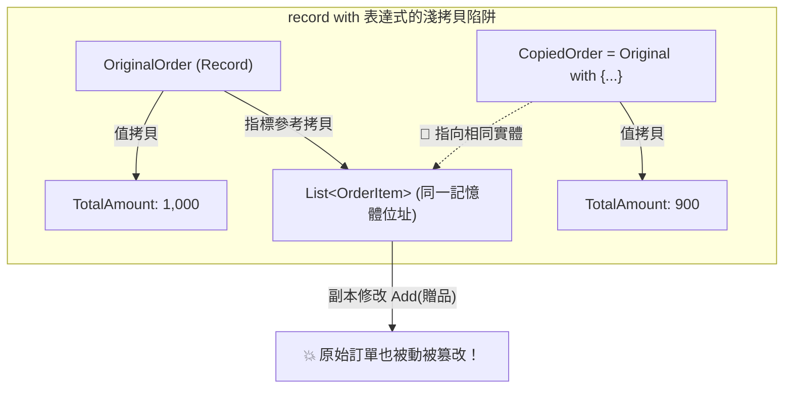

在 C# 現代語言演進中，諸如不可變記錄（Records）、可為 Null 參考型別（Nullable Reference Types, NRT）、以及模式比對（Pattern Matching）等強大特性的引入，極大地豐富了語言的表現力。然而，高層次的語法糖往往容易讓工程師放鬆警惕。若未透徹理解語言特性的編譯期本質與底層執行期（Runtime）行為，微小的語法誤用就可能在線上引發財務對帳差額、資料交叉污染或突發性空指標崩潰。

## 案發現場

某電商中台在一次年度結算與高併發促銷期間，連續爆發了三起令人匪夷所思的生產事故：

1. **財務月結帳目神秘短少數萬元**：財務部門在進行每月底帳目核對時，發現交易明細總和與銀行撥款金額永遠對不攏，累計短少數萬元。追查程式碼發現，購物車折價券計算與跨幣別匯率轉換竟然使用了 `double` 進行浮點運算，在多次乘除與四捨五入後，因二進位精度遺失產生了微小的累計誤差；更糟的是，系統預設採用了「銀行家捨入法（Banker's Rounding）」，部分特定尾數被自動捨去。
2. **折扣活動中商品規格被跨訂單污染**：促銷系統中使用了 `record OrderRequest` 作為訂單資料載體，開發者使用 `with { DiscountAmount = 50 }` 複製出優惠訂單，並在副本的商品明細列表（`List<OrderItem>`）中標記促銷贈品。然而，多個買家的購物車竟隨機出現彼此加贈的贈品！排查發現 `with` 表達式僅執行**淺拷貝（Shallow Copy）**，原始物件與副本物件共享了同一個 List 參考，引發嚴重的跨請求狀態污染。
3. **編譯器 0 警告，線上卻狂噴 NullReferenceException**：專案啟用了 `<Nullable>enable</Nullable>`，程式碼中宣告了 `public string Nickname { get; set; } = null!;`。在編譯期看似處處安全，然而當外部請求傳入缺少該欄位的 JSON 字串時，`System.Text.Json` 在還原序列化時直接將 `null` 注入欄位，繞過了 C# 編譯期的非空保證，導致後續核心邏輯頻繁拋出未捕獲的 NRE 崩潰！



## 反模式與正確解法

### 反模式一：使用 `float` / `double` 計算金額與匯率

二進位浮點數（IEEE 754 標準）無法精確表示絕大多數十進位小數（例如 $0.1 + 0.2$ 在 `double` 運算下結果為 $0.30000000000000004$）。在高頻交易計算與累加求和時，微小誤差會不斷放大。

#### 正確解法：嚴格使用 128 位元十進位 `decimal` 並明確宣告捨入模式

`decimal` 提供 28-29 位有效數字的精確十進位表示。計算金額、稅率與折扣時，一律強制使用 `decimal`，且在進行除法四捨五入時，必須顯式指定 `MidpointRounding`（依業務規定選擇「四捨五入」或「銀行家捨入」）：

```csharp
// 💣 Bad：使用 double 計算促銷折價，產生精度遺失
double badTotal = 0.1 + 0.2; // 0.30000000000000004
```

~~~csharp title="Program.cs"
// ✅ Good：金額、庫存、稅率一律強制使用 128 位元十進位 decimal
decimal unitPrice = 99.99m;
int quantity = 3;
decimal total = unitPrice * quantity;
Console.WriteLine($"金額計算精確: {total}");

// 模式比對（Pattern Matching）安全評估狀態
OrderStatus status = OrderStatus.Paid;
string result = status switch
{
    OrderStatus.Paid => "可出貨",
    OrderStatus.Pending => "等待付款",
    OrderStatus.Cancelled or OrderStatus.Refunded => "已終止",
    _ => "未知狀態"
};
Console.WriteLine($"訂單狀態: {result}");

enum OrderStatus { Pending, Paid, Cancelled, Refunded }
~~~

預期輸出：
```text
金額計算精確: 299.97
訂單狀態: 可出貨
```

### 反模式二：誤以為 `record` 的 `with` 表達式是深拷貝（Deep Copy）

C# 的 `record` 提供了極佳的不變性（Immutability）語義，並支援非破壞性變異語法 `order with { Status = ... }`。
**但必須警惕：`with` 表達式僅複製物件本身的所有欄位（淺拷貝）！**
若 record 內部包含任何參考型別成員（如 `List<T>`、`Dictionary<K,V>` 或其他 class 物件），副本物件中的參考依然指向與原始物件**完全相同的記憶體實例**！

#### 正確解法：不可變集合或手動深拷貝

```csharp
// 💣 Bad：with 僅淺拷貝，修改副本的 List 會同時污染原始訂單！
public record OrderDto(long Id, decimal Amount, List<string> Tags);

var original = new OrderDto(1001, 500m, new List<string> { "一般" });
var promoOrder = original with { Amount = 400m };
promoOrder.Tags.Add("促銷加贈"); // 💥 original.Tags 內部也被加入了 "促銷加贈"！

// ✅ Good：在 record 內部使用不可變集合 (ImmutableList) 阻斷副作用
using System.Collections.Immutable;

public record OrderDtoSafe(long Id, decimal Amount, ImmutableList<string> Tags);

var safeOriginal = new OrderDtoSafe(1001, 500m, ImmutableList.Create("一般"));
// 若要增加標籤，必須透過不可變 API 產生全新集合
var safePromo = safeOriginal with 
{ 
    Amount = 400m,
    Tags = safeOriginal.Tags.Add("促銷加贈") 
};
```

### 反模式三：濫用 `!`（Null-forgiving）與 NRT 的虛假安全感

在開啟 `<Nullable>enable</Nullable>` 後，若為了消除編譯器警告而隨意使用 `!`（例如 `user.Profile!.Nickname!` 或 `public string Name { get; set; } = null!;`），等同於向編譯器撒謊。

#### 崩潰機理：
C# 的 Nullable Reference Types **完全是編譯期中繼資料檢查**，執行期 CLR 根本不強制檢查 null。當來自 HTTP 請求的 JSON 字串反序列化為 DTO 時，如果前端傳遞了 `{ "name": null }` 或遺漏了該屬性，`System.Text.Json` 會直接將 `null` 寫入被標註為非空的屬性中！

#### 正確解法：善用 `required` 關鍵字與模式比對防禦

```csharp
// ✅ Good：使用 C# 11+ 的 required 關鍵字，並在反序列化時進行強驗證
public sealed class CreateCustomerRequest
{
    // required 保證物件初始化時必須提供值
    public required string Email { get; init; }

    // 可為 null 的屬性顯式標註 ?，迫使呼叫端處理 null 情境
    public string? PhoneNumber { get; init; }
}

// 運用 Pattern Matching 進行清晰且無害的安全解構
public static string FormatUserInfo(CreateCustomerRequest req)
{
    // 屬性模式 (Property Pattern) 確保非空且符合條件
    return req switch
    {
        { PhoneNumber: { Length: > 0 } phone } => $"已驗證手機: {phone}",
        _ => "未提供手機"
    };
}
```

### 反模式四：自定義型別覆寫了 `Equals` 卻未覆寫 `GetHashCode`

在將自定義領域物件放入 `HashSet<T>` 或作為 `Dictionary<TKey, TValue>` 的 Key 時，若只覆寫了 `Equals` 而遺漏了 `GetHashCode`，或者雜湊碼計算依賴了可變屬性（Mutable Properties）。當物件的屬性在外部被修改後，其 HashCode 隨之改變，導致字典底層的桶位索引（Bucket Index）失效，出現「物件明明在集合中，但 `Contains(x)` 永遠回傳 false」的幽靈遺失現象！

#### 正確解法：Dictionary Key 必須是不可變的（Immutable）並正確實作相等性

優先採用 `record` 或 `readonly struct` 作為字典 Key，或確保 `GetHashCode` 計算所依賴的欄位為不可變 `readonly`。

## 踩坑與避坑指南

### 1. 閉包捕獲循環變數（Closure Variable Capture）
在迴圈中建立 Lambda 或啟動 Task 時：

```csharp
// 💣 Bad：在 C# 舊版或多執行緒下可能捕獲到變異的變數
for (int i = 0; i < 5; i++)
{
    Task.Run(() => Console.WriteLine(i)); // 可能印出多次 5！
}

// ✅ Good：宣告迴圈內部區域變數進行捕獲隔離
for (int i = 0; i < 5; i++)
{
    int index = i; // 每個迴圈獨立的區域變數
    Task.Run(() => Console.WriteLine(index));
}
```

### 2. 避免在熱路徑中進行字串格式化拼接
在百萬次迴圈中呼叫 `$"Order-{id}-{status}"` 會產生數百萬個臨時字串。
- **避坑建議**：在高頻日誌與字串建構中，使用 `StringBuilder` 並預設容量，或使用 .NET 6+ 的 `DefaultInterpolatedStringHandler`。

### 3. 枚舉（Enum）的預設值為 0
C# 的 `enum` 若未明確指定數值，第一個成員數值為 `0`。當宣告物件但未賦值時，枚舉欄位會自動初始化為 `0`。
- **最佳實踐**：永遠將 `0` 保留給 `None` 或 `Unknown`，不要將重要的有效狀態（如 `OrderStatus.Paid`）定義為 `0`，防止因預設未初始化而產生業務誤判。

## 線上排查指令

針對線上環境因語法陷阱引發的 NRE、溢位或資料異常，使用下列指令排查：

```bash
# 1. 檢索生產環境日誌中是否有未捕獲的空指標與溢位例外堆疊
grep -E "NullReferenceException|OverflowException" /var/log/ecommerce-api/*.log | tail -n 30

# 2. 監控當前進程的例外拋出速率
dotnet-counters monitor --process-id <PID> --counters System.Runtime[exception-count]

# 3. 採集 Dump 並排查記憶體中是否有因為雜湊失真或字典洩漏導致的異常物件
dotnet-dump collect --process-id <PID> --output /tmp/syntax_trap.dump
dotnet-dump analyze /tmp/syntax_trap.dump

# 在 dump 分析中檢視特定 DTO 的屬性狀態是否包含意外的 null：
> dumpheap -type CreateCustomerRequest
```
